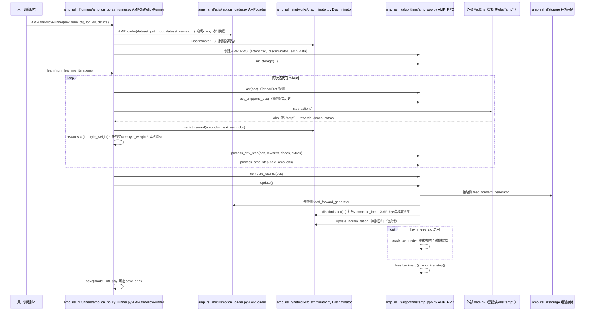

---

type: entity
tags: [repo, humanoid, amp, rsl-rl, imitation-learning, eth]
status: complete
updated: 2026-06-08
summary: "gbionics/amp-rsl-rl 在 rsl_rl 的 PPO 上扩展 AMP（对抗式运动先验），让人形从动捕数据学运动技能；IIT 维护，含对称性增广，可 pip 安装。"
related:
  - ../methods/amp-reward.md
  - ./amp-for-hardware.md
  - ./amp-mjlab.md
  - ../methods/imitation-learning.md
  - ./rsl-rl.md
sources:
  - ../../sources/repos/amp_rsl_rl.md
---

# AMP-RSL-RL

**AMP-RSL-RL**（<https://github.com/gbionics/amp-rsl-rl>）由 **Istituto Italiano di Tecnologia (IIT)**（Giulio Romualdi、Giuseppe L'Erario）维护，在 [RSL-RL](./rsl-rl.md) 的 PPO 之上扩展 **AMP（对抗式运动先验）**，用对抗模仿让**人形** agent 从动捕数据学运动技能。可通过 PyPI `pip install amp-rsl-rl` 安装，BSD-3-Clause。

## 英文缩写速查

| 缩写 | 英文全称 | 简要说明 |
|------|----------|----------|
| AMP | Adversarial Motion Prior | 判别器约束策略状态分布接近参考运动 |
| PPO | Proximal Policy Optimization | rsl_rl 的基础 RL 算法 |
| RSL-RL | Robotic Systems Lab RL | ETH RSL 的 GPU RL 库（`leggedrobotics/rsl_rl`） |
| MoCap | Motion Capture | 风格/参考动作来源 |

## 为什么重要

- **重定向产物的消费侧**：与 [AMP_for_hardware](./amp-for-hardware.md) 定位一致——回答「重定向 / 动捕参考如何喂给策略」；区别是**框架无关、可 pip 安装、偏人形**，接入现代 [RSL-RL](./rsl-rl.md) 训练栈成本低。
- **对称性增广**：内置 symmetry-aware data augmentation，提升样本效率与步态对称性。
- **与同类的分工**：[amp_mjlab](./amp-mjlab.md) 走 mjlab 栈、[AMP_for_hardware](./amp-for-hardware.md) 偏四足 Isaac Gym，本仓提供一个轻量、可 pip 的 rsl_rl + 人形选项。

## 源码运行时序图

入口：库无命令行入口，由用户训练脚本构造 `AMPOnPolicyRunner(env, train_cfg, log_dir, device)` 后调用 `learn(num_learning_iterations)`（`example/load_amp_dataset.py` 演示数据加载部分）。

图依据：gbionics/amp-rsl-rl@465f1b4，实际读过 `README.md`、`example/load_amp_dataset.py`（局部）、`amp_rsl_rl/runners/amp_on_policy_runner.py`（局部，`__init__`、`learn` 循环与 `save`）、`amp_rsl_rl/algorithms/amp_ppo.py`（类与方法列表及 `update` 局部）、`amp_rsl_rl/networks/discriminator.py`（方法列表）。未运行代码。

## 关联页面

- [AMP 奖励设计](../methods/amp-reward.md)
- [AMP_for_hardware](./amp-for-hardware.md)
- [amp_mjlab](./amp-mjlab.md)
- [Imitation Learning](../methods/imitation-learning.md)
- [RSL-RL](./rsl-rl.md) — 官方 PPO / 蒸馏后端；本仓是 AMP 扩展

## 参考来源

- [AMP-RSL-RL 仓库归档](../../sources/repos/amp_rsl_rl.md)
- 源码核对（2026-11-02）：gbionics/amp-rsl-rl@465f1b4，读过 README.md、example/load_amp_dataset.py（局部）、amp_rsl_rl/runners/amp_on_policy_runner.py（局部）、amp_rsl_rl/algorithms/amp_ppo.py（局部）、amp_rsl_rl/networks/discriminator.py（方法列表）；时序图依据以上文件，未运行代码。

## 推荐继续阅读

- GitHub：<https://github.com/gbionics/amp-rsl-rl>
- [AMP 方法页](../methods/amp-reward.md)
