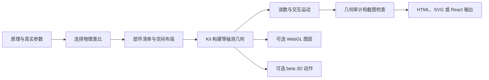

# Anatomy

## 一句话定义

**Anatomy 是 Claude Code 的 Agent Skill：把技术原理或机器描述转成细节丰富、带运动与读数的等轴测机械插图，核心产物为 SVG / HTML，也支持 React、WebGL 与 beta 3D 模式。**

## 英文缩写速查

| 缩写 | 英文全称 | 简要说明 |
|------|----------|----------|
| SVG | Scalable Vector Graphics | Anatomy 的主要图形输出格式 |
| WebGL | Web Graphics Library | 在 SVG 图层之间绘制火焰、水面、光照等效果 |
| React | React JavaScript Library | 可选的组件化集成输出 |
| CAD | Computer-Aided Design | 制造与几何设计工具；Anatomy 不生成可制造 CAD 真值 |
| CLI | Command-Line Interface | 通过 `npx skills add` 安装 Skill 的命令行入口 |

## 它解决什么问题

技术说明经常只能用方框和箭头描述结构，读者仍要自行想象部件怎样运动。Anatomy 让 Claude 为一项原理构造一个“会工作的机器”作为解释载体：例如用锁芯说明条件匹配、用带滑台和测头的量具表现测量过程，再把运动、数值与部件关系画在同一幅插图里。

它适合制作技术博客、产品文档、科普视频配图和交互式说明页。截图里的“把 Claude 变成 3D 机械师”是传播性概括；按上游 README，项目的主要产物是 SVG / HTML 机械插图，另外支持 WebGL 特效和实验性的 3D 动作。它的机械造型用途不等于 CAD 建模、工程制图或可直接制造的零件。

## 核心信息

| 项 | 内容 |
|----|------|
| **项目类型** | Claude Code Agent Skill + 等轴测绘图 Kit |
| **维护者** | Ryan（wheresryan22） |
| **代码开放** | 已开源；MIT |
| **主要输出** | 独立 HTML、内嵌样式的 SVG、React / Next.js 组件 |
| **可选效果** | WebGL shader；beta 3D 动作 |
| **安装** | `npx skills add wheresryan22/anatomy -g -a claude-code` |
| **构建环境** | Node.js 20.10+；核心 Kit 使用内置模块，无需安装额外 npm 依赖 |

## 工作流程

1. **先收集真实参数：** 给 Claude 原理、部件数量、尺寸、速率、阈值等关键数字，而不是只说“画得像机器”。
2. **把抽象关系映射成机构：** Claude 选择可表现因果关系的物理类比，再列出零件、位置、连接与运动状态。
3. **按深度绘制：** 绘图 Kit 提供等轴测相机、实体、圆件、管线、阴影和前后遮挡次序；核心图形渲染为 SVG。
4. **添加可读的反馈：** 在图卡中加入标题、提示、实时读数与轻缓交互。需要火焰、蒸汽或水面时，可在 SVG 前后叠加 WebGL canvas。
5. **验证图形：** 运行几何审计、线段检查，并用 headless Chrome 截取桌面、手机与交互状态，人工放大检查关节和线条。

## 对机器人研究与工程的价值

- **把复杂机构讲清楚：** 可用于解释减速器、传感器、夹爪、关节、接触或控制概念，图形比流程框更适合展示部件怎样相互作用。
- **生成可交付的说明图：** 输出可独立嵌入静态网页或 React 文档，适合项目主页、产品说明、演示视频和培训材料。
- **几何审计提高图面可信度：** 项目脚本可以抓明显的穿插、悬空连接和遮挡顺序问题；这验证的是插图几何与呈现质量，不等于机械设计审查。

## 工程实践与边界

| 目标 | 适合程度 | 实际边界 |
|------|----------|----------|
| 科普视频、博客、文档中的机械原理图 | 适合 | 先给真实参数，再审查类比有没有把原理画错 |
| 带读数、按钮、轻量动画的交互解释页 | 适合 | SVG/HTML 是成熟主路径；WebGL 负责附加光效等内容 |
| 会转动或弯曲的立体部件 | 可试用 | 3D 模式仍是 beta；可动对象有限，密集模型性能和验证成本较高 |
| 生成机械零件、装配 CAD、工程图 | 不适合直接承担 | 没有以 STEP/B-rep、尺寸公差、材料、承载分析或制造约束为目标的输出流程 |
| 生成仿真可用机器人资产 | 不可直接等同 | 插图和动画不能替代 URDF/MJCF、碰撞几何、惯量与关节参数 |

推荐的提示方法是给它“**要解释的原理 + 关键真实数字 + 需要动的部件 + 输出位置**”。若用于机器人演示，生成后仍要由工程人员检查物理类比、运动方向和数值是否正确；图形审计只能发现部分几何错误，无法证明实际机械正确性。

## 局限与风险

- Anatomy 不是数据图表工具，也不是通用 CAD/3D 建模器。
- 3D 动作模式在官方文档中标为 beta；复杂场景的建模与审核可能耗时，移动设备上的高零件数量场景性能较弱。
- 插图中出现了真实数值，不代表数值已由外部传感器或仿真自动验证；需由提示或项目逻辑提供可信数据。
- 图形审计检查穿插、端点和绘制深度等事项，不涉及材料强度、公差链、运动学可达性、碰撞安全或可制造性。
- 适用于创作解释图；涉及产品结构、CAD 出图或机器人仿真资产时，应转交对应专业 CAD 与机器人描述工作流。

## 关联页面

- [文字生成 CAD（Text-to-CAD）](../concepts/text-to-cad.md) — 区分说明插图与制造级几何。
- [3D Gen Studio](./3dgenstudio.md) — 生成/编辑网格资产；Anatomy 的目标是解释图。
- [CAD Operations Skill](./2836048681-cad-operations-skill.md) — 面向真实 CAD 操作与 DXF/PDF 文件的 Agent Skill。

## 参考来源

- [Anatomy 官方仓库归档](../../sources/repos/anatomy.md)
- [Anatomy 官方项目页归档](../../sources/sites/anatomy.md)

## 推荐继续阅读

- [Anatomy GitHub README](https://github.com/wheresryan22/anatomy/blob/main/README.md)
- [Anatomy Skill 定义](https://github.com/wheresryan22/anatomy/blob/main/SKILL.md)
- [Anatomy 项目页与在线示例](https://skills.wheresryan.sh/anatomy)
