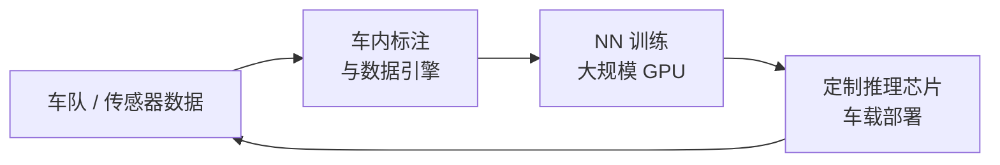
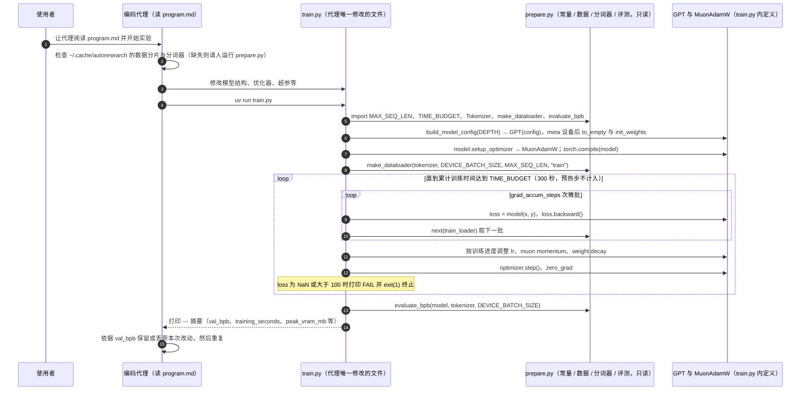

---

type: entity
tags: [deep-learning, education, tesla, openai, llm, methodology, computer-vision, reinforcement-learning, stanford]
status: complete
updated: 2026-11-14
related:
  - ../references/llm-wiki-karpathy.md
  - ./karpathy-autoresearch.md
  - ./llms-from-scratch-raschka.md
  - ../methods/reinforcement-learning.md
  - ../concepts/deep-learning-foundations.md
  - ../concepts/backpropagation.md
  - ../concepts/transformer.md
  - ../concepts/ai-auto-research.md
  - ../overview/robot-learning-overview.md
  - ../methods/imitation-learning.md
  - ../../roadmap/depth-vla.md
sources:
  - ../../sources/sites/karpathy-ai.md
  - ../../sources/blogs/karpathy_llm_wiki_gist_reading_full.md
  - ../../sources/blogs/karpathy_llm_wiki_gist.md
  - ../../sources/repos/karpathy-autoresearch.md
  - ../../sources/courses/karpathy_zero_to_hero_youtube.md
  - ../../sources/repos/nn-zero-to-hero.md
  - ../../sources/courses/karpathy_intro_llms_youtube.md
  - ../../sources/courses/karpathy_deep_dive_llms_youtube.md
original:
  - ../../sources/sites/karpathy-ai.md
  - ../../sources/repos/nn-zero-to-hero.md
  - ../../sources/repos/karpathy-autoresearch.md
  - ../../sources/blogs/karpathy_llm_wiki_gist_reading_full.md
summary: "Andrej Karpathy：OpenAI 创始成员、前 Tesla AI 总监（Autopilot 视觉全栈）、Stanford CS231n 创始讲师；现以 Zero to Hero 等教育内容为主，其 LLM Wiki Gist 是本知识库维护范式的思想来源。"
---

# Andrej Karpathy

## 一句话定义

**Andrej Karpathy** 是连接 **深度学习教育、大规模视觉系统与 LLM 时代知识工程** 的关键人物：从 Stanford CS231n 与 micrograd 把神经网络讲清楚，到 Tesla 时期把 **数据标注–训练–定制芯片部署** 收成 Autopilot 视觉闭环，再到提出 **LLM 维护持久 wiki** 模式——本仓库的 ingest / query / lint 即其后者在机器人研究域的实例化。

## 英文缩写速查

| 缩写 | 英文全称 | 简要说明 |
|------|----------|----------|
| LLM | Large Language Model | 大语言模型；Karpathy LLM Wiki 模式中的维护代理 |
| CNN | Convolutional Neural Network | 卷积神经网络；CS231n 与 Autopilot 视觉栈核心 |
| RL | Reinforcement Learning | 强化学习；OpenAI 早期研究与 Zero to Hero 教程覆盖 |
| FSD | Full Self-Driving | Tesla 全自动驾驶目标；其任内 Autopilot 团队长期主线 |

## 为什么重要

- **机器人栈上的「产品级视觉 ML」样本**：Tesla 任内公开描述 **车内标注 + NN 训练 + 定制推理芯片** 一体化，是理解 **Sim2Real 以外的大规模部署工程** 与 **Software 2.0** 叙事的参照点。
- **研究–教育–工具三位一体**：CS231n、Zero to Hero（micrograd / makemore / nanoGPT）、Software 2.0 等构成社区 **深度学习入门与工程习惯** 的公共基础设施；与本站 [Deep Learning Foundations](../concepts/deep-learning-foundations.md)、[Reinforcement Learning](../methods/reinforcement-learning.md) 直接相交。
- **本知识库的方法论作者**： [LLM Wiki（Karpathy）](../references/llm-wiki-karpathy.md) 提出 **compilation beats retrieval**；Robotics_Notebooks 的 `sources/` → `wiki/` → `schema/` 分层即该思想在 **机器人跨主题知识** 上的落地。

## 核心脉络（与机器人学习相关的子集）

### 1. 早期：仿真与运动技能

- UBC MSc：物理仿真 **figures** 的学习控制器（「machine-learning for agile robotics but in simulation」）。
- 代表论文：**Locomotion Skills for Simulated Quadrupeds**（SIGGRAPH 2011）、**Curriculum Learning for Motor Skills**（AI 2012）——与 [Locomotion](../tasks/locomotion.md) 主题同源，早于近年人形 RL 热潮。

### 2. 视觉–语言与规模化训练

- Stanford PhD（Fei-Fei Li）：CNN/RNN、image captioning、Video CNN 等；**CS231n** 成为视觉深度学习课程事实标准之一。
- OpenAI（2015–2017）：创始成员；深度 RL 与生成模型早期探索。

### 3. Tesla：Autopilot 视觉全栈（2017–2022）

- **Director of AI**：统领计算机视觉——车内数据标注、神经网络训练、**定制推理芯片** 部署。
- 公开材料：Tesla AI Day 2021、Autonomy Day 2019、CVPR / ScaledML「AI for Full Self-Driving」等；与 [Pieter Abbeel](https://www.youtube.com/watch?v=GxYFaZZA_ms) *Robot Brains* 对谈连接 **学术机器人** 与 **量产视觉栈** 话语。
- 短暂参与 **Optimus** 人形项目（主页自述 *very briefly*）——与本站 [Humanoid Robot](./humanoid-robot.md) 叙事相邻但非其主贡献轴。

### 4. OpenAI 回归与合成数据（2023–2024）

- 组建 **midtraining** 与 **synthetic data generation** 团队——与当前 LLM/VLA **数据飞轮** 讨论同频。

### 5. 2024–：教育与 LLM 知识工程

- YouTube 三条并行轨：
  - **技术轨 — [Neural Networks: Zero to Hero](../../sources/courses/karpathy_zero_to_hero_youtube.md)**（`karpathy.ai/zero-to-hero.html` 列 8 讲主课：micrograd 2h25m → makemore 5 讲 → GPT 1h56m → GPT Tokenizer 2h13m；播放列表含 State of GPT / GPT-2 124M 共 10 集 ~19 h；配套 [`nn-zero-to-hero`](../../sources/repos/nn-zero-to-hero.md) 仓 `lectures/` 入库第 1–6 讲 7 份 notebook，GPT 与 Tokenizer 分别外链至视频描述/nanoGPT 与 [minBPE](https://github.com/karpathy/minbpe)）。
  - **大众轨 — LLM 科普（成对）**：[Intro to LLMs（~1 h，2023）](../../sources/courses/karpathy_intro_llms_youtube.md) 建立两文件模型、预训练/微调、Scaling Laws、工具与多模态、**LLM OS** 与安全攻击面；[Deep Dive into LLMs（~3.5 h，2025）](../../sources/courses/karpathy_deep_dive_llms_youtube.md) 系统拆解预训练（tokenization / Transformer / GPT-2 / Llama 3.1 base）→ 后训练（SFT、幻觉与上下文、RL / DeepSeek-R1 / RLHF）；主页另列 *How I use LLMs*。
  - **方法论轨 — LLM Wiki Gist**：持久 markdown wiki + ingest/query/lint —— 见 [LLM Wiki 方法论页](../references/llm-wiki-karpathy.md)。
- 走 [VLA 纵深](../../roadmap/depth-vla.md) 者建议 **Intro → Deep Dive**（直觉）或 **Zero to Hero**（动手），再接 [Raschka 书/课](./llms-from-scratch-raschka.md)。
- **autoresearch（2026）**：[karpathy/autoresearch](./karpathy-autoresearch.md) — 在 nanochat 单 GPU 栈上让编码代理通宵改 `train.py`、以 **val_bpb** 与固定 5 分钟预算循环实验；人类迭代 `program.md` 作为「研究组织技能」。与 [AI Auto-Research](../concepts/ai-auto-research.md) S3 阶段直接同构。

## 流程总览（Tesla 期公开描述的视觉 ML 闭环）

下列为 Karpathy 多次演讲归纳的 **逻辑骨架**（细节以 Tesla 官方材料为准），与机器人 **数据–训练–部署** 飞轮同构：

## 常见误区或局限

- **个人页 ≠ 实时新闻源**：任职、项目状态以机构公告与一手演讲为准。
- **LLM Wiki 是模式文件，非本仓库配置**：具体目录、lint 规则、CI 门禁见 [Ingest Workflow](../../schema/ingest-workflow.md) 与 [AGENTS.md](../../AGENTS.md)。
- **Tesla / Optimus 贡献边界**：主页对 Optimus 仅一笔带过；人形控制主线应优先引用 LECAR / GEAR 等当代论文簇，而非将其归因于 Karpathy 个人。

## 源码运行时序图

入口：一次性准备 `uv run prepare.py`；单次实验 `uv run train.py`（固定 5 分钟训练预算）；代理的循环规则见 `program.md`。

图依据：`karpathy/autoresearch@228791f`，已通读 `README.md`（1–92）、`program.md`（1–114）、`train.py`（1–630，含 RoPE + FA3 + ResFormer `value_embeds` + logit `softcap=15` + Polar-Express/NorMuon `MuonAdamW`）与 `prepare.py`（1–389，含 `rustbpe`、`climbmix-400b-shuffle`、BOS-aligned best-fit `make_dataloader` 与 `evaluate_bpb`）。未运行代码（依赖单张 NVIDIA GPU 与下载分片数据）。

## 工程实践

- **Zero to Hero 本地上手路径**：直接克隆 `karpathy/nn-zero-to-hero` 可跑第 1–6 讲（`lectures/micrograd` 与 `lectures/makemore/makemore_part1..5.ipynb`）；第 7 讲 GPT 与第 8 讲 BPE Tokenizer 需按 `README.md` 跳转到视频描述链接 / `karpathy/minbpe` 与 Colab。
- **`autoresearch` 单 GPU 契约与小算力适配**：`prepare.py` 固定拉取 `karpathy/climbmix-400b-shuffle` 分片与训练 `VOCAB_SIZE=8192` 的 `rustbpe` 分词器；`train.py` 强制调用 `torch.device("cuda")` 与 `kernels` FlashAttention-3，不直接兼容 CPU/MPS。在更小硬件或笔记本上复现实验环时，README 建议选用 Mac/AMD/Windows 社区 fork，或调小 `vocab_size`、`MAX_SEQ_LEN`、`DEPTH` 并把 `WINDOW_PATTERN` 改为 `"L"`。
- **VLA 前置分工**：先按 Zero to Hero 或 *Intro/Deep Dive* 建立反向传播与 Transformer 直觉，再对照 [Raschka《LLMs-from-scratch》](./llms-from-scratch-raschka.md) 补齐预训练/SFT 工程脚本，最后进入 [VLA 纵深路线](../../roadmap/depth-vla.md)。

## 结论

Andrej Karpathy 的公开教学与开源工具链构成了机器人/VLA 读者理解现代神经网络训练栈、自主实验代理与持久化知识工程的最小自包含起点。

- **教育栈边界清晰**：`nn-zero-to-hero` 本地聚焦 micrograd 与 makemore 前六讲手写梯度与结构直觉，GPT 与 Tokenizer 需结合 `nanoGPT`/`minBPE`。
- **`autoresearch` 是自主研究最小闭环**：用只读 `prepare.py`（固定 `val_bpb` + 300s 预算）约束代理只改单文件 `train.py`，人类通过修改 `program.md` 编排研究策略。
- **机器人引用需分清领域**：早期 UBC 仿真四足与 Tesla Autopilot 视觉闭环具有直接启发，但 Optimus 与当代人形策略并不归因于其个人主页细节，应以具体论文为准。

## 关联页面

- [LLM Wiki 方法论（Karpathy）](../references/llm-wiki-karpathy.md)
- [autoresearch（karpathy/autoresearch）](./karpathy-autoresearch.md)
- [AI Auto-Research](../concepts/ai-auto-research.md)
- [Robot Learning Overview](../overview/robot-learning-overview.md)
- [Reinforcement Learning](../methods/reinforcement-learning.md)
- [Deep Learning Foundations](../concepts/deep-learning-foundations.md)
- [Backpropagation](../concepts/backpropagation.md)
- [Transformer](../concepts/transformer.md)
- [VLA 纵深路线](../../roadmap/depth-vla.md)
- [Humanoid Robot](./humanoid-robot.md)
- [Ingest Workflow](../../schema/ingest-workflow.md)

## 参考来源

- [Karpathy 个人站点原始资料](../../sources/sites/karpathy-ai.md)（主要原文：`karpathy.ai` 首页与 `zero-to-hero.html` 全文核对）
- [nn-zero-to-hero 配套仓库](../../sources/repos/nn-zero-to-hero.md)（主要原文：克隆仓 README 与 7 个 notebook 核对）
- [autoresearch 仓库原始资料](../../sources/repos/karpathy-autoresearch.md)（主要原文：克隆仓 `README.md`、`program.md`、`prepare.py`、`train.py` 全文核对）
- [LLM Wiki Gist 精读归档](../../sources/blogs/karpathy_llm_wiki_gist_reading_full.md)（主要原文：`通读：已完成`）
- [Zero to Hero 播放列表（YouTube）](../../sources/courses/karpathy_zero_to_hero_youtube.md)
- [Intro to LLMs（YouTube，2023）](../../sources/courses/karpathy_intro_llms_youtube.md)
- [Deep Dive into LLMs（YouTube，2025）](../../sources/courses/karpathy_deep_dive_llms_youtube.md)
- [LLM Wiki Gist 原始资料](../../sources/blogs/karpathy_llm_wiki_gist.md)

## 推荐继续阅读

- [karpathy.ai](https://karpathy.ai/) — 职业时间线、演讲与项目总索引
- [LLM Wiki Gist](https://gist.github.com/karpathy/442a6bf555914893e9891c11519de94f) — 方法论原文
- [karpathy/autoresearch](https://github.com/karpathy/autoresearch) — 自主 LLM 训练实验环
- [Neural Networks: Zero to Hero（YouTube，10 集）](https://www.youtube.com/playlist?list=PLAqhIrjkxbuWI23v9cThsA9GvCAUhRvKZ) — micrograd → makemore → GPT → GPT-2 124M
- [nn-zero-to-hero（GitHub）](https://github.com/karpathy/nn-zero-to-hero) — 各讲 notebook 归档
- [Intro to LLMs（YouTube，~1 h）](https://www.youtube.com/watch?v=zjkBMFhNj_g) — LLM 全景、LLM OS 与安全
- [Deep Dive into LLMs（YouTube，~3.5 h）](https://www.youtube.com/watch?v=7xTGNNLPyMI) — 完整训练栈深潜
- [LLMs-from-scratch（Raschka）](./llms-from-scratch-raschka.md) — 结构化书+notebook 路线，与 Zero to Hero 互补
- [Software 2.0（2017 博文）](https://karpathy.medium.com/software-2-0-a64152b37c35) — 学习即编程与端到端栈讨论
