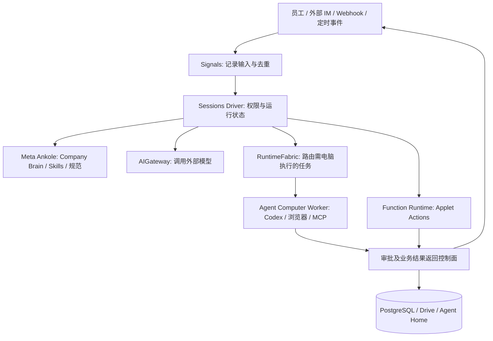
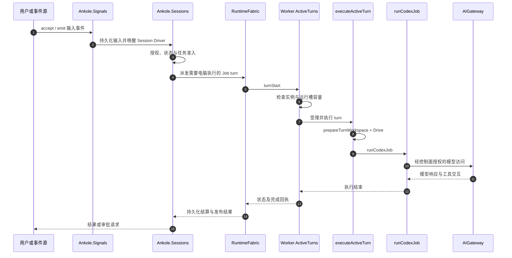

# Ankole：企业 Pod 与多智能体运行时 / Open-source Pod and Multi-Agent Runtime

## 一句话定义

**Ankole**（[AgentBull/ankole](https://github.com/AgentBull/ankole)）是开源自托管的企业 Agent Harness 与协作工作空间（Pod）：将人、个人助理、职能 AI 同事、公司大脑、结构化业务数据及跨平台工具执行归入受控任务闭环，而不只是给 LLM 加一个聊天界面。

## 英文缩写速查

| 缩写 | 英文全称 | 在 Ankole 中的作用 |
|---|---|---|
| Pod | Pod Workspace | 企业 / 团队的协同工作空间 |
| OTP | Open Telecom Platform | Elixir/Erlang 的监督树与容错运行时 |
| A2A | Agent-to-Agent | 个人助理向职能 AI 同事委派任务 |
| MCP | Model Context Protocol | 通用外部工具连接协议 |
| SSO | Single Sign-On | 企业身份源统一登录 |
| FUSE | Filesystem in Userspace | Worker 的 /drive 文件挂载 |
| ACL | Access Control List | Pod 文档与业务资源的访问范围 |

## 为什么重要

对企业 AI Agent 的难点，不只是单轮推理，而是**跨成员权限、外部真实业务状态、长期运行、审批与恢复**。Ankole 在同一软件底座中提供：

- **人机共享工作对象：** Documents、关系型 Base、多维表、Slides、Applet 与 Pod Chat。业务状态不必只靠对话上下文传递。
- **持久组织知识：** Company Brain 标记证据来源、时间、可信状态及可见范围；Skills 和 `AGENTS.md` / `DESIGN.md` 约束执行行为。
- **多 Agent 协同：** 个人助理按成员权限工作；专业 AI 同事以独立角色权限接收委派，对越权操作要求人工审批。
- **事件与确定性自动化：** 聊天、定时、Webhook、Base 变化和连接器事件可唤醒任务；已发布 Applet Actions 用确定性代码执行常规流程。

与 [Hermes Agent](./hermes-agent.md) 的个人常驻助理路线、[Agnes Harness](./agnes-harness.md) 的 FDE/设备集成路线相比，Ankole 更重视**企业 Pod、结构化业务数据、组织权限和多人业务闭环**。

## 核心信息

| 项 | 核对结论 |
|---|---|
| 维护组织 | AgentBull |
| 类型 | 开源企业多智能体运行时与 Pod 协作平台 |
| 许可证 | Apache-2.0（官方根 LICENSE） |
| 控制面 | Elixir / Phoenix / OTP |
| Worker | Bun + TypeScript，每个 Agent 的独立 Linux 容器 |
| 内核与数据 | Rust Kernel；PostgreSQL 18+、Drive 对象存储、持久化 Agent Home |
| 部署 | Docker Compose、Kubernetes Helm；其他云 Worker 视提供商支持 |
| 官方资料 | [README](https://github.com/AgentBull/ankole/blob/main/README.zh-Hans.md)、[文档](https://ankole.agentbull.com/zh-Hans-CN/docs/introduction/) |
| 机器人定位 | 可作为自然语言/任务级协调层，**不直接提供机器人实时闭环** |

## 核心原理

### 分层架构

1. **Pod 与 Meta Ankole：** 文档、Base、Applet、会话、身份权限，以及带来源/可见性约束的 Company Brain。
2. **Control Plane：** 持久化 Signals、Sessions、审批、任务调度、AIGateway 和业务数据；用 Elixir/OTP 管理运行状态。
3. **Function Runtime：** 无状态处理 Applet 后端与已经发布的确定性 Applet Actions。
4. **Agent Computer Worker：** 单 Agent 容器负责终端命令、浏览器、Codex、Skills、MCP；`/workspace` 为持久 Home，授权 `/drive` 可由 FUSE 或服务回退访问。
5. **Kernel / 数据层：** Rust 提供关键底层能力；PostgreSQL 与对象存储承担持久化真相。

### 流程总览

图示按 README 的系统架构与 `Sessions.md`、`Signals.md` 的职责边界概括；Function Runtime 的确定性动作和 Worker 的开放式 Agent Job **不是同一个调用路径**，应分别理解。

## 源码运行时序图

以下是**需要 Worker 的后台 Codex Job** 对应的已核对模块。普通 Pod Chat 不保证使用同一 Codex 执行分支。

核对的实际代码入口：`app/control_plane/lib/ankole/signals.ex`、`sessions.ex`；`app/agent_computer/src/main.ts` 建立 RuntimeFabric 通道；`worker/active-turns.ts` 中 `ActiveTurns.start` 进行接收和容量管理；`worker/turn-execution.ts` 中 `executeActiveTurn` 调用 `runCodexJob`。该时序为模块层级摘要，未做本地运行验证。

## 工程实践

| 场景 | 建议 |
|---|---|
| 私有试用 | 按 [Docker Compose 快速开始](https://github.com/AgentBull/ankole/tree/main/tools/deploy/docker-compose) 配置 .env、PostgreSQL、域名与 HTTPS，启动后走 /setup 配模型及身份 |
| 企业多成员协作 | 先定义 Pod 资源权限与 Agent 角色，再接 IM、GitHub、Linear 或 MCP；把高权限写入放在审批边界 |
| 长时业务流程 | 例行同步用 Applet Actions，开放式调研或软件维护用 Sessions / Background Agent Jobs；区分确定性运行与模型执行开销 |
| 知识治理 | 让 Company Brain 保留来源及证据等级，不把推断、未经核实信息自动当成业务真实状态 |
| 机器人集成 | 可考虑连接工单、设备日志、实验追踪和人工审批，但实际 ROS2 控制器、运动安全层、急停及实时通信须另行建设 |

**部署不是一键无门槛：** Docker socket 挂载意味着高权限宿主机访问；Worker 需要适当的隔离、备份与退出恢复策略。官方标注生产使用经历，但没有给公开 API 的跨版本稳定承诺；本页也未实测运行。

## 局限与风险

- **站点信任边界：** 多租户共享同一站点运维方、控制面与运行基础设施；不能将其当成针对互不信任租户的强计算隔离。
- **Worker 内的隔离粒度：** 不同 Agent 有独立 Worker；同一 Agent 的 Session 与 Job 共享其 `/workspace`，并非彼此保密。
- **存储/可靠性：** 不同 Worker Provider 的存储恢复保证不同；部分云环境的突发终止可能损失上次快照后的更改。
- **权限与外部系统：** Agent 代表其授权主体执行，审批能约束指定高权限操作，但不能替代第三方连接器权限设计、安全审计和现场风险评估。
- **具身控制边界：** 官方未宣称提供 ROS 2 实时控制环、关节级控制、硬件安全互锁或 Sim2Real 训练流水线。若用于机器人系统，只适合在**任务层 / 流程层**编排，底层运动和安全闭环必须独立。

## 关联页面

- [Hermes Agent](./hermes-agent.md) — 个人自主 Agent 与常驻 Gateway 的对照方案
- [Agnes Harness](./agnes-harness.md) — FDE Agent、设备工具连接和追踪记录的对照方案
- [DeepSeek Harness](./deepseek-harness.md) — 插件式 Agent Loop 与 SDK 的轻量级对照
- [OpenClaw](./openclaw.md) — 多 IM / 本地 Skills 的个人助理与消息 Gateway 路线
- [LLM 机器人控制接口](../concepts/llm-robotics-control-interfaces.md) — 任务级语言决策与实时设备控制的边界

## 参考来源

- [Ankole 官方仓库及源码阅读归档](../../sources/repos/ankole.md)
- [Ankole 官方中文网站归档](../../sources/sites/ankole.md)
- [Ankole README（中文）](https://github.com/AgentBull/ankole/blob/main/README.zh-Hans.md)
- [官方架构与取舍限制](https://github.com/AgentBull/ankole/blob/main/docs/TradeoffsAndKnownLimits.md)
- [Sessions 设计文档](https://github.com/AgentBull/ankole/blob/main/docs/design-docs/Sessions.md)
- [Agent Computer README](https://github.com/AgentBull/ankole/blob/main/app/agent_computer/README.md)

## 推荐继续阅读

- [Ankole 中文部署指南](https://ankole.agentbull.com/zh-Hans-CN/docs/quickstart/)
- [Signals：可靠事件输入](https://github.com/AgentBull/ankole/blob/main/docs/design-docs/Signals.md)
- [Agent Workers：运行边界与恢复](https://github.com/AgentBull/ankole/blob/main/docs/design-docs/AgentWorkers.md)
- [官方已知限制](https://github.com/AgentBull/ankole/blob/main/docs/TradeoffsAndKnownLimits.md)
