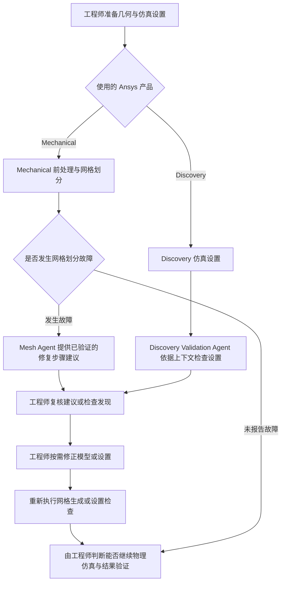

# Ansys 2026 R1 智能体工程（Ansys 2026 R1 Agentic Engineering）

## 一句话定义

**Ansys 2026 R1 智能体工程（Agentic Engineering）**是 Synopsys 于 2026-03-11 发布的一组工程仿真 AI 能力，其中明确命名的智能体包括 **Mesh Agent**（网格故障排查）与 **Discovery Validation Agent**（仿真设置检查）；它们仍以辅助工程师验证和修正为核心。

## 英文缩写速查

| 缩写 | 英文全称 | 简要说明 |
|------|----------|----------|
| CAE | Computer-Aided Engineering | 计算机辅助工程，产品设计、前处理与物理仿真 |
| AI | Artificial Intelligence | 本版本中的智能辅助、生成式建模与验证功能 |
| SaaS | Software as a Service | SimAI Premium 的云端服务形态 |
| ROM | Reduced-Order Model | 数字孪生中用于加速推演的降阶模型 |

## 为什么重要

网格生成失败、前处理设置遗漏会影响物理仿真启动与结果可信性。Ansys 2026 R1 将智能体引入商业 CAE 的这两个具体环节：**协助修复网格问题**、**更早发现设置问题**。对机器人关节结构、机械零件、电机热管理等场景，价值在于减少工程师反复排错的负担，而不是替代求解器或自动证明结果正确。

本页归档的是**厂商软件内置能力**，有别于社区独立开发的 [Ansys MCP 工具](./laplaceyoung-ansys-aedt-mcp.md) 或 [AnsysAgent](./sduwby-ansysagent.md)。

## 核心信息与版本状态

| 功能（英文原名） | 集成产品 | 已披露的核心职责 | 2026 R1 公告状态 |
|------------------|----------|------------------|------------------|
| **Mesh Agent** | **Ansys Mechanical** | 辅助调试、定位网格划分失败，并建议经过验证的修复步骤 | **探索性使用**（available for exploratory use） |
| **Discovery Validation Agent** | **Ansys Discovery** | 结合情境信息与行业最佳实践，主动发现仿真设置问题 | **早期客户评估**（early customer evaluations） |

发布方为 **新思科技（Synopsys）**；产品品牌为 **Ansys**。发布日期 **2026-03-11**，本页依据当日厂商英文新闻稿和对应中文公告整理。

## 核心原理

### Mesh Agent：让网格故障更容易诊断

- **输入场景：** 工程师在 Mechanical 模型前处理阶段遭遇网格划分失败。
- **公开能力：** 根据故障提供经过验证的修复指导，帮助工程师排查问题。
- **实际边界：** 公告描述的是“引导工程师”，没有说明自动修改网格参数、自动重复求解或能否直接调用特定求解器 API。

### Discovery Validation Agent：设置阶段的前置检查

- **输入场景：** 工程师在 Discovery 中配置仿真模型。
- **公开能力：** 利用上下文和工程最佳实践主动识别设置问题。
- **实际边界：** 官方未公开其检查规则清单、模型实现或定量误检率；现阶段属于早期客户评估。

### 流程总览（依据官方功能范围抽象）

> 这是根据官方**对外披露的产品功能**绘制的工程使用流程，不是智能体内部架构图；“修正”“复核”等步骤由工程师执行，未把人工操作画成 Agent 的自主工具调用。

## 与同版其他 AI 产品的区别

| 组件 | 主要作用 | 是否为公告明确命名的智能体 |
|------|----------|----------------------------|
| Mesh Agent | Mechanical 网格错误排查 | **是** |
| Discovery Validation Agent | Discovery 设置问题前置发现 | **是** |
| Ansys GeomAI | 从参考设计学习、生成与评估几何概念 | 否；官方将其称为生成式 AI 平台 |
| Ansys SimAI | 数据驱动仿真代理模型/设计研究；有 Premium SaaS 与 Pro 本地数据版本 | 否；官方未把其表述为本次两项智能体之一 |
| Ansys Engineering Copilot | medini analyze、ModelCenter、Rocky 中界面内的 AI 辅助 | 否；是另列的 Copilot 功能 |
| optiSLang + Discovery | 敏感性分析和一键优化的工作流集成 | 否；是优化集成 |

## 工程实践

1. **先明确待验证对象。** 机器人关节、传动件或壳体分析应先核对几何简化、材料、接触、约束、载荷及输出物理量，不因为有 Agent 就跳过。
2. **Mechanical 网格失败时。** 若所用授权版本提供 Mesh Agent，可参考其修复提示；工程师仍需检查网格质量、关键应力集中区域、收敛性和复算结果。
3. **Discovery 设置阶段。** 若参与早期评估，可将 Validation Agent 的发现作为建模检查线索，再用问题清单确认边界条件与工程假设。
4. **记录证据。** 保留修复前后网格、仿真设置、求解日志、误差/收敛指标，重要物理量与试验或独立计算对照。

这些是**工程使用建议**，不是厂家承诺的自动化操作序列或已验证性能数据。更广的仿真工具分类见 [CAE / CFD 代理工具总览](../overview/cae-cfd-agent-skills-landscape.md)。

## 局限与风险

- **可用阶段不同：** Mesh Agent 是探索性使用，Discovery Validation Agent 处于早期客户评估；不能把两者都表述为对所有用户正式开放。
- **开放性：** 截至 2026-11-16，核对的官方公告及发布亮点页没有提供上述两款智能体的官方公开源码、模型权重或可运行入口，不能按社区开源 Agent 进行复现。
- **技术细节未知：** 官方未公布底层模型、工具调用协议、自治执行边界与独立基准测试数据，故不推断其内部使用何种 LLM、MCP 或多智能体架构。
- **工程安全性：** 智能体给出的排错建议不是收敛验证、网格独立性、材料/边界一致性和实物试验的替代品。

## 源码运行时序图

**不适用。** 厂商发布的两项智能体属于商业产品内功能，本次官方来源没有提供可运行的源码入口；不能用通用 LLM-Agent 时序图冒充 Ansys 的内部实现。

## 关联页面

- [CAE / CFD 代理工具与技能总览](../overview/cae-cfd-agent-skills-landscape.md) — 区分厂商内置智能体和社区 MCP/Skill 项目
- [AnsysAgent（社区工程助手）](./sduwby-ansysagent.md) — 对照公开仓库、子代理与工具连接机制
- [Ansys AEDT MCP](./laplaceyoung-ansys-aedt-mcp.md) — 对照社区 API 桥接工作流
- [仿真物理保真度知识链](../overview/hub-physics-fidelity.md) — 物理验证、模型证据与误差边界
- [电机设计流程](../overview/motor-design-workflow.md) — 机器人关节电机结构/热设计与台架验证
- [Engineering Simulation and Verification Workflow · 工程仿真建模与验证流程](../methods/engineering-simulation-workflow.md)：将 Mesh Agent 与 Discovery Validation Agent 嵌入 CAE 工程仿真前处理建模与验证流程。
- [Agent Planning and Feedback Loops · 智能体规划与反馈执行](../methods/agent-planning-feedback.md)：通过主动检查仿真设置、定位网格故障并给出逐步修复建议，形成人机协同的反馈执行循环。

## 参考来源

- [Ansys 2026 R1 官方资料归档](../../sources/sites/ansys-2026-r1-agentic-engineering-official.md)（原文通读：英文、中文官方发布公告；核对日 2026-11-16）
- [Synopsys 2026-03-11 英文官方新闻稿](https://news.synopsys.com/2026-03-11-Synopsys-Launches-Ansys-2026-R1-to-Re-Engineer-Engineering-with-Joint-Solutions-and-AI-Powered-Products)
- [新思科技 2026 R1 中文官方新闻稿](https://cn.news.synopsys.com/2026-03-13)

## 推荐继续阅读

- [Ansys 2026 R1 官方发布亮点与产品入口](https://ansys.synopsys.com/zh-CN/Products/Release-Highlights)
