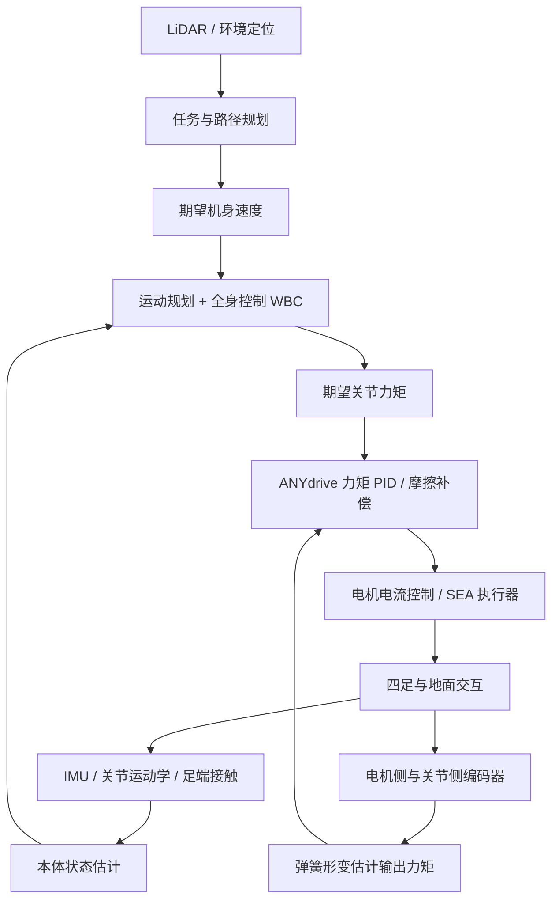

# ANYmal 四足机器人（ETH RSL / ANYbotics）

**ANYmal** 由 ETH Zurich 的 Robotic Systems Lab（RSL）开展原始研究，并经 ANYbotics 商业化；它同时是**足式力控与运动控制研究平台**、**自主工业巡检产品家族**。理解它时必须区分 2016 年系统原型、后续 ANYmal D 和面向危险气体环境的 ANYmal X，不能混用参数与认证。

## 一句话定义

**ANYmal 是把模块化串联弹性关节、全身力控、导航感知和足式运动能力集成起来，并在后续型号上扩展学习式运动与工业巡检应用的四足机器人系列。**

## 英文缩写速查

| 缩写 | 英文全称 | 简要说明 |
|---|---|---|
| RSL | Robotic Systems Lab | ETH Zurich 机器人系统实验室 |
| SEA | Series Elastic Actuator | 串联弹性执行器，允许通过弹性形变估计输出力矩 |
| WBC | Whole-Body Control | 同时协调机身运动、关节力矩和地面接触力的全身控制 |
| HAA/HFE/KFE | Hip Abduction-Adduction / Hip Flexion-Extension / Knee Flexion-Extension | 每条腿的三个驱动关节 |
| ZMP | Zero Moment Point | 原型静态行走中的质心/支撑稳定性规划方法之一 |
| CANopen | CANopen | 2016 年 ANYdrive 关节命令与状态的总线协议 |
| RL | Reinforcement Learning | ANYmal 后续复杂地形运动研究的重要范式 |
| IP67 | Ingress Protection 67 | 产品防尘防水等级，不等同于防爆认证 |
| ATEX / IECEx | ATEX / IECEx | 危险爆炸性环境的相关认证体系；当前 ANYmal X 官方页标明 ATEX，IECEx 仍写作计划随首批生产提供 |

## 为什么重要

- **执行器—控制联合设计：** 2016 年 IROS 原型将 12 个 ANYdrive SEA 关节、扭矩反馈与模型驱动 WBC 整合成可移动的整机，是理解高柔顺腿式机器人控制环的具体案例。
- **研究到产品的延伸：** 后续 ETH 研究在 ANYmal 上验证纯本体感知强化学习的复杂地形运动；ANYbotics 又将足式移动、导航和巡检传感器做成工业产品。两条路线共享平台家族，但研究成果不应默认具备商业化认证。
- **便于工程选型：** SEA 力控的冲击吸收与测力能力，和工业巡检需要的防护、续航、传感器、认证，是不同维度的指标。

## 核心原理

### 2016 年原型：ANYdrive + 实时 WBC

根据 [ETH IROS 2016 全文归档](../../sources/papers/anymal-iros-2016.md)，原始 ANYmal 略低于 **30 kg**、共 **12 个驱动关节**（每腿 HAA/HFE/KFE）。每个 ANYdrive 使用电机、减速器和**串联转动弹簧**；利用关节侧与减速器侧编码器的角度差估计力矩，底层为电流控制、力矩 PID（带前馈和摩擦补偿）及外层位置 PID。

- **关节指标必须注明测试条件：** 原型单关节最大力矩 **40 Nm**、最大速度 **12 rad/s**；小信号力矩带宽约 **70 Hz**，在 10 Nm 激励时约 **24 Hz**。不能把 70 Hz 理解为所有工况下的恒定带宽。
- **整机控制：** IMU、腿部运动学和足端接触用于本体状态估计；静态行走使用 ZMP 规划，动态步态落脚规划使用简化倒立摆模型；WBC 在关节力矩、接触力与机体轨迹约束下求解控制命令。
- **计算和通信：** 论文中导航、运动、巡检职责分布在多台机载 PC；实时状态估计与 WBC 由 CAN 驱动以 **400 Hz** 定时，非实时模块通过共享内存及 ROS 交换信息。这是**2016 年历史架构**，不代表当前 ANYmal D/X 的控制栈。

## 流程总览

以下是依据 IROS 2016 Sec. II.D、III.C、IV 绘制的**系统控制链路概念图**，不是从某个公开源码仓库逆向得到的运行调用图。

### 原型实验（IROS 2016）

| 维度 | 论文报告结果 | 使用边界 |
|---|---|---|
| 静态步行 | 约 **0.3 m/s** | ZMP 规划下的原型演示 |
| 动态小跑 | 约 **0.8 m/s** | 论文的特定步态与实验设置 |
| 攀爬 | 约 **50°** 的工业梯面爬行动作 | 采用谨慎的贴地爬行，不是常规楼梯速度指标 |
| 续航 | 约 **650 Wh** 电池，超过 **2 h** | 2016 年原型，不可套用于商业版 |

## 型号与研究成果边界

| 对象 | 证据明确的定位 | 不应混同的事项 |
|---|---|---|
| **ANYmal（IROS 2016 原型）** | 约 30 kg、ANYdrive SEA、基于模型的状态估计与 WBC；[原论文](../../sources/papers/anymal-iros-2016.md) | 不是后续 RL 算法或所有商业型号的参数表 |
| **ANYmal D（工业巡检）** | ANYbotics [官方产品介绍](https://www.anybotics.com/robotics/anymal/)和 [2024 年规格资料](https://www.anybotics.com/ANYbotics_Specs_US.pdf)说明 IP67、LiDAR/多相机/热像、导航与自主巡检 | **IP67 不意味着防爆**；机载传感器与续航需按 D 的资料核查 |
| **ANYmal X（防爆巡检）** | [ANYbotics 官方页](https://www.anybotics.com/robotics/anymal-x/)标明 **ATEX Zone 1/2、IIB T4**；其页面写明 IECEx 将在首批生产时提供，并区分 **IP65 机身 / IP67 载荷** | 防爆能力**针对 X 型号及对应认证范围**，不能泛化为所有 ANYmal |
| **后续学习式运动论文** | ETH [2020 年复杂地形运动研究](https://rsl.ethz.ch/the-lab/news/2020/10/learning-locomotion-over-challenging-terrain.html)展示纯本体感知深度 RL；另见 [PACE](./paper-pace-sim2real-legged-robots.md) | RL 成果来自**各篇独立工作**，不是 2016 年平台论文提出的控制算法 |

## 工程实践

1. **控制环设计：** 若参考 2016 年架构，先区分编码器估计关节输出力矩、内层扭矩环、WBC 约束求解与上层任务速度命令，再逐层验证延迟和带宽。
2. **指标阅读：** 硬件参数必须标明原型或商业代际；70 Hz 关节小信号带宽、400 Hz 整机 WBC 频率、0.8 m/s 小跑速度分别是不同实验量，不能相互代换。
3. **研究资料入口：** [Legged Gym](./legged-gym.md) 是后续足式强化学习的软件生态之一，**不等同于 ANYmal 2016 整机控制代码**；[PACE](./paper-pace-sim2real-legged-robots.md) 和 [协调羽毛球](./paper-coordinated-badminton-skills-anymal.md) 分别展示后续 Sim2Real、移动操作研究。

**源码运行时序图：不适用。** 本页主原文是 2016 年系统论文，描述设计和控制架构，但本次未核验到能够复现**该版完整平台控制栈**的官方可运行仓库与入口。上图明确是论文架构概念图，不冒充源码调用顺序。

## 局限与风险

- **SEA 代价：** 物理弹簧带来冲击柔顺与力矩反馈，同时限制控制带宽，并引入弹性动态；论文的 70 Hz 结果仅适用于对应小信号实验。
- **原型和产品混写风险：** 历史原型的 30 kg、650 Wh 与商业版规格不能拼接为“一台 ANYmal”；IP67 防护与 ATEX/IECEx 防爆也不能合并为全系列声明。
- **开放程度：** 2016 年论文提供硬件、控制与实验描述，**不是一套可直接部署的开源工程仓**；工程复现需额外核查当前硬件与控制软件接口。
- **研究结论外推：** 复杂地形 RL 和视觉移动操作实验应按对应论文的机器人型号、感知条件和评测边界解释，不能推断 ANYmal 在所有场景的成功率或长时可靠性。

## 关联页面

- [四足机器人](./quadruped-robot.md)
- [人形机器人](./humanoid-robot.md)
- [Locomotion 任务](../tasks/locomotion.md)
- [Legged Gym](./legged-gym.md)
- [Sim2Real](../concepts/sim2real.md)
- [PACE：ANYmal D 的 Sim2Real](./paper-pace-sim2real-legged-robots.md)
- [ANYmal-D 动态羽毛球](./paper-coordinated-badminton-skills-anymal.md)
- [Inverse Dynamics Control（逆动力学控制，IDC）](../methods/inverse-dynamics-control.md) — 从期望运动到力矩的动力学映射可作为理解原型力控/WBC 的背景，不代表其全部任务约束求解器。

## 参考来源

- [Hutter 等：ANYmal — A Highly Mobile and Dynamic Quadrupedal Robot（全文通读归档）](../../sources/papers/anymal-iros-2016.md)
- [Locomotion RL 早期论文索引](../../sources/papers/locomotion_rl.md)
- [ETH 2016 原始论文与 PDF](https://www.research-collection.ethz.ch/entities/publication/d3770b2f-5aa1-4a92-8c2c-a56d79771820)
- [ANYbotics 官方 ANYmal / ANYmal X 产品资料](https://www.anybotics.com/robotics/anymal/)

## 推荐继续阅读

- [ANYmal IROS 2016 原文 DOI](https://doi.org/10.1109/IROS.2016.7758092)
- [ANYbotics：ANYmal X 防爆认证与应用范围](https://www.anybotics.com/robotics/anymal-x/)
- [ETH RSL：Learning Locomotion over Challenging Terrain（2020）](https://rsl.ethz.ch/the-lab/news/2020/10/learning-locomotion-over-challenging-terrain.html)
- [Terrain-Grounded Imagination](terrain-grounded-imagination.md)：ANYmal-D 在显式三维地形查询下预测足端与非足端接触，用短想象轨迹训练到点策略。
