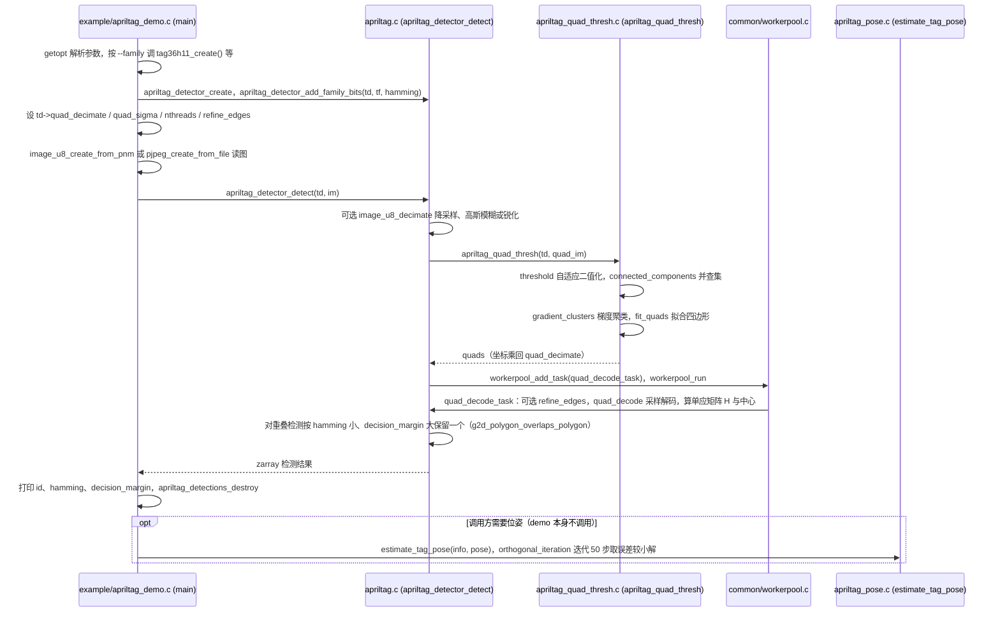

---

type: entity
tags: [perception, computer-vision, calibration, fiducial, c, software, mit]
status: complete
updated: 2026-09-15
code: https://github.com/AprilRobotics/apriltag
related:
  - ../queries/robot-perception-stack-selection-loop.md
  - ../methods/visual-servoing.md
  - ../tasks/manipulation.md
sources:
  - ../../sources/repos/april_tag.md
summary: "AprilTag 是机器人里常用的黑白视觉 fiducial：用普通打印机生成标记，检测库输出 ID 与相对相机的位姿；AprilRobotics 的 C 库（AprilTag 3）依赖极少，适合嵌入控制与标定管线。"
---

# AprilTag（视觉 fiducial 与检测库）

**AprilTag** 是一类为**机器人、相机标定与 AR** 设计的**视觉基准标记（visual fiducial）**系统：标记可用普通打印机制作，软件从图像中恢复每个标记的 **ID** 以及相对相机的 **6D 位姿**（位置与朝向），在光照与视角变化下仍保持工程上可用的鲁棒性。

当前广泛使用的参考实现是 GitHub 上的 **AprilTag 3** C 库（依赖极少、便于嵌入；需自行接入相机与图像采集）。

## 英文缩写速查

| 缩写 | 英文全称 | 简要说明 |
|------|----------|----------|
| Sim2Real | Simulation to Real | 把仿真中学到的策略迁移落地真机的工程主线 |
| API | Application Programming Interface | 应用程序编程接口 |
| SLAM | Simultaneous Localization and Mapping | 同步定位与建图 |
| Manipulation | Robot Manipulation | 抓取、移动、操作物体的任务总称 |

## 为什么重要

- **几何真值入口：** 给 PBVS、装配对齐、移动底座定位等提供**低延迟、可重复**的相对或全局位姿观测。
- **标定与手眼：** 官方材料长期将 **相机标定**（如 AprilCal 工作）列为典型应用；与「已知几何的平面目标」配合，标定流程可脚本化。
- **Sim2Real 与调试：** 在真机或场地布置固定标记，便于对齐仿真坐标系、检查外参漂移或作为多传感器融合的锚点。

## 核心机制（工程视角）

1. **编码与族（families）：** 不同「族」对应不同位数、布局与字典；README 建议**默认**使用 **tagStandard41h12**，预生成图像见 [apriltag-imgs](https://github.com/AprilRobotics/apriltag-imgs) 仓库。
2. **AprilTag 3 相对前代的增量：** 上游 README 概括为更快检测、小标签检测率提升、**flexible tag layouts**、内置 **pose estimation** 路径；并整合了若干 **ArUco** 族以便迁移。
3. **与 QR 的取舍：** 同类系统常强调「载荷更小 → 更远距离/更强检出」与「角点/边几何利于亚像素位姿」；不适合需要传大量文本或 URL 的场景。
4. **集成方式：** C API 为主，Python / OpenCV 示例与第三方 Matlab、Julia 绑定在 README 中有索引；调参（如 `quad_decimate`、`nthreads`）在速度与作用距离之间折中。

## 常见误区或局限

- **把标记当 SLAM 全部：** 单标记只解决「相对相机」或「已知地图中若干锚点」；大范围导航仍需里程计、地图或其他观测。
- **忽略物理尺寸：** 位姿估计需要**真实 tag 边长**与相机内参一致；打印缩放错误会直接变成系统性尺度误差。
- **混淆历史链接：** 密歇根 APRIL 实验室早期站点可能指向旧仓库名；以 **AprilRobotics/apriltag** 的 README 与发行版为准对接依赖。

## 源码运行时序图

入口：官方示例程序 `apriltag_demo --family tag36h11 --threads 1 --hamming 1 --decimate 2.0 <图像.pnm|jpg>`（`CMakeLists.txt` 由 `example/apriltag_demo.c` 构建；作为库使用时调用方自行调用同样的 `apriltag_detector_*` API）。

图依据：AprilRobotics/apriltag@b7c0ebe，读过 README.md、CMakeLists.txt（可执行目标）、example/apriltag_demo.c、apriltag.c（apriltag_detector_detect、quad_decode_task）、apriltag_quad_thresh.c（apriltag_quad_thresh 与函数清单）、apriltag_pose.c（estimate_tag_pose）。`quad_decode` 内部采样细节、`refine_edges` 与 Python 绑定（`apriltag_pywrap.c`）未读。

## 关联页面

- [Visual Servoing（视觉伺服）](../methods/visual-servoing.md) — 基于位置的伺服常需稳定 6D 目标位姿，AprilTag 是常见观测源
- [Manipulation（操作任务）](../tasks/manipulation.md) — 桌面操作、抓取对齐与数据采集中的基准布置

## 推荐继续阅读

- AprilTag 3 仓库 README（安装、OpenCV 示例、位姿 API）：<https://github.com/AprilRobotics/apriltag>
- 密歇根大学 APRIL 实验室 **AprilTag 软件总览**（论文索引、邮件列表、应用叙述）：<https://april.eecs.umich.edu/software/apriltag>
- Olson, *AprilTag: A robust and flexible visual fiducial system* (2011)：<https://april.eecs.umich.edu/papers/details.php?name=olson2011tags>

## 参考来源

- [AprilTag 资料归档](../../sources/repos/april_tag.md)

- 源码核对（2026-11-02）：AprilRobotics/apriltag@b7c0ebe，读过 README.md、CMakeLists.txt、example/apriltag_demo.c、apriltag.c、apriltag_quad_thresh.c、apriltag_pose.c；时序图依据以上文件，未运行代码。
