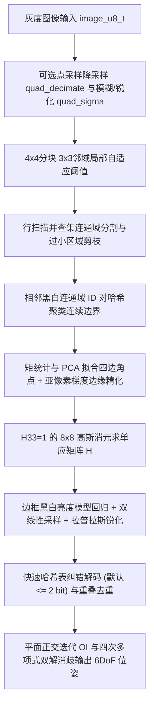
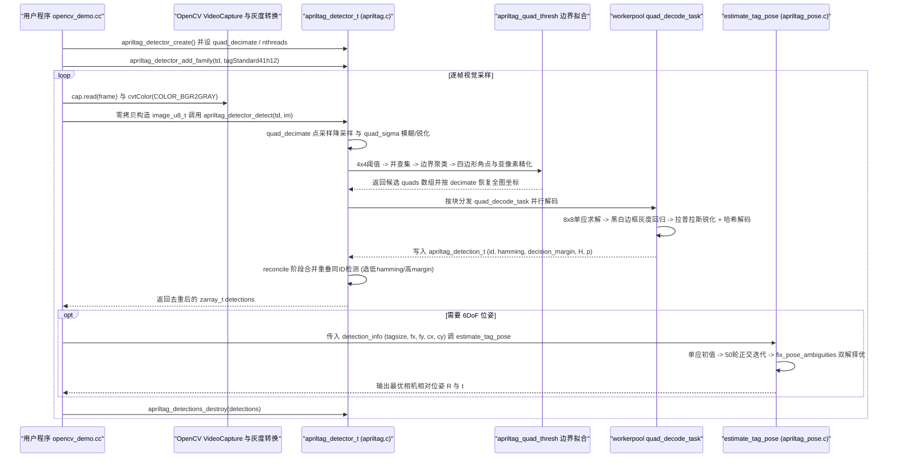

# AprilTag

[**AprilTag**](https://april.eecs.umich.edu/software/apriltag)（当前开源 C 参考实现为 [AprilRobotics/apriltag](https://github.com/AprilRobotics/apriltag)，即 **AprilTag 3**，BSD-2-Clause）是密歇根大学 APRIL Lab 发起并开源的 2D 黑白视觉基准标记（Visual Fiducial）与检测位姿估计系统。相比面向高字节数存储的二维码，AprilTag 聚焦**紧凑 ID 载荷（4–12 bit 量级）、高旋转鲁棒最小 Hamming 距离与低自然图像误检率**，是机器人手眼标定、工作台基准定位、多机协同参考与视觉伺服的工业/学术界常用基础设施。

## 一句话定义

**面向机器人标定与 6DoF 定位的轻量级视觉 Fiducial 系统** — 通过自研高熵几何复杂编码族、连续边界/并查集四边形检测、梯度边缘亚像素精化与正交迭代平面位姿消歧，在单目灰度图像上实时输出标签 ID 与相机相对位姿。

## 英文缩写速查

| 缩写 | 英文全称 | 简要说明 |
|------|----------|----------|
| Fiducial | Visual Fiducial Marker | 人造视觉基准标记，用于鲁棒特征匹配与已知尺度测距 |
| DoF | Degree of Freedom | 相机相对于标签的 6 自由度位姿（平移 + 旋转） |
| DLT | Direct Linear Transform | 根据四角点对应求解单应矩阵的线性变换方法 |
| PnP | Perspective-n-Point | 已知 3D-2D 点对求解相机外参的问题 |
| OI | Orthogonal Iteration | Lu 等人提出的平面 3D 目标空间迭代位姿精化算法 |
| SLAM | Simultaneous Localization and Mapping | AprilTag 常作为基准真值或闭环地标输入 |

## 为什么重要

1. **填补自然特征定位与物理尺度的确定性缺口：** 无纹理桌面、单目视觉或双臂协同场景下，自然特征点易漂移且缺绝对尺度；打印已知边长的 AprilTag 即可直接为手眼标定与视觉伺服（PBVS）提供无尺度歧义的 6DoF 观测。
2. **极简 C99 工程集成：** 核心库无强制外部视觉库依赖（不绑定 OpenCV），自带多线程 `workerpool` 与 `matd` 矩阵运算，可直接嵌入嵌入式 Linux、ROS/ROS 2 节点或 OpenCV/Python 流水线。
3. **跨代算法与灵活布局兼顾远近距场景：** AprilTag 3 通过 `uramaki`（外移数据位）、圆形标签与中心递归嵌套布局，使同一着陆标靶或圆形小型机器人既能兼顾大码容与高密小尺寸检测，又能覆盖近远百倍跨距。

## 核心原理

从 AprilTag 1（2011）到 AprilTag 2（2016）再到 AprilTag 3（2019），检测骨干由「梯度聚线搜四边形」演进为「分块自适应阈值 + 并查集连通域边界分段 + 快速哈希纠错 + 灵活布局与拉普拉斯锐化解码」：

### 演进与关键模块拆解

1. **防误检编码体系（Olson 2011 + Krogius 2019）：**
   - 在经典字典码基础上强制 0°/90°/180°/270° 四向旋转仍满足最小 Hamming 距离 $d$（纠错 $\lfloor(d-1)/2\rfloor$ 位），杜绝旋转混淆。
   - **复杂度过滤与灵活布局：** 初代采用矩形覆盖最小数量剔除条纹/纯色块等易在自然界出现的高误检图案；AprilTag 3 改用适应非方形/异形布局的 **Ising 边界能量**度量，并以 `w/b/d/x` 字符串定义标签，扩展出 `uramaki`（数据位外绕边框，如 `tagStandard41h12` 在 `9×9` 网格实现 2115 个 ID）、圆形族（`tagCircle21h7`/`49h12`）与递归嵌套族（`tagCustom48h12`）。
2. **高速四边形检测（Wang 2016 + Krogius 2019）：**
   - 放弃对边框部分遮挡的耗时长链搜索，改用 `4×4` 块极值自适应阈值与并查集连通域分割，并通过 `(r0, r1)` 黑白域配对键解决小标签 1 像素白隙粘连问题。
   - AprilTag 3 引入点采样降采样保留强边缘、象限-斜率排序替代 `atan2`、协方差最小特征值直算拟合误差以及 `H33=1` 的 8×8 线性方程替代 9×9 SVD。
3. **自适应采样解码与位姿消歧（`apriltag.c` / `apriltag_pose.c`）：**
   - 沿标签已知黑白边框分别拟合空间线性灰度模型 $I(x,y)=Ax+Bxy+Cy+D$ 消除光照不均，采样数据格中心时执行双线性插值并经 $3\times 3$ 拉普拉斯锐化（`decode_sharpening`），再通过预生成 2-bit 容错哈希表以 $O(1)$ 匹配输出 `id`、`hamming` 与 `decision_margin`。
   - 位姿估计模块 `estimate_tag_pose` 以单应分解为初值，执行 50 轮目标空间正交迭代（Lu 2000），并由 `fix_pose_ambiguities` 求解四次多项式以生成平面透视翻转的另一局部极小解，按误差择优防止近正视角轴向翻转误判。

## 实验与评测

基于三篇原始论文在自然无标靶数据集（LabelMe）与真实/仿真定位场景的公开评测结论：

| 评测维度 | 关键数据与对比基线 | 来源论文 |
|------|------|------|
| 自然场景误检抑制 | `36h11`（允许 2 bit 纠错）在 LabelMe 421,049 张图像上，AprilTag 2 候选 quad 由 51,075,971 降至 13,623,725，误检由 145 次降至 6 次（`0.000284%` -> `0.000044%`）；AprilTag 3 采用 Ising 能量生成 `41h12` 与 `21h7` 在 LabelMe 207,920 张图像上误检最低 | Wang 2016 / Krogius 2019 |
| 单核检测耗时 | Intel Xeon 2.5 GHz 上由 AprilTag 1 的 `0.374 us/px` 降至 AprilTag 2 的 `0.254 us/px`（VGA ~78 ms）；开启 `quad_decimate=2` 后降至 `0.072 us/px`（VGA ~22 ms）；i7-7600U 全参数扫描下 AprilTag 3 Recall-FPS 帕累托前沿优于 AprilTag 2 与 ArUco 3（`DM_FAST`） | Wang 2016 / Krogius 2019 |
| 有效测距与嵌套扩展 | 400×400 仿真测试中可稳定工作至 50 m（ARToolkitPlus 在 ~25 m 检出率跌破 50%）；使用 `90.2 cm` 双重递归嵌套 `tagCustom48h12` 与 640×480 树莓派相机 V2，可在 `0.08–16.15 ± 0.03 m` 连续定位无人机降落区 | Olson 2011 / Krogius 2019 |

## 源码运行时序图

入口：`example/opencv_demo.cc`（或标准 C 示例调用链 `apriltag_detector_create` -> `apriltag_detector_detect` -> `estimate_tag_pose`）

图依据：`AprilRobotics/apriltag@b7c0ebe`，实际核查过 `README.md`、`apriltag.h`、`apriltag.c`（`apriltag_detector_detect`、`quad_decode_task`、`quad_decode`、`reconcile`）、`apriltag_pose.c`（`estimate_tag_pose`、`estimate_tag_pose_orthogonal_iteration`、`fix_pose_ambiguities`）与 `example/opencv_demo.cc`。

## 工程实践

1. **首选码族与坐标系约定：** 官方 `README.md` 推荐通用场景首选 `tagStandard41h12`（较 `tag36h11` 拥有更大 ID 容量与更大 Hamming 距，且单元尺寸更大）；注意库内 `tagsize` 严格定义为**标签黑边框与白边框交界处**的物理外边长（单位由用户与位姿 `t` 保持一致，通常为米）。相机坐标系约定为 `+Z` 朝向镜头前方、`+X` 向右、`+Y` 向下，而标签坐标系 `+Z` 指向标签表面内部。
2. **关键超参数调优（`apriltag_detector_t`）：**
   - `quad_decimate`：高分辨率相机设为 `2.0` 可大幅降低延迟且几乎不损定位精度；极小远距目标则保持 `1.0`。
   - `nthreads`：设为物理核心数以加速 `quad_decode_task`。
   - `quad_sigma`：仅在高噪点环境下适当给 `0.8` 轻量高斯平滑；开启 `debug=1` 可直接导出 `debug_quads_raw.pnm` 与 `debug_samples.pnm` 排查采样对齐问题。
   - **最大纠错位数：** `apriltag_detector_add_family` 默认 `bits_corrected = 2`；对极高误检敏感的工业场景建议调用 `apriltag_detector_add_family_bits(..., 1)` 或 `0`。
3. **静默白边（Quiet Zone）与平面刚性：** 打印张贴时务必围绕编码外围保留至少 1 格完整白边，且标定板需贴合在刚性平整基板上，避免纸张卷曲引入系统性重投影残差与位姿翻转。

## 常见误区与局限

- **误区：位姿精度完全由检测库决定而忽略单标签翻面歧义：** 当标签正对相机或处于远距离小视角下时，平面四点透视存在天然的近对称双解（正交迭代局部极小翻转）；即便是 `fix_pose_ambiguities` 在噪声下仍可能跳变，高精度任务应采用多标签板（Tag Board）、OpenCV `SOLVEPNP_IPPE_SQUARE` 结合时间平滑或融合 IMU/里程计滤波。
- **误区：纠错位数越多召回率越划算：** 在纯 C/哈希快速解码限制下，提高纠错位数（尤其对窄 Hamming 距码族如 `tag16h5`）会令自然背景纹理误报率呈指数级飙升，实际工程严禁在高动态复杂背景下盲目使用 `tag16h5` 配 `2 bit` 纠错。
- **局限：无法应对严重遮挡、强运动模糊与动态反光：** AprilTag 2/3 架构明确舍弃了部分遮挡边框修复机制，若四角点边缘任一处被强反光截断或遮挡即直接漏检；运动高速场景需依赖短曝光、全局快门相机或外部预测 ROI。
- **局限：官方仅支持 Linux 主机开发：** 根据仓库 README，主线构建与维护以 Linux 为一等平台，Windows 依赖社区工具链适配，部署至微控制器时亦需注意 `workerpool` 对 POSIX 线程与动态内存的假定。

## 关联页面

- [Visual Servoing](../methods/visual-servoing.md)
- [Manipulation](../tasks/manipulation.md)
- [Hand-Eye Calibration](../concepts/hand-eye-calibration.md)
- [Camera Calibration, Zhang, Nine-Point & Hand-Eye](../concepts/camera-calibration-zhang-nine-point-hand-eye.md)
- [Perception Coordinate Postprocessing](../concepts/perception-coordinate-postprocessing.md)
- [机器人视觉感知栈选型闭环](../queries/robot-perception-stack-selection-loop.md)

## 参考来源

- [sources/repos/april_tag.md](../../sources/repos/april_tag.md) — `AprilRobotics/apriltag@b7c0ebe` C 参考库、API 与工程约定核查归档
- [sources/papers/apriltag_reading.md](../../sources/papers/apriltag_reading.md) — AprilTag (Olson 2011)、AprilTag 2 (Wang 2016)、AprilTag 3 (Krogius 2019) 三篇原文通读归档

## 推荐继续阅读

- 官方项目页：<https://april.eecs.umich.edu/software/apriltag>
- GitHub 源码仓库：<https://github.com/AprilRobotics/apriltag>
- 预生成图案库：<https://github.com/AprilRobotics/apriltag-imgs>
