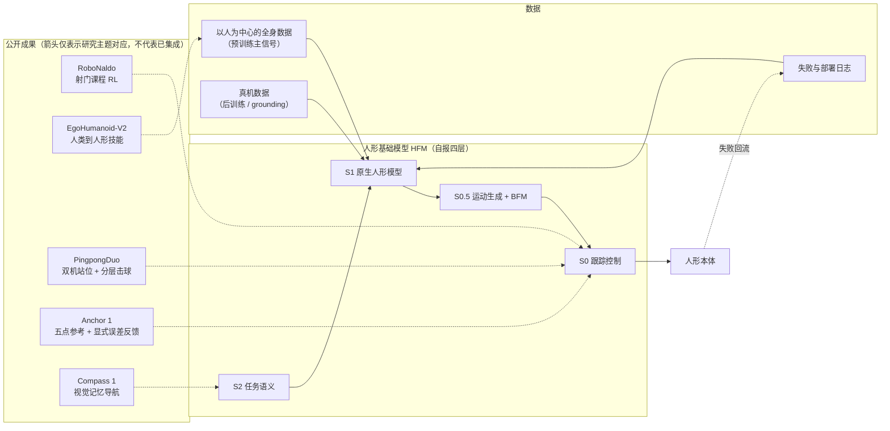

# 源策未来（Archon Robotics）

## 一句话定义

**源策未来（Archon Robotics，官网 archon.tech）** 是 2026 年 4 月成立（媒体口径）、研发总部在上海的人形机器人基础模型公司，由香港大学助理教授、OpenDriveLab 负责人 **李弘扬** 创办。公司以 **全身智能（Whole-Body Intelligence, WBI）** 为核心方向：提出以人类全身数据预训练人形基础模型（HFM）、再结合真机数据后训练的技术路线。2026 年 10–11 月官网陆续公开双机乒乓（PingpongDuo）、全身控制器（Anchor 1）与跨本体导航（Compass 1）；**不同项目是独立研究成果，官网未宣称已组合为一套完成开源的通用人形模型**。

## 英文缩写速查

| 缩写 | 英文全称 | 简要说明 |
|------|----------|----------|
| WBI | Whole-Body Intelligence | 全身智能；公司技术路线名，见 [WBI 详情页](./archon-whole-body-intelligence.md) |
| HFM | Humanoid Foundation Model | 人形基础模型；官网 Mission 中的产品目标 |
| CRO | Chief Robot Officer | 首席机器人官；李弘扬在公司的职位 |
| BFM | Behavior Foundation Model | 行为基础模型；官网称在做「情境感知 BFM」 |
| HKU | The University of Hong Kong | 香港大学；创始人任职单位，官网列为机构支持方 |
| SII | Shanghai Innovation Institute | 上海创智学院；种子轮投资方之一，李弘扬任导师 |
| ADS | Advanced Driving System | 华为乾崑智驾系统；CEO 李天羽曾参与 ADS 4.0 |
| RSS | Robotics: Science and Systems | 机器人顶会；2026 年公司与 OpenDriveLab 联合参会 |

## 为什么重要

- **自动驾驶团队整体转向人形的样本：** 三位创始人都来自端到端自动驾驶（UniAD 负责人、UniAD 第一作者、华为 ADS 4.0 核心开发者）。投资方评论直接把 UniAD「planning-oriented」类比为公司的「Human Body Learning」，可以观察智驾方法论能否迁移到人形。
- **全身运动路线逐步具象化：** WBI 提出 S2/S1/S0.5/S0 分层与人类全身数据预训练；[Anchor 1](./paper-anchor-1.md) 给出 S0 稀疏指令与反馈控制的实测案例，[PingpongDuo](./paper-pingpongduo.md) 则展示双机协同和分层技能。核心是人形，但 [Compass 1](./paper-compass-1-navigation.md) 另有跨轮式、四足、人形与无人机的导航验证。
- **学术与公司边界仍需区分：** RoboNaldo、EgoHumanoid-V2 及 2026 年 10–11 月官网 Research 公开的 PingpongDuo、Anchor 1、Compass 1 含合作机构成果；不能把所有 OpenDriveLab 论文都自动计为公司独立研发或可直接复现的产品。
- **开源边界可追踪：** RoboNaldo 训练/部署已在 OpenDriveLab 下开放；Anchor 1 的权重和部署计划 2026 年末发布，Compass 1 的数据、权重与部署预计 2026 年 12 月发布；截至 2026-11-16 仍应将这些计划与实际发布区分。

## 公司概况

| 项 | 内容 | 来源 |
|----|------|------|
| 名称 | 源策未来；英文 Archon Robotics；标语「以源为始 · 以策为径 · 通向未来」 | 官网 |
| 成立 | **2026 年 4 月**（官网未写；工商全称未找到） | 硬氪 2026-06-29、投中网 2026-06-29、港大 TEC 讲者页（**媒体口径**）；Gasgoo 写「2024 年 4 月」，判为笔误（推测） |
| 总部 | 研发总部 **上海市徐汇区漕河泾开发区** | 硬氪 2026-06-29（**媒体口径**）；港大 TEC 页「Shanghai-based」 |
| 团队规模 | 约 20 名研究员与工程师，来自港大、清华、上海交大及科技公司 | 官网 |
| 使命 | 为全身智能构建 HFM：让人形在真实世界中移动、感知、推理与行动的基础 AI 层（自报） | 官网 Mission |
| 研究平台 | 公开研究使用 Unitree G1、Booster K1 等合作方本体；官网未见自研整机产品发布 | PingpongDuo、Compass 1 项目页 |
| 渠道 | X [@archon_robotics](https://x.com/archon_robotics)；YouTube [@archon_robotics](https://www.youtube.com/@archon_robotics)；LinkedIn；招聘站 careers.archonrobotics.tech（「源策新星计划 / Archon Star Program」） | 官网页脚 |

### 创始团队

| 人物 | 职位 | 背景 | 来源 |
|------|------|------|------|
| **李弘扬**（Hongyang Li） | Founder & Chief Robot Officer (CRO) | 港大计算与数据科学学院助理教授、助理院长（AI Research & Tech Transfer），领导 OpenDriveLab；上海创智学院导师；UniAD（CVPR 2023 Best Paper）负责人，BEVFormer、AgiBot World；2026 RSS Early Career Spotlight | 官网；港大 TEC；硬氪 |
| **李天羽**（Tianyu Li） | Co-Founder & CEO | 华为 ADS 4.0 核心架构师（官网）/「世界引擎」方案核心开发者（硬氪）；WAIC Rising Star 2026；复旦大学博士、上海创智学院首批毕业生 | 官网；硬氪 |
| **陈立**（Li Chen） | Co-Founder & Head of AI | UniAD 第一作者；具身智能与世界模型；ECCV 2026 Area Chair；上海交大致远荣誉工程本科、港大校长博士奖学金 | 官网；硬氪 |

### 融资（媒体报道，官网只列机构 logo）

| 公布日期 | 轮次 | 金额 | 投资方 | 领投 | 财务顾问 | 来源 |
|----------|------|------|--------|------|----------|------|
| 2026-06-29 | 种子轮（投中网称「首轮」） | **数亿元人民币**（港大 TEC："nine-figure RMB"）；估值未披露 | 真格基金、高榕创投、IDG 资本、五源资本；戈壁创投与香港大学联名基金、奇绩创坛、上海创智学院 | **未披露** | 光源资本（独家） | 硬氪独家、36 氪英文快讯、投中网、Gasgoo |

- 官网 Investors 区 logo：ZhenFund、Gaorong、IDG Capital、5Y Capital、Gobi、HKU、MiraclePlus、SII，与媒体名单一致；官网不写轮次和金额。
- 资金用途（媒体）：全身人形基础模型研发、多模态全身动作数据采集、人才扩充、多地研发中心与产业合作生态。
- 截至 2026-10-10 未检索到其他轮次。完整链接见 [新闻归档](../../sources/blogs/archon_robotics_press.md)。

## 时间线

| 日期 | 事件 | 来源 |
|------|------|------|
| 2026-04 | 公司成立（媒体口径） | 硬氪、投中网、港大 TEC |
| 2026-06-09 | **[RoboNaldo](./paper-robonaldo-humanoid-soccer-shooting.md)** arXiv v1（2606.11092）；G1 运动引导课程 RL 射门，训练与部署代码在 OpenDriveLab | [论文](https://arxiv.org/abs/2606.11092) |
| 2026-06-29 | 公布数亿元种子轮；提出 2026 年内开放人形基础模型的目标 | 硬氪、投中网 |
| **2026-07-13** | **[Whole-Body Intelligence](./archon-whole-body-intelligence.md)**：S2/S1/S0.5/S0 分层、全身人体数据预训练路径（研究观点） | [官网 Research](https://www.archon.tech/research/whole-body-intelligence) |
| 2026-07-13 至 17 | RSS 2026：「Archon & OpenDriveLab」联合参会与 RoboNaldo 现场演示 | [官方 RSS 页面](https://opendrivelab.com/rss2026) |
| 2026-09-29 | **[EgoHumanoid-V2](./paper-egohumanoid-v2.md)** arXiv v1（2609.37181），人体到人形全身协调技能迁移 | [论文](https://arxiv.org/abs/2609.37181) |
| **2026-10-15** | **[PingpongDuo](./paper-pingpongduo.md)**：双台 G1 乒乓球双打，团队风险过滤站位 + 分层击球 | [官网 Research](https://www.archon.tech/research/pingpongduo) |
| **2026-10-30** | **[Anchor 1](./paper-anchor-1.md)**：五点稀疏指令、离线动作配对和独立跟踪误差反馈的全身控制器 | [官网 Research](https://www.archon.tech/research/anchor1) |
| **2026-11-09** | **[Compass 1](./paper-compass-1-navigation.md)**：长时视觉历史地图与异步导航，官方跨本体真机评测 | [官网 Research](https://www.archon.tech/research/compass1) |
| 2026-11-16 | 本库更新 Research 四项与六项公司路线节点，按实际开放状态区分论文/演示/部署 | [Research 核查归档](../../sources/sites/archon-research-2026-11.md) |

## 公司署名与官网 Research 成果（截至 2026-11-16）

**历史核查快照（2026-10-10）：** 当时按作者及机构检索后，确认下列两篇论文有 Archon Robotics 署名。该结论**仅对应当时的时间窗**，不代表 2026-11-16 仍只有两篇。此后官网 Research 公开三篇论文/项目，另列于下表，不能把官网栏目总数等同于公司全部署名论文总数。

| arXiv | 标题 | v1 日期 | Archon 署名作者 | 代码 | 本库页面 |
|-------|------|---------|-----------------|------|----------|
| [2606.11092](https://arxiv.org/abs/2606.11092) | RoboNaldo: Accurate, Stable and Powerful Humanoid Soccer Shooting via Motion-Guided Curriculum Reinforcement Learning | 2026-06-09 | Yixuan Pan、李天羽、李弘扬（李弘扬同时署港大） | ✅ `OpenDriveLab/RoboNaldo` + `RoboNaldo_Deploy`（在实验室组织下） | [RoboNaldo](./paper-robonaldo-humanoid-soccer-shooting.md) |
| [2609.37181](https://arxiv.org/abs/2609.37181) | EgoHumanoid-V2: Human-to-Humanoid Transfer of Coordinated Whole-Body Skills for Loco-Manipulation | 2026-09-29 | Modi Shi、Shijia Peng、陈立、李天羽（李弘扬署 OpenDriveLab@HKU） | ❌ 项目页标「Coming soon」 | [EgoHumanoid-V2](./paper-egohumanoid-v2.md) |

**2026-10-10 快照中已核查但未署名公司的相关论文**（作者有创始人，单位是港大 / OpenDriveLab 等）：AMS（2511.17373）、EgoHumanoid（2602.10106）、RISE（2602.11075）、SparseVideoNav（2602.05827）、GuidedVLA（2605.12369）、NativeMEM（2607.06678）、World Engine（2606.19836）等。其中 RISE、EgoHumanoid、GuidedVLA、NativeMEM、SparseVideoNav 出现在「Archon & OpenDriveLab at RSS 2026」页面，但论文本身没有 Archon 署名。

### 官网 Research 四项（按发布日期）

| 发布日期 | 类型 / 研究 | 技术位置 | 结果与开放状态 |
|---|---|---|---|
| 2026-07-13 | [WBI](./archon-whole-body-intelligence.md)（Perspective） | 人体全身预训练 + 真机后训练的全局路线 | 研究愿景；无可下载 HFM |
| 2026-10-15 | [PingpongDuo](./paper-pingpongduo.md)（X-Lab） | 双机团队站位 + 个体步法/击球技能 | 双台 G1 演示与仿真对照；未找到运行代码 |
| 2026-10-30 | [Anchor 1](./paper-anchor-1.md)（System 0） | 校准五点稀疏动作参考、独立误差反馈 | 真机精度/稳定性基准；权重和部署计划 2026 年末公开 |
| 2026-11-09 | [Compass 1](./paper-compass-1-navigation.md)（Navigation） | 单目视觉历史地图、结构化 VQA、异步视频动作 | Go2 真机 254/320（79.4%），对照 17.8%；展示仓已公开，数据/部署/权重计划 2026-12 |

官网目录见 [Research](https://www.archon.tech/research)，独立核验记录见 [来源归档](../../sources/sites/archon-research-2026-11.md)。上表是**不同研究主题**，不是声称它们已经整合为同一个部署栈。

## 核心原理：全身智能路线（摘要）

详见 [WBI 详情页](./archon-whole-body-intelligence.md)。

- **首页四要点（自报）：** WBI 框架；面向带地形交互的移动操作的情境感知 BFM；大规模人类全身数据预训练；真机数据高效后训练。
- **媒体访谈三层（自报）：** 大脑（任务理解、长程规划）/ 中脑（跨本体全身运动表征，输出全身轨迹而非特定机型关节角）/ 小脑（实时跟踪与平衡）。与博文 S2 / S1+S0.5 / S0 大致对应（推测）。
- **Human Body Learning：** 学人类全身位姿与协调方式，而非只跟踪末端轨迹；访谈称「一条覆盖重心移动、躯干角度变化的全身数据，信息密度远高于一百条只有手部轨迹的桌面数据」（自报）。

## 开源与开放状态（2026-11-16）

| 渠道 / 项目 | 已验证状态 | 依据 |
|-------------|------------|------|
| WBI 观点文章 | 研究愿景与结构图，没有公开完整 HFM 的可运行实现 | [Research](https://www.archon.tech/research/whole-body-intelligence) |
| [RoboNaldo](./paper-robonaldo-humanoid-soccer-shooting.md) | **已开放**训练和 G1 部署实现；代码位于 OpenDriveLab 组织 | [RoboNaldo 仓库](https://github.com/OpenDriveLab/RoboNaldo) |
| [EgoHumanoid-V2](./paper-egohumanoid-v2.md) | 既有核查显示项目页代码待发布；本次未复查其最新代码状态 | [论文](https://arxiv.org/abs/2609.37181) |
| [PingpongDuo](./paper-pingpongduo.md) | 官网提供论文、视频、3D 回放；**未发现运行代码入口** | [项目页](https://www.archon.tech/research/pingpongduo) |
| [Anchor 1](./paper-anchor-1.md) | 权重、部署、PICO 遥操作与示范采集工具均标记 **预计 2026 年末**，目前 GitHub/HF 按钮显示 Available soon | [项目页](https://www.archon.tech/research/anchor1) |
| [Compass 1](./paper-compass-1-navigation.md) | [OpenDriveLab/Compass](https://github.com/OpenDriveLab/Compass) 已公开 README/研究展示；数据、部署代码与真机权重仍为 **2026 年 12 月预计** | [项目页](https://www.archon.tech/research/compass1) / [README](https://github.com/OpenDriveLab/Compass) |
| 公司自身 GitHub / Hugging Face 组织 | 2026-10-10 历史核查为 0 公开仓库/模型；**本次未重新完成组织级核查**，不作为今日实时结论 | [旧核查](../../sources/sites/archon-tech.md) |

**结论：** 已有论文、真机演示和部分研究仓库，**不等于 WBI 全栈通用模型已开放**。官方未来发布日期属于预期，不能当作可复现发布。

## 与港大 OpenDriveLab 的关系

- **人员重叠：** 李弘扬领导 OpenDriveLab；陈立是 UniAD 第一作者、实验室出身；李天羽、陈立是自动驾驶后训练论文 World Engine（arXiv 2606.19836，2026-06-18，含华为 ADS 实验，即硬氪所说「世界引擎」）的第一、第二作者，该论文单位中没有 Archon。真格基金评论称 OpenDriveLab「成为人才山谷」，两位联合创始人「正是其中的杰出代表」。
- **品牌并列：** OpenDriveLab 官网有「Archon & OpenDriveLab at RSS 2026」页面，三位创始人以 Archon 职位演讲。
- **论文归属以 arXiv 署名为准：** UniAD、BEVFormer、[AgiBot World](./agibot-world-2026.md)、[AMS](../methods/ams.md)、[EgoHumanoid](./paper-loco-manip-161-060-egohumanoid.md)、[RISE](./paper-sa-2602-11075-rise-self-improving-robot-policy-with-compositio.md) 等是实验室或合作方的学术成果，多数早于公司成立。高榕创投的投资方评论把 UniAD、WorldEngine、Agibot、WholeBodyVLA、Ego-humanoid 都算作「源策团队」成果；WBI 中文博文把 AMS 称为「Archon 方案原型」。这些都是公司 / 投资方叙事，本库只把 arXiv 列出 Archon 单位的论文计为公司成果。
- **项目页托管：** 两篇署名公司的论文，项目页都在 opendrivelab.com，代码（如有）也在 OpenDriveLab GitHub 组织下。

## 工程实践

| 场景 | 建议 |
|------|------|
| 复现现有开源实现 | 优先看 [RoboNaldo](./paper-robonaldo-humanoid-soccer-shooting.md) 的训练与真机部署仓；其他项目逐一核查，不以论文发表替代可运行性 |
| 精确遥操作 / 全身追踪 | 参考 [Anchor 1](./paper-anchor-1.md) 的五点稀疏参考和独立误差反馈；源码和权重发布前暂不写未经核对的运行命令 |
| 双机器人协同 | 用 [PingpongDuo](./paper-pingpongduo.md) 的风险过滤站位及分层击球设计分析系统，但论文/视频不等于现成可用 SDK |
| 长时导航 | [Compass 1](./paper-compass-1-navigation.md) 提供单目 RGB + 历史关键帧/地图的评测思路；仓库目前是研究展示入口，需等待官方发布可运行资源 |
| 规划整套人形架构 | [WBI](./archon-whole-body-intelligence.md) 作为分层路线参考，不假定四项 Research 已有成熟可互联接口 |
| 行业研究 | 成立日期仍采用「2026-04（媒体口径）」；论文学术归属与公司研究展示分别标注，避免过度归因 |

## 局限与风险

- **研究并非单一系统：** 四项 Research 内容涉及预训练路线、团队体育控制、精确跟踪与长时导航；未公开统一训练与部署接口。
- **实验协议差异：** Compass 1 的 79.4% 来自特定 Go2 实地导航任务；Anchor 1 报告不同全局/局部跟踪误差；PingpongDuo 有仿真与真机两类指标，不能直接横向排名。
- **开源不完整：** 除 RoboNaldo 已有可运行训练和部署入口外，Anchor 1/Compass 1 的关键资源仍列为计划发布，PingpongDuo 未给代码；不能用展示仓代替模型和部署的实测。
- **机构边界：** 多项研究由 Archon、HKU、SII、OpenDriveLab 等合作团队开展，不应直接归为公司独家成果。
- **成立/投资信息来源性质：** 成立时间、融资金额仍来自媒体；官网未给出同口径工商信息。

## 关联页面

- [全身智能 WBI（博文详情）](./archon-whole-body-intelligence.md)
- [RoboNaldo 人形射门](./paper-robonaldo-humanoid-soccer-shooting.md) · [EgoHumanoid-V2](./paper-egohumanoid-v2.md) — 署名公司的两篇论文
- [EgoHumanoid](./paper-loco-manip-161-060-egohumanoid.md) · [RISE](./paper-sa-2602-11075-rise-self-improving-robot-policy-with-compositio.md) · [AMS](../methods/ams.md) — OpenDriveLab 相关学术工作
- [UniAD](./paper-uniad.md) · [AgiBot World 2026](./agibot-world-2026.md) — 创始人的代表性学术成果
- [Helix 02](./helix-02.md) · [西湖机器人](./westlake-robotics.md) — 产业对照
- [行为基础模型](../concepts/behavior-foundation-model.md) · [Loco-Manipulation](../tasks/loco-manipulation.md) · [人形足球](../tasks/humanoid-soccer.md)
- [国内具身智能实验室三层地图 2026](../overview/china-embodied-ai-labs-landscape-2026.md)
- [PingpongDuo](./paper-pingpongduo.md) — 双台 G1 乒乓球双打；[Anchor 1](./paper-anchor-1.md) — 精准稳定全身控制；[Compass 1](./paper-compass-1-navigation.md) — 长时视觉历史导航

## 参考来源

- [Research 四项与开放状态核查（2026-11-16）](../../sources/sites/archon-research-2026-11.md)
- [源策未来官网历史核查（2026-10-10）](../../sources/sites/archon-tech.md)
- [WBI 博文来源归档](../../sources/blogs/archon_whole_body_intelligence.md)
- [成立与融资报道归档](../../sources/blogs/archon_robotics_press.md)
- [RoboNaldo 论文归档](../../sources/papers/robonaldo_arxiv_2606_11092.md)
- 硬氪独家（2026-06-29）<https://www.36kr.com/p/3868055841641476>
- 投中网（2026-06-29）<https://www.chinaventure.com.cn/news/114-20260629-392047.html>
- 港大 TEC 讲者页 <https://tec.hku.hk/?p=903871>
- Archon & OpenDriveLab at RSS 2026 <https://opendrivelab.com/rss2026>
- arXiv：[2606.11092](https://arxiv.org/abs/2606.11092)、[2609.37181](https://arxiv.org/abs/2609.37181)

## 推荐继续阅读

- [源策未来 Research](https://www.archon.tech/research) — 四项官方研究入口与发布日期
- [Whole-Body Intelligence 博文](https://www.archon.tech/blog/whole-body-intelligence) — 公司技术路线全文
- [硬氪独家融资报道与访谈](https://www.36kr.com/p/3868055841641476) — 三层架构与数据路线的创始人原话
