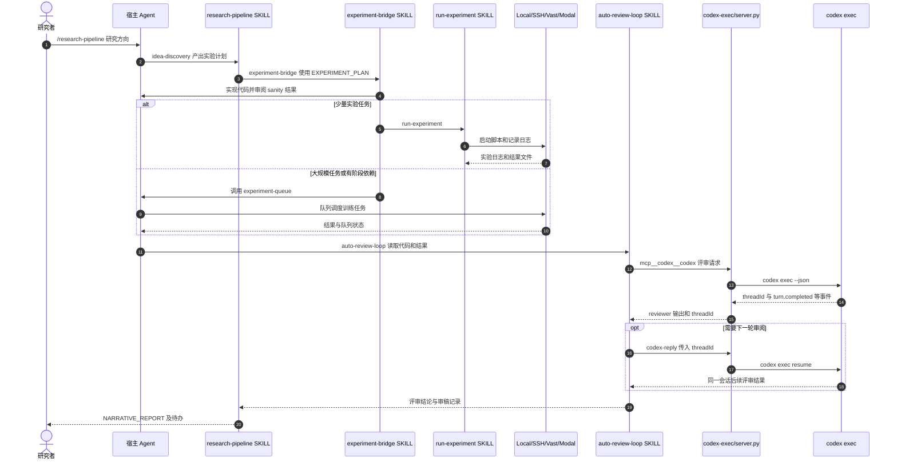

# ARIS — Auto-Research-In-Sleep（自动科研技能流程）

## 一句话定义

**ARIS** 将 `idea-discovery`、`experiment-bridge`、`auto-review-loop` 与论文写作组织为可组合的 Markdown Skill 工作流，支持科研代理执行实验与独立模型复核；并不保证无人监管的科研结论有效。

## 英文缩写速查

| 缩写 | 英文全称 | 简要说明 |
|---|---|---|
| ARIS | Auto-Research-In-Sleep | 官方项目名称 |
| GPU | Graphics Processing Unit | 自动实验的可计费或有限计算资源 |
| MCP | Model Context Protocol | ARIS 的 reviewer/工具接入通道 |
| W&B | Weights & Biases | 可选实验日志与指标跟踪平台 |

## 为什么重要

对于机器人强化学习或消融实验，大量重复配置、运行、日志收集与审稿修订可以被结构化代理辅助。**但夜间运行的核心风险是算力、错误实验和权限边界**，因此预算和停止条件需由人明确核验。

## 核心原理

1. `/research-pipeline` 的主路径由选题/文献 → `/experiment-bridge` 计划转代码和部署 → `/auto-review-loop` 独立评审与修订 → 论文写作组合而成；阶段互相有条件交接。
2. `/experiment-bridge` 阅读 `EXPERIMENT_PLAN.md`，按 sanity、baseline、main、ablation 顺序实现，并可在代码审阅后部署。默认 `SANITY_FIRST=true`、`CODE_REVIEW=true`，同时 `AUTO_DEPLOY=true`。
3. `/auto-review-loop` 的 `MAX_ROUNDS=4`；最新 Skill 明确终止条件同时要求评分阈值及 verdict，独立评审的有效性取决于实际 reviewer 返回。
4. `docs/CUSTOMIZATION.md` 的 `MAX_TOTAL_GPU_HOURS=8` 属于 **idea discovery 的 pilot**，绝不应当作后续 `experiment-bridge`、`run-experiment` 或任意云 GPU 费用的全局硬上限。
5. `research-pipeline/SKILL.md` 明确 `AUTO_WRITE=false` 为默认值：实验/审阅到 Stage 4 产出 `NARRATIVE_REPORT.md` 为止，写论文需要另外选择或启用 `AUTO_WRITE=true`，不是自动投稿。

## 流程总览

这是 `skills/research-pipeline/SKILL.md`、`experiment-bridge/SKILL.md` 与官方定制文档的阶段逻辑图，**不是**所有底层 GPU/多代理代码都已证实的运行轨迹。

## 源码运行时序图

基于 `research-pipeline`、`experiment-bridge`、`run-experiment` 的官方 Skill 入口，以及实际 `mcp-servers/codex-exec/server.py` 的 `handle_call`、`build_argv`、`run_codex` 与 `codex-reply`。展示 Claude Code + **默认 Codex MCP reviewer** 的一条已核实条件路径，其他宿主/后端会不同。

上图不是运行测试截图；`run-experiment` 在本地使用 Python 进程，在远程 SSH/Vast.ai 路线使用 `screen`，Modal 路线委托 `serverless-modal`。除默认 Codex 外还支持可选择 reviewer，且只有符合审稿独立性门禁的结果才可获得相应接受状态。

## 工程实践

官方 `docs/CUSTOMIZATION.md` 默认参数：

| 作用域 | 配置 | 官方默认值 |
|---|---|---|
| 选题 Pilot | `PILOT_MAX_HOURS` | 2h |
| 选题 Pilot | `PILOT_TIMEOUT_HOURS` | 3h |
| 选题 Pilot | `MAX_TOTAL_GPU_HOURS` | 8h |
| 实验 Bridge | `AUTO_DEPLOY` | true |
| 实验 Bridge | `MAX_PARALLEL_RUNS` | 4 |
| Review Loop | `MAX_ROUNDS` | 4 |

对机器人实验建议先设 `AUTO_DEPLOY=false`、明确总 GPU-hour / 费用上限、单次 timeout、最大迭代次数、异常时停机与保存日志规则。**这些建议不是 ARIS 全局保证**，应由外部任务调度或云平台配额实际强制。

## 局限与风险

- 核心技术原文已阅读并核对运行路径，但主 README 的冗长历史更新记录和全仓库 87 个技能没有逐一验证；不把本页 3/3 文档健康度等同于全仓源码或 GPU 测试合格。
- review 分数不等于实验可复现，也不等于真实论文被接收。
- 远程 GPU、密钥、自动部署以及外部模型审阅带来费用和权限风险；需在宿主侧设置独立硬限制。默认 `AUTO_DEPLOY=true` 并非用户确认费用的机制。
- 本项目是 ML 科研工作流工具，不是机器人真实时间控制系统。

## 关联页面

- [karpathy/autoresearch](karpathy-autoresearch.md)：固定单一训练脚本和度量的可控实验循环。
- [Supervisor-Skills](supervisor-skills.md)：科研方法与论文辅导型 Skills。
- [PaperSpine](paperspine.md)：论文贡献、Motivation 与文稿交付。
- [nature-polishing](nature-polishing.md)：证据约束的语言润色。
- [AI Auto-Research](../concepts/ai-auto-research.md)：跨阶段科研代理总体风险。

## 参考来源

- [ARIS 原仓库归档](../../sources/repos/aris.md)
- [wanshuiyin/Auto-claude-code-research-in-sleep](https://github.com/wanshuiyin/Auto-claude-code-research-in-sleep)

## 推荐继续阅读

- [ARIS Agent Guide（技术路由总入口）](https://github.com/wanshuiyin/Auto-claude-code-research-in-sleep/blob/8f3110718259/AGENT_GUIDE.md)
- [run-experiment 实际部署入口](https://github.com/wanshuiyin/Auto-claude-code-research-in-sleep/blob/8f3110718259/skills/run-experiment/SKILL.md)
- [Codex MCP Bridge 源码](https://github.com/wanshuiyin/Auto-claude-code-research-in-sleep/blob/8f3110718259/mcp-servers/codex-exec/server.py)
- [ARIS Customization（预算与权限）](https://github.com/wanshuiyin/Auto-claude-code-research-in-sleep/blob/8f3110718259/docs/CUSTOMIZATION.md)
- [实验桥接入口](https://github.com/wanshuiyin/Auto-claude-code-research-in-sleep/blob/8f3110718259/skills/experiment-bridge/SKILL.md)
