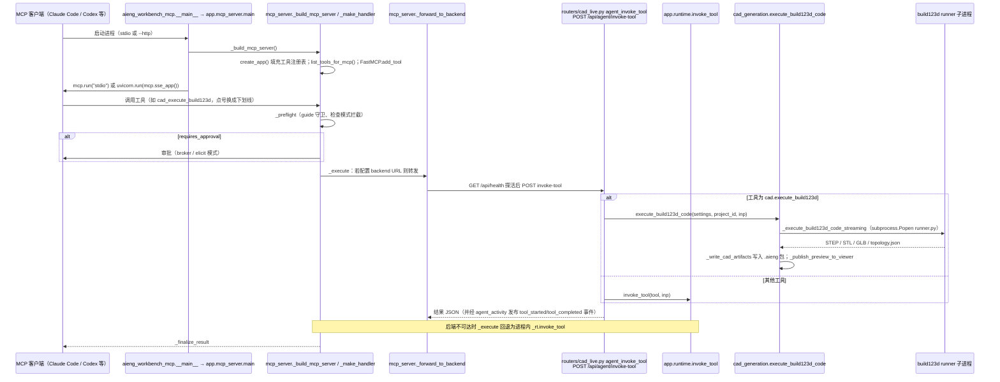

# CAD CAE Copilot（armpro24-blip/cad-cae-copilot）

## 一句话定义

CAD CAE Copilot（armpro24-blip/cad-cae-copilot）是以自然语言生成 CAD/CAE 任务，使用 build123d 与 OpenCASCADE 创建真实可编辑几何，包含参数、稳定拓扑引用、确定性检查和 MCP 工具。

## 英文缩写速查

| 缩写 | 英文全称 | 简要说明 |
|------|----------|----------|
| CAD | Computer-Aided Design | 计算机辅助设计与几何建模 |
| MCP | Model Context Protocol | 代理调用 CAD/可视化工具的协议 |
| FEM | Finite Element Method | 结构有限元分析方法 |

## 为什么重要

对 CAE 自动化而言，代理能否稳定完成任务，取决于工程步骤是否清楚、工具边界是否明确、结果是否保留可审查证据。以自然语言生成 CAD/CAE 任务，使用 build123d 与 OpenCASCADE 创建真实可编辑几何，包含参数、稳定拓扑引用、确定性检查和 MCP 工具。

## 核心原理

**项目自身范围：** AI-native CAD/CAE workbench for text-driven geometry and simulation tasks.

**工作流：** 将文本意图转换为参数化几何，再通过拓扑引用和规则检查约束模型；MCP 让代理调用建模与审查工具。

## 工程实践

1. 从目标问题识别所需的 Skill、MCP、CLI 或软件接口，不把指导文件当成求解器。
2. 依照仓库 README 检查安装前提、软件/许可证、输入文件和输出证据。
3. 小规模运行并逐项核对几何、网格、边界、求解状态和物理量，再决定是否扩大任务。

文章所述的项目特征：以自然语言生成 CAD/CAE 任务，使用 build123d 与 OpenCASCADE 创建真实可编辑几何，包含参数、稳定拓扑引用、确定性检查和 MCP 工具。

## 局限与风险

自然语言建模的几何正确性仍需检查；文本提示不提供公差、制造可行性或结构安全保证。

源码状态核验：该 GitHub 仓库于 2026-10-07 可公开访问。仓库 API 报告许可证为 MIT。 

## 源码运行时序图

入口：`aieng-workbench-mcp`（即 `python -m aieng_workbench_mcp`，`--http` 为 SSE，默认 stdio；`--backend-url` 可选转发到 FastAPI 后端 `uvicorn app.main:app`）

图依据：armpro24-blip/cad-cae-copilot@b98b4d5，读过 `README.md`、`aieng-ui/backend/pyproject.toml`、`aieng_workbench_mcp/__main__.py`、`app/mcp_server.py`、`app/main.py`、`app/runtime.py`、`app/routers/cad_live.py`、`app/cad_generation.py`（部分段落）。

## 关联页面

- [CAE / CFD 代理工具项目总览](../overview/cae-cfd-agent-skills-landscape.md)
- [AnkusDrive](./gchen19-ankusdrive.md)

## 参考来源

- [公众号文章原始资料归档](../../sources/blogs/wechat_cae_cfd_agent_skills_2026-10-07.md)
- [GitHub 仓库资料归档](../../sources/repos/armpro24-blip-cad-cae-copilot.md)
- [armpro24-blip/cad-cae-copilot 官方仓库](<https://github.com/armpro24-blip/cad-cae-copilot>)
- 源码核对（2026-11-02）：armpro24-blip/cad-cae-copilot@b98b4d5，读过 README.md、aieng-ui/backend/pyproject.toml、aieng_workbench_mcp/__main__.py、app/mcp_server.py、app/main.py、app/runtime.py、app/routers/cad_live.py、app/cad_generation.py（部分）；时序图依据以上文件，未运行代码。

## 推荐继续阅读

- [项目 README](<https://github.com/armpro24-blip/cad-cae-copilot/blob/main/README.md>)