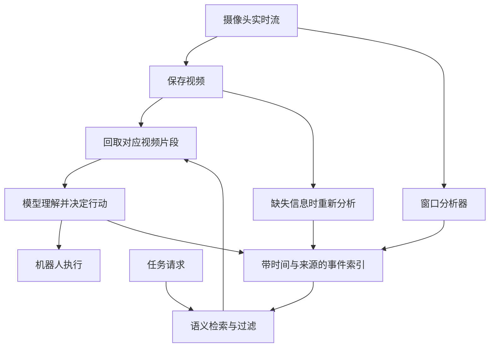
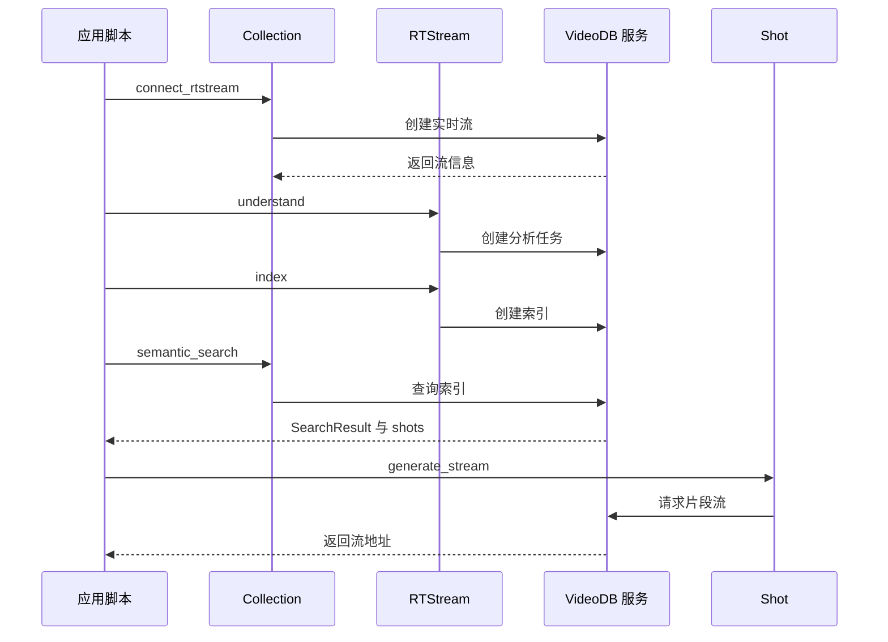

# How a robot remembers：机器人外部视频记忆

VideoDB 的文章提出：将摄像头视频与可查询的带时间索引结合，让模型按任务回看片段，并把分析结果写回索引。

## 英文缩写速查

| 缩写 | 英文全称 | 简要说明 |
| --- | --- | --- |
| VLA | Vision-Language-Action | 将视觉与语言条件映射为机器人动作的模型 |
| VLM | Vision-Language Model | 处理视觉与语言的模型 |
| RTSP | Real Time Streaming Protocol | 摄像头实时流协议 |
| SDK | Software Development Kit | 调用服务的软件开发工具包 |

## 流程总览

这是文章所述架构和示意流程，不代表完整真机系统已公开或实测。索引结果指向画面，模型仍需判断对象身份与环境是否改变。

## 记忆分层

| 文章用语 | 内容与作用 | 边界 |
| --- | --- | --- |
| 实时 | 持续接入视频，分析并更新索引 | 作者描述存在数秒处理滞后 |
| 长期 | 人物、物体、地点和时间等事件记录及视频指针 | 分析器可能误识别，记录可能过时 |
| 短期 | 按当前任务从历史中取回的几秒画面 | 与策略内部控制频率的近期观测缓存是两回事 |

找瓶子示例先检索人喝水的记录确定候选瓶子，再按时间找最近位置，回看画面确认细节。若索引缺项，可重新分析历史画面并创建新索引；再次询问时可复用。任务结论也可能出错，不能自动视为事实。

## 工程判断与限制

- 文章是厂商观点和产品说明；找瓶子是示意，没有报告该系统的真机闭环成功率。
- 厂商报告同区域生成视频流中位数约 **433–447 ms**，适用于所述测试窗口，且不包括模型推理、网络全链路和机器人动作；不能作为控制周期或端到端保证。
- 部署时应测量检索召回、跨摄像头身份一致性、记录过期和模型推理成本，并在执行前重新观察环境。视频留存涉及隐私、权限和存储成本。
- 官方公开 [Python SDK](https://github.com/video-db/videodb-python)，但文章未提供完整找瓶子机器人应用；SDK 开源不代表 VideoDB 服务端或整个机器人方案开源。

## 源码运行时序图

以下根据 [Python SDK 源码](https://github.com/video-db/videodb-python/tree/9d6e55fb6115d6b210d7609105dd2601115b98ad) 和文章示例整理客户端请求；服务端内部处理不可见。

入口为文章的 Python 示例；`collection.py`、`rtstream.py` 和 `shot.py` 中这些方法发送服务请求。未运行在线服务或验证文章示例的完整可执行性；机器人动作和结论写回未实现于上述片段。

## 关联页面

- [MEM 多尺度具身记忆](./paper-pai-2603-03596-memmultiscaleembodiedmemory.md)：策略内短时视频与长期语言记忆。
- [MemER](./paper-memer.md)：为机器人控制选择历史关键帧。

## 参考来源

- [VideoDB 原文归档](../../sources/blogs/videodb_how_a_robot_remembers_2026-10-27.md)

## 推荐继续阅读

- [原文](https://videodb.io/blog/how-a-robot-remembers)
- [官方帧访问测试](https://videodb.io/blog/frame-access-that-keeps-research-moving)
