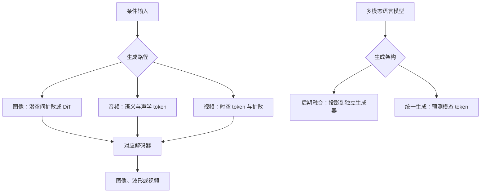

# A Visual Guide to Multimodal Generation

## 一句话定义

这篇图解教程梳理图像、音频、视频的生成机制，以及语言模型如何连接或统一这些生成能力。

## 英文缩写速查

| 缩写 | 英文全称 | 简要说明 |
| --- | --- | --- |
| LLM | Large Language Model | 大语言模型 |
| VAE | Variational Autoencoder | 用编码器和解码器处理潜变量的自编码器 |
| DiT | Diffusion Transformer | 使用 Transformer 骨干的扩散模型 |
| VQ | Vector Quantization | 将向量映射到离散码本 |
| RVQ | Residual Vector Quantization | 逐级量化残差 |

## 流程总览

下面是文章的知识组织图：各分支是不同模型范例，不是一个可直接运行的统一系统。

## 三类生成机制

| 模态 | 文中代表路径 | 关键点 |
| --- | --- | --- |
| 图像 | Stable Diffusion、DiT | VAE 将图像压入潜空间；条件去噪后解码。DiT 将潜张量分块，利用 Transformer 与时间等条件预测去噪量。 |
| 音频 | AudioLM | w2v-BERT 提取语义 token，SoundStream 的残差量化得到声学 token；分级 Transformer 先预测语义，再生成粗、细声学 token，最后解码成波形。 |
| 视频 | Latte | 视频含时间维度；文章比较逐帧 patch 与时空 tubelet，并介绍交替处理空间和时间的 Transformer 块。不同视频模型的条件和采样方式各异。 |

扩散训练中向数据加噪并学习预测目标；生成时从噪声出发迭代采样。文本条件通过网络引导预测，不能严格理解为简单删除所有与文字无关的内容。

## 与语言模型结合

- **后期融合**：模型输出文本提示或经投影的表示，交给独立的模态生成器。文中以 NExT-GPT 说明模态专用输入、输出投影器和预训练生成器的连接。
- **统一生成**：共享自回归主干生成文本或图像 token，再由相应解码器还原。Janus 对图像理解和图像生成使用不同视觉编码路径；文章将其作为统一生成的例子。
- 这是文章的分类方式，不意味着统一模型一定比模块化系统更准确；成本和效果依赖具体模型、训练数据与评测。

## 局限与阅读提示

- 文章是教学综述，不是单个模型的实验论文；文中不同模型的架构与实验结论不能直接相互套用。
- Transformer 可处理连续向量，离散音频 token 是 AudioLM 采用的建模选择，不能推广为 Transformer 的普遍要求。
- 本文主要讨论图像、音频和视频生成，并未给出机器人动作生成或真机实验；迁移到 VLA 或世界模型需另外验证。

## 源码运行时序图

不适用：文章综述多个独立模型，并未提供文章对应的统一可运行实现；各模型源码和入口需要分别查阅，不能画成一条实际调用链。

## 关联页面

- [扩散模型](../concepts/diffusion-model.md)
- [Diffusion Transformer](../concepts/diffusion-transformer.md)

## 参考来源

- [文章归档](../../sources/blogs/visual_multimodal_generation_2026-10-29.md)

## 推荐继续阅读

- [文章原文及参考文献](https://newsletter.maartengrootendorst.com/p/a-visual-guide-to-multimodal-generation)
