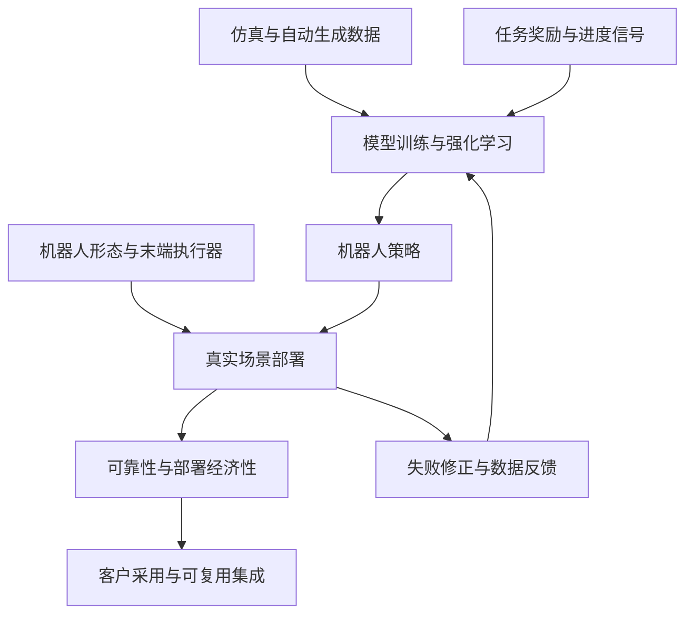

# Where Physical AI Is Heading（Physical AI 将走向何方）

Alex 的文章从数据、机器人形态和经济性三个角度提出对 Physical AI 的发展预测，并将实际部署视为价值来源。

## 英文缩写速查

| 缩写 | 英文全称 | 简要说明 |
| --- | --- | --- |
| AI | Artificial Intelligence | 人工智能 |
| RL | Reinforcement Learning | 通过环境交互和奖励学习策略 |
| RaaS | Robots as a Service | 以持续服务或按任务计费的机器人交付模式 |
| VLA | Vision-Language-Action | 结合视觉、语言和动作的机器人模型 |

## 观点关系图

图中是对文章论证的概括，其中反馈和仿真规模化是作者提出的路径，不代表文中已验证完整闭环。

## 数据与训练

- 作者预测仿真将成为主要数据来源：自动生成环境、仿真交互和模型提供奖励可能降低数据生成成本。他引用仿真训练案例，但这些案例不能证明所有任务都能以仿真取代真实数据。
- 长任务的稀疏奖励、模型奖励错误，以及接触、形变和视觉的仿真偏差会限制迁移。需以真机评估检验，而非只看仿真成功率。

## 形态与部署

- 作者认为人手数据与人类环境让灵巧手在近期有优势；同时指出耐用性问题。长期设想是联合优化机器人形态与策略，但依赖更可靠的仿真和跨形态控制能力。
- 部署决策应考虑人工成本、机器人与算力成本、故障损失、接管和维护。作者将 RaaS 视为降低客户前期投入风险的方式，并认为可复用集成和现场反馈可能形成壁垒。
- 算力集中导致少数基础模型供应商主导、以及开源生态的地区分布，均为作者的产业预测；现有示例不足以证明其必然发生。

## 源码运行时序图

不适用：本文是个人观点文章，没有对应的可运行实现；文中引用的第三方项目各自独立。

## 关联页面

- [机器人仿真三层分工](../concepts/robot-simulation-three-layers.md)：检查物理、场景与学习框架的边界。
- [Sim2Real](../concepts/sim2real.md)：分析仿真迁移到真机的误差来源。
- [Eka Robotics VFA](./eka-robotics-vfa.md)：文中提及的仿真强化学习案例。

## 参考来源

- [原文资料记录](../../sources/blogs/alex_where_physical_ai_is_heading_2026-11-05.md)

## 推荐继续阅读

- [Where Physical AI Is Heading 原文](https://x.com/AIex_3/status/2118059565388607533)
