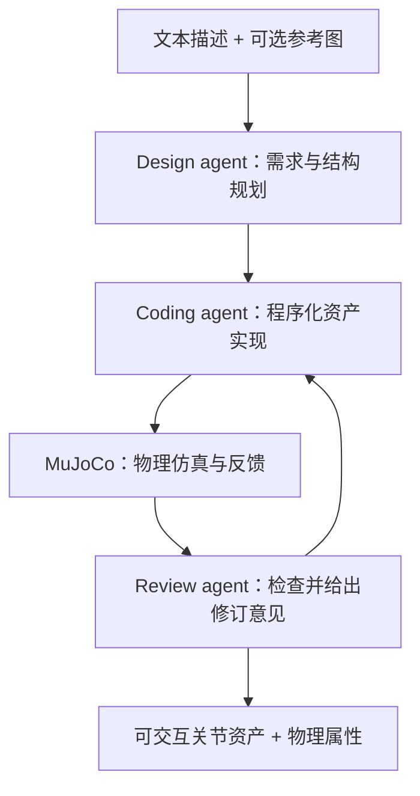
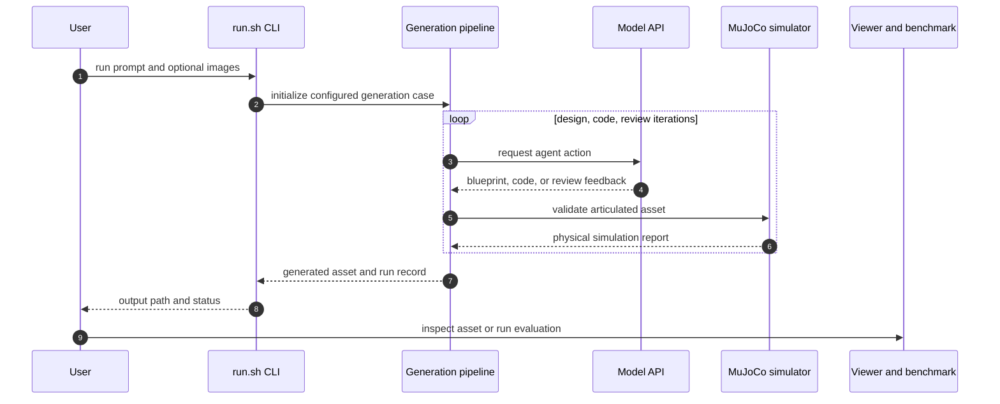

# Artisan：物理接地的可关节 3D 资产生成

## 一句话定义

**Artisan 是一套多智能体 3D 资产生成与验证管线：从文本和可选图像生成带关节的物体，再用物理仿真反馈检查它是否能稳定、无明显碰撞地运动。**

## 英文缩写速查

| 缩写 | 英文全称 | 简要说明 |
|------|----------|----------|
| 3D | Three-Dimensional | 资产具有三维几何和空间结构 |
| LLM | Large Language Model | 驱动设计、编码或审查代理的语言模型 |
| PBR | Physically Based Rendering | 描述资产表面材质与渲染属性的模型 |
| ABO | Amazon Berkeley Objects | 论文中提供参考质量物体的资产数据集 |
| VLA | Vision-Language-Action | 论文下游机器人策略评测中的视觉语言动作策略类别 |

## 为什么重要

仿真和机器人操作需要的不只是外观逼真的网格，还需要合理的部件层级、关节、碰撞关系、稳定性和质量。若资产只能“看起来像”，却无法按预期运动或承受重力，就难以直接用于交互仿真和训练数据生成。

Artisan 的意义在于把物理验证放进生成闭环，并将评测从单一几何相似度扩展到物理表现和下游机器人任务。它与 [Articraft](./articraft.md) 共属程序化可关节资产路线，但 Artisan 的论文重点是多代理审核及仿真反馈。

## 核心流程

论文将系统描述为 Design、Coding、Review 多代理协作。设计代理根据用户的文本和可选参考图形成资产设计，编码代理生成程序化模型，审查代理结合结构化检查和仿真反馈指出问题，再驱动修订。

物理验证针对生成资产的行为，不等同于真实世界实验。论文 benchmark 从空间保真度、物理合理性、下游任务表现和整体质量评估生成结果。

## 源码运行时序图

README 提供 `./run.sh run`、`./run.sh viewer` 和 benchmark 脚本入口；图中把论文定义的代理协作闭环与仓库 CLI 入口对应起来，具体内部调用以仓库实现为准。

## 实验与评测

论文的 benchmark 覆盖四类问题：

| 维度 | 关注点 |
|------|------|
| 空间保真度 | 生成资产与参考对象在几何/空间上的一致程度 |
| 物理合理性 | 关节运动时的碰撞与受重力稳定性等表现 |
| 下游任务表现 | 生成资产对机器人策略训练和未见物体泛化的作用 |
| 整体质量 | 综合比较生成资产的可用性与偏好 |

论文摘要报告 Artisan 在所评估方法中取得较低碰撞率和较高稳定率；消融结果支持物理验证反馈的作用。论文还报告，将生成资产加入训练数据可改善 π0.5 在未见原生资产上的任务表现。所有结论限定于论文的基准、模型与数据配置，不能直接外推到不同仿真器或机器人平台。

## 结论

**Artisan 的核心贡献是把仿真反馈变成资产生成过程中的修订信号，并用物理与下游任务指标检验生成资产是否可用。**

1. 评估 3D 资产时，几何相似度不足以代表可交互性；应同时检查关节行为、碰撞和稳定性。
2. 物理验证的消融结果说明，视觉上合理的资产可能仍有严重物理问题，仿真闭环是系统设计的重要组成。
3. 机器人训练收益是论文特定数据组合和 π0.5 评测下的结果，不能视为对所有任务的保证。
4. 运行官方生成管线需配置模型 API；复现成本应考虑推理预算、数据下载和依赖安装。
5. 项目与 [Articraft](./articraft.md) 的关系可理解为相邻工作：Artisan 在类似程序化生成基础上明确强调独立审查和物理反馈。

## 工程实践与开源状态

截至 2026-10-25，项目页链接官方代码仓库和 benchmark 数据页。仓库 README 提供 Ubuntu/Debian x86_64 安装脚本、文本加可选图像生成 CLI、本地 viewer 及评估脚本。其默认模型配置和每案例费用预算可能变化，实际运行前检查上游配置并按自己的模型 API 预算调整。

目前公开入口足以复现仓库支持的生成与评估流程；具体数据集访问、数据许可和模型 API 可用性分别以数据集卡、仓库配置和模型服务条款为准。代码许可证为 Apache-2.0，不代表所有依赖或数据具有相同许可证。

## 局限与风险

- **物理合理不等于真实物理准确：** 仿真验证依赖模型、碰撞几何、质量估计和模拟器设定，仍需按下游任务检查。
- **指标外推有限：** benchmark 结果反映论文列出的数据与基线，不能直接代替特定机器人任务上的验证。
- **运行成本：** 生成流程调用模型 API，需配置密钥并设预算；官方 README 的默认模型/预算只是仓库当前默认值。
- **许可需分层核查：** 代码、benchmark 数据及第三方资产的许可边界不同，不能由代码仓库的 Apache-2.0 推断数据可自由再分发。

## 关联页面

- [Articraft](./articraft.md) — 相关的 agent + SDK 可关节资产生成工作。
- [PhysForge](./paper-physforge-physics-grounded-3d-assets.md) — 学习式物理接地关节资产生成路线。
- [RoboTwin 2.0](./robotwin.md) — 机器人操作仿真的下游评测语境。
- [SAPIEN](./sapien.md) — 交互式关节物体仿真背景。
- [Sim2Real](../concepts/sim2real.md) — 仿真资产与真实动力学一致性的工程问题。
- [Manipulation](../tasks/manipulation.md) — 机器人操作任务对可交互资产的需求。

## 参考来源

- [Artisan 论文归档（arXiv:2610.13947）](../../sources/papers/artisan_arxiv_2610_13947.md)
- [Artisan 项目主页](../../sources/sites/artisan-project.md)
- [Artisan 官方仓库](../../sources/repos/physicalvision-artisan.md)

## 推荐继续阅读

- 论文全文：https://arxiv.org/html/2610.13947
- 项目主页：https://physicalvision.github.io/artisan/
- 官方仓库：https://github.com/physicalvision/artisan
