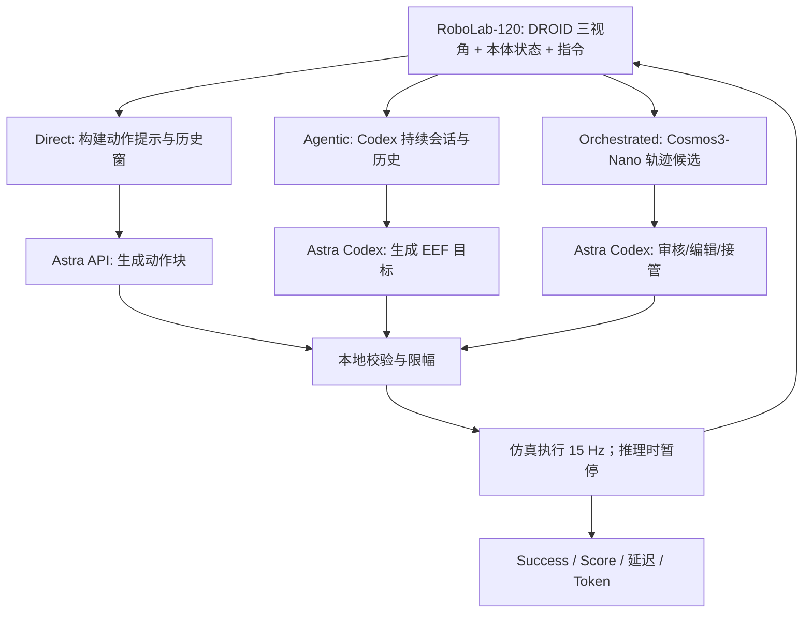
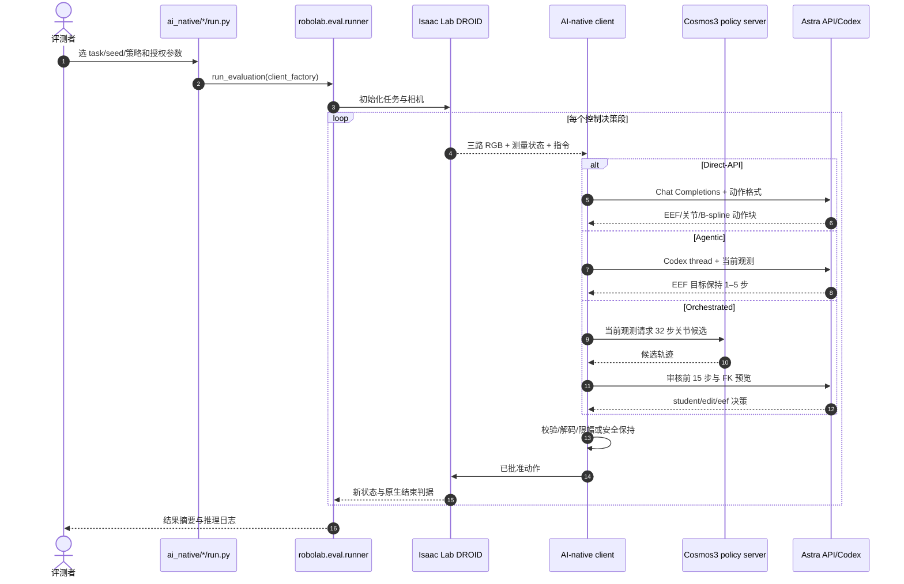

# Astranomy：GPT-6 Astra 原生机器人策略研究

**Astranomy** 是 NVIDIA Seattle Robotics Lab 对 GPT-6 Astra 直接控制、agentic 控制和策略监督三种用法进行系统比较的技术报告，重点揭示推理时动作接口与上下文设计的效果，以及通用模型策略的延迟和成本边界。

## 一句话定义

**Astranomy** 在 RoboLab-120 的 DROID 抓放仿真中研究 Astra 直接输出动作、经 Codex 持续对话驱动机器人、监督 Cosmos 专用策略三种形式；成功率最高的是 Agentic（74.8%），但没有建立真机实时控制证据。

## 英文缩写速查

| 缩写 | 英文全称 | 简要说明 |
|------|----------|----------|
| SRL | Seattle Robotics Lab | 本报告所属的 NVIDIA 研究团队 |
| SR | Success Rate | RoboLab-120 任务成功率 |
| EEF | End-Effector | 报告中可选择的末端位姿动作表示 |
| RFM | Robot Foundation Model | 报告用于对照的机器人预训练策略类别 |
| WAM | World Action Model | Orchestrated Policy 所监督的 Cosmos3-Nano-Policy 类型 |

## 为什么重要

- **把通用模型与机器人策略的边界变成可测问题：** 报告在不做机器人策略微调的条件下，允许通过提示配置动作表示、几何信息与观测历史，比较模型直接控制和 agentic 支持。
- **Agentic 系统提高仿真成绩，但付出高昂成本：** 74.8% 成功率领先于 Direct 和 Orchestrated 两种方案，然而每 episode 平均 token 成本也最高。
- **延迟是首要部署约束：** Direct 调用平均 18.56 秒；这与通常需要的高频闭环控制存在巨大差距。结果说明推理能力不等于实时控制能力。
- **同一基础模型的性能受接口设计影响：** 动作参数化、几何描述、观察历史和指令具体程度都会改变结果，不能只用模型名称解释策略表现。

## 核心信息

| 字段 | 内容 |
|------|------|
| 报告标题 | *Astranomy: An Empirical Study of GPT-6 Astra as a Native Robot Policy* |
| 作者 | Jenai Xuning Yang、Ashna Khetan、Shun Zhang |
| 机构 | 英伟达（NVIDIA）Seattle Robotics Lab |
| 发布日期 | 2026-10-14 |
| 评测 | RoboLab-120 全量结果；30-task 子集消融 |
| 机器人形态 | DROID 机器人形态，在仿真中评测 |
| 开源状态 | 2026-11-21 官网 Code 已公开 RoboLab `policies/ai_native` 三种策略实现；arXiv 仍标 coming soon，公开代码与历史论文评测协议有差异 |

## 核心原理

报告比较三种把 GPT-6 Astra 放进机器人闭环的方式：

| 策略形态 | 输入到动作的关系 | 主要取舍 |
|----------|------------------|----------|
| **Direct Policy** | 模型 API 直接按图像、本体状态和任务指令生成动作块；调用间不保留历史 | 结构直接、token 成本相对较低，但单次推理仍很慢 |
| **Agentic Policy** | Astra 在持续的 Codex 会话中工作，保留历史并可调用图像检查、计算等工具 | 观察与行动上下文更完整，成绩最高，token 成本最高 |
| **Orchestrated Policy** | Astra 审查 Cosmos3-Nano-Policy（WAM）给出的候选动作，决定接受或干预 | 将高频候选动作交给专用策略，通用模型承担监督与纠偏 |

### 推理时接口消融

报告改变动作表示（末端执行器位姿、关节位置、B-spline）、动作长度、机器人几何描述、图像/状态历史、任务指令措辞、显式规划及工具使用。其关键含义是：通用模型策略的行为接口可在推理时配置，但接口变化本身也会改变结果，评测时必须说明提示、观察和动作协议。

## 流程总览

本图按照原文三种系统角色与已公开代码边界描绘**替代性评测配置**，不是三种模型在同一回合全部同时执行。

## 源码运行时序图

依据 RoboLab [AI-native README](https://github.com/NVlabs/RoboLab/blob/main/policies/ai_native/README.md)、[DESIGN.md](https://github.com/NVlabs/RoboLab/blob/main/policies/ai_native/DESIGN.md) 及三个 `run.py` 入口；`alt` 是三种互斥运行模式。

**复现要点：** Direct 使用 `direct_api/run.py`；Agentic 使用 `agentic/run.py` 与 Codex App Server；Orchestrated 使用 `orchestrated/run.py`、Cosmos WebSocket 策略服务和 Codex。模型请求需访问权限和正确凭证。当前 Agentic 代码已移除历史参考试验曾提供的原生进度/成功判据输入，不能宣称直接重跑即复得 74.8%。

## 评测结果

| 策略 | 成功率 | 平均完成分 | 推理延迟/调用 | 每 episode API 成本 |
|------|-------:|------------:|----------------:|--------------------:|
| Direct Policy | 66.3% | 76.7 | 18.56 s | 160k tokens / $1.96 |
| Agentic Policy | **74.8%** | **83.6** | 13.37 s | 30.9M tokens / $36.40 |
| Orchestrated Policy | 66.5% | 79.1 | 11.50 / 2.74 s* | 11.0M tokens / $17.72 |
| Cosmos3-Nano-Policy | 36.8% | 51.9 | 713.76 ms | — |
| π0.5 | 28.0% | 43.4 | 46.96 ms | — |

\* 页面概览对 Orchestrated Policy 报告两个时延数值（11.50 / 2.74 秒）；比较时应保留其页面上下文，不应将其简单等同于模型或控制周期的单一延迟。

### 结果解读

- Agentic Policy 相比 Direct Policy 提升 **8.5 个百分点 SR**，同时每 episode token 量约为后者 **193 倍**，成本约为 **18.6 倍**。
- Orchestrated Policy 的成功率接近 Direct Policy；它不代表高频物理控制已经实时化，Astra 仍参与闭环决策。
- 实验在模型推理期间暂停仿真，且没有实际机器人真机验证。因此成绩是仿真任务完成能力的证据，不能证明真实硬件上的实时性、稳定性或安全性。

## 结论

**总判：** GPT-6 Astra 可通过提示接口在 RoboLab 仿真中直接承担通用抓放策略，但 agentic 上下文带来的成绩提升伴随明显的推理延迟和成本，现有结果不足以支持实时真机部署结论。

1. **按目的选策略形态：** 追求此基准最高成功率可参考 Agentic Policy；资源受限时 Direct Policy 更省 token，但不能满足常规高速控制节拍。
2. **把接口纳入基准定义：** 记录动作表示、几何标定、历史采样、提示结构和每次动作执行长度，否则横向比较难以复现。
3. **优先攻克系统延迟：** 18.56 秒级 API 调用要求引入本地快速策略、动作缓存或异步监督，才能接近实时闭环；这些是后续工程方向，不是本报告已验证的结果。
4. **限制外推范围：** 5 个 seed/任务、仿真暂停等待推理、没有真机验证，限制了结果的方差估计与现实部署解释。

## 工程实践

| 环节 | 建议 |
|------|------|
| 复现实验 | 固定 RoboLab 版本、DROID 形态、图像视角、提示和动作协议；逐项对齐 30-task 消融设置 |
| 比较策略 | 同时报告任务成功率、部分完成分、延迟和 API 成本 |
| 真机迁移 | 先将 Astra 用作低频监督器或规划器，再由本地快速策略维持高频控制；需另行做安全限幅与硬件验证 |
| 源码与复现 | [官方 AI-native 实现](https://github.com/NVlabs/RoboLab/tree/main/policies/ai_native) 已发布；读三种后端 README 配置环境、权限和 task；报告原始参数与现版后端存在差异，**不保证直接复现论文成绩** |

## 局限与风险

- **只验证仿真：** 报告使用 RoboLab/DROID 形态，不提供物理机器人运行验证。
- **时延与仿真设置：** 仿真在推理期间暂停，策略可等任意时长再继续；评测没有体现墙钟时间下的实时失败。
- **样本量有限：** 每任务 5 个固定 seed 不足以完整刻画任务方差。
- **成本差异大：** Agentic Policy 的 token 与费用明显高于 Direct Policy；实际费用依赖当时模型计费与会话配置。
- **开放状态与可复现性：** 2026-11-21 官方已给出 Direct / Agentic / Orchestrated 三种实现；Agentic README 明言历史参考运行曾暴露原生进度/成功判据，发布版已去除且更新 reset/seed，原先的实验成绩**未按发布版重新评测**。Orchestrated 文档另列图像、seed、超时和 token 预算的差异；arXiv 仍标 coming soon。

## 关联页面

- [OpenAI 机器人团队重组与通用模型路线评论审计](./openai-robotics-reorganization-aiwang-2026.md) — 用本报告实验限制检验媒体关于「专用模型被通用模型吸收」的产业推断。
- [GPT 6 Astra as an Embodied Policy](./paper-gpt-6-astra-embodied-policy.md) — 独立的 GPT-6 Astra 与 π0.5 混合策略评测。
- [RoboLab](./robolab.md) — Astranomy 所使用的仿真基准与任务库。
- [具身评测选型闭环](../queries/embodied-eval-benchmark-selection-loop.md) — 将 benchmark 结果放进策略评测与选型流程中解释。
- [VLA](../methods/vla.md) — 视觉–语言–动作策略的常见结构与接口。

- [机器人智能体执行框架](../methods/robot-agent-harness.md)：对照规划、工具调用与反馈的系统边界。

## 参考来源

- [Astranomy NVIDIA SRL 项目页与全文核读归档](../../sources/sites/astranomy-nvidia.md)
- [NVIDIA 原始代码 AI-native（三种策略）](https://github.com/NVlabs/RoboLab/tree/main/policies/ai_native)
- [AI-native 实现设计与接口契约](https://github.com/NVlabs/RoboLab/blob/main/policies/ai_native/DESIGN.md)

## 推荐继续阅读

- [Astranomy 官方报告页](https://research.nvidia.com/labs/srl/projects/astranomy/) — 报告正文、结果表与交互式消融。
- [AI-native 运行入口](https://github.com/NVlabs/RoboLab/tree/main/policies/ai_native) — Direct、Agentic、Orchestrated 的代码与复现条件。
- [RoboLab-120](https://research.nvidia.com/labs/srl/projects/robolab/) — 评测环境与基准说明。
- [GPT 6 Astra as an Embodied Policy](./paper-gpt-6-astra-embodied-policy.md) — 另一项独立评测及其代码入口。
