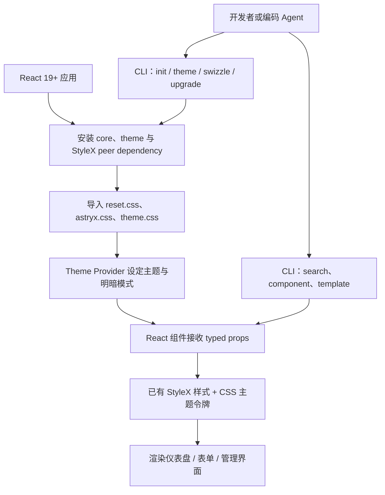
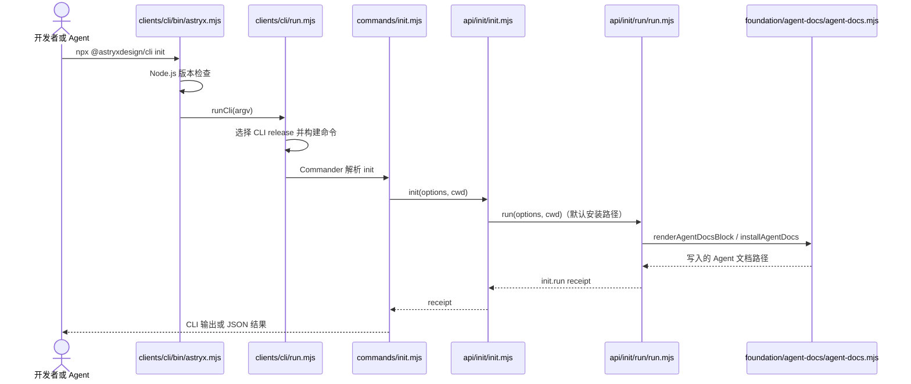

# Astryx：面向人与 Agent 的可定制设计系统（Agent-Ready React Design System）

## 一句话定义

**Astryx** 是 Meta 开源的 React 19+ UI 设计系统：通过预编译组件样式、可覆盖的设计令牌、模板与供人类及编码 Agent 共用的 CLI，减少应用界面重复开发。

## 英文缩写速查

| 缩写 | 英文全称 | 简要说明 |
|---|---|---|
| UI | User Interface | 项目的界面组件与交互层 |
| CLI | Command-Line Interface | Astryx 组件检索、初始化与主题操作入口 |
| CSS | Cascading Style Sheets | 组件预构建样式与 CSS 自定义属性主题 |
| API | Application Programming Interface | 组件 props 与 CLI 的结构化接口 |
| SSR | Server-Side Rendering | Next.js 等框架的服务端渲染场景 |
| AI | Artificial Intelligence | 使用同一官方规范的编码 Agent |

## 为什么重要

- **统一组件与视觉语言**：组件库、主题、布局模板和文档相互配套，适合搭建实验看板、机器人项目展示站或设备管理界面。
- **人机协同开发**：CLI 能检索可用组件及用法；init 将组件索引提示写入项目的 Agent 指令文件，降低编码 Agent 猜测 API 的概率。
- **降低样式侵入**：消费者导入已构建 CSS，可继续用 Tailwind、CSS Modules 或普通 CSS 的 className 覆盖；不必把现有项目迁移到 StyleX 编译链。
- **定位边界**：它解决前端界面问题，不能替代 ROS 2、机器人状态监控后端、策略推理或实机安全链路。

## 核心原理

### 组件、样式与主题三层

1. **组件**：@astryxdesign/core 对外提供带 TypeScript 属性的 React 组件；Button 等组件内部实现使用 StyleX、统一设计 token 和交互状态。
2. **样式**：普通消费者按 reset.css → astryx.css → theme.css 顺序加载编译产物；层级依次是 reset、astryx-base、astryx-theme。
3. **主题**：Theme 绑定主题名与明暗模式；主题自定义由 CSS custom properties 及组件覆写规则实现，根 Theme 同步 data-theme、data-astryx-theme 到文档根元素。
4. **Agent 入口**：@astryxdesign/cli 向人类和编码 Agent 提供相同的组件文档、模板、主题和升级命令；init 会写入 Agent 提示文件，涉及文件副作用，应先审查差异。

**来源口径**：GitHub README 称「150+」组件，官方首页在 2026-11-07 显示「Over 180」；未独立核实精确数量。README 列举七套主题（neutral、butter、chocolate、matcha、stone、gothic、y2k）。

### 流程总览



此图来自根 README、Core/CLI 使用文档和 Theme.tsx；箭头代表典型接入关系，并非单一运行线程。

### 源码运行时序图



**核对的实际入口**：上图针对默认 init 路径，来自源码快照 143a5de。特殊的 --user、--remove-agents、--features 走不同分支；不能据此推断它们有相同时序。Theme.tsx 负责浏览器端主题生命周期，与此 CLI 初始化流程独立。

## 工程实践

### 在 React 项目引入

依照官方 Quick Start：

```bash
npm install @astryxdesign/core @astryxdesign/theme-neutral @stylexjs/stylex
npm install -D @astryxdesign/cli
npx @astryxdesign/cli component Button
```

在入口 CSS 中按照以下顺序导入：

```css
@import '@astryxdesign/core/reset.css';
@import '@astryxdesign/core/astryx.css';
@import '@astryxdesign/theme-neutral/theme.css';
```

在组件树上使用 @astryxdesign/core/theme 导出的 Theme 与 theme-neutral 提供的主题对象。Next.js 可按官方 Core README 的 providers.tsx 方式组织，并根据是否使用 Tailwind 调整导入。

### 给编码 Agent 使用

1. 运行 npx @astryxdesign/cli init，检查它对 AGENTS.md / CLAUDE.md 等文件的变更。
2. 使用 npx @astryxdesign/cli search button、component Button、template --list 查询官方接口，避免手写不存在的属性。
3. 自定义配色优先使用主题令牌；需要完全维护组件实现时再考虑 swizzle。
4. 在仪表盘场景验证键盘操作、焦点顺序、暗色模式、SSR 水合与移动端性能；上述检查属于引入工程的验证项，本次入库未在浏览器运行这些测试。

**适配建议**：对于机器人 Web 控制台，Astryx 可以构建参数、告警和实验结果的 UI，实际遥测、ROS 2 数据桥接、设备授权和危险动作互锁仍需独立工程实现。

## 局限与风险

- **Beta**：API、主题和组件数量可能随版本变化。上游 npm Core 包的 package.json 在核查快照标为 0.7.11；不等于所有子包都有相同稳定版本。
- **框架限定**：依赖 React 19+；纯静态 HTML/JS 导图页面无法无改造直接使用 JSX 组件。
- **开源不等于运行验证**：已确认源代码与 MIT 标识，但尚未进行安装构建、性能基准或完整无障碍审计；不能把 README 的可访问性主张当作本次独立测试结果。
- **Agent 文件副作用**：init 会更新项目内 Agent 指令文件，正式项目需审查自动写入内容。
- **审读边界**：通读上游主要 README 与 Core/CLI 文档；源码路径只精查 Button、Theme 和 CLI init 相关入口，不宣称逐个读完全部组件实现。

## 关联页面

- [React Bits](./react-bits.md)：面向网站动效的可复制组件，与 Astryx 整套应用设计系统定位不同。
- [GSAP Skills](./gsap-skills.md)：Agent 编写 Web 动效的技能文档，Astryx 侧重 UI 设计与组件规范。
- [Plotly](./plotly.md)：真实机器人实验数据交互图表；Astryx 可提供承载这些可视化的外围 UI。

## 参考来源

- [官方仓库原文、源码与版本归档](../../sources/repos/astryx.md)
- [官方项目站点核查](../../sources/sites/astryx.md)
- [Meta Astryx 源码](https://github.com/meta/astryx)
- [官方核心组件用法](https://github.com/meta/astryx/blob/main/packages/core/README.md)

## 推荐继续阅读

- [Astryx 官方网站](https://astryx.atmeta.com/)
- [Astryx CLI 官方文档](https://github.com/meta/astryx/blob/main/packages/cli/README.md)
- [源代码中的 Theme.tsx](https://github.com/meta/astryx/blob/main/packages/core/src/theme/Theme.tsx)
