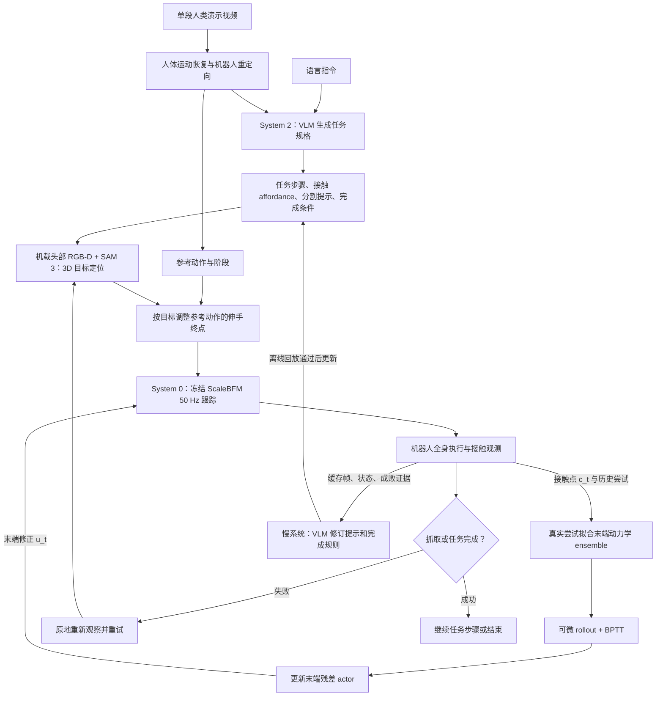

# ATLAS：基于人类视频与 Agentic Harness 的人形全身智能（Agentic Harness for Whole-Body Intelligence from Human Video）

## 一句话定义

**ATLAS** 从**一段人类演示视频 + 一条语言指令**提取人形全身动作参考，让 System 2 Agent 编写任务规则、冻结的 System 0 全身 tracker 执行，并通过连接两者的 harness 在真机尝试中修正抓取终点偏差和失败判断。

## 英文缩写速查

| 缩写 | 英文全称 | 简要说明 |
|---|---|---|
| ATLAS | Agentic Test-time Learning and Adaptation System | 项目技术博客给出的完整系统名 |
| VLM | Vision-Language Model | System 2 理解任务并编写/改写任务规格 |
| BFM | Behavior Foundation Model | 低层冻结的 ScaleBFM 全身运动跟踪基础策略 |
| RL | Reinforcement Learning | 在线 model-based RL 训练末端残差 actor |
| BPTT | Backpropagation Through Time | 经已学习动力学模型展开并沿时间反传更新 actor |
| RGB-D | Red, Green, Blue and Depth | 头部相机提供图像、深度以定位物体 |
| SAM 3 | Segment Anything Model 3 | 根据文本提示词分割机器人视野中的目标 |
| VLA | Vision-Language-Action | 本项目不需要另行训练的任务动作基础策略路线 |
| WAM | World-Action Model | 本项目不需要另行训练的世界动作生成模型路线 |

## 核心信息

| 项 | 原文可核实内容 |
|---|---|
| 机构 | 加州大学伯克利分校（UC Berkeley）、英伟达（NVIDIA）、香港大学（HKU）；作者还含斯坦福大学（Stanford） |
| 原始资料 | [项目主页](https://atlas-humanoid.github.io/) / [官方技术长文（2026 Early release）](https://atlas-humanoid.github.io/blog/)；截至 2026-11-13 无独立论文 PDF / arXiv 链接 |
| 输入 | 人与物体交互的单段视频、语言指令；机器人依赖自身观测执行 |
| System 2 | VLM 编写步骤、末端选择、接触 affordance、SAM 3 查找提示词、完成判据，并在会话中审查改写 |
| System 0 | 冻结 ScaleBFM 全身动作跟踪策略，50 Hz；步行与抓取使用同一 tracker |
| 快速系统 | 残差 actor + 在线拟合的动力学 ensemble；在每次会话从零开始学习 |
| 代码/数据开放状态 | **官网网站仓库已公开**（2026-11-14 核查），但仅包含网页、展示素材与渲染工具；**ATLAS 策略训练、在线学习和真机部署实现仍无公开入口**，无法给出算法复现命令 |

## 为什么重要

传统人形全身操作往往需要大量任务专用机器人示范、仿真奖励/策略训练，或通过 VLA/WAM 学习动作。ATLAS 探索一条不同路径：**保留已训练的通用动作跟踪基座，把任务细节交给慢速 Agent，把真实机器人定位和执行误差交给会话内在线自适应。**

这里的“没有 System 1”是**没有预训练的专职中间动作策略**，而不是没有快速闭环。接触修正仍由在机器人上实时运行的残差 actor 完成；System 2 本身不逐控制周期发关节指令。

## 核心原理

### 1. 参考与任务规格

先从人类互动视频恢复人体运动并重定向为机器人参考动作。VLM 根据语言与参考的阶段生成有限词汇表的 task specification：walk/pick 等步骤、操作末端、抓取接触部位、SAM 3 的 find phrase、完成判据。操作开始后，对动作参考进行终点修正，而不是把人类动作原封不动回放。

### 2. System 0 与快速残差学习

SAM 3 根据头部 RGB 图和 find phrase 提取目标 mask，深度恢复物体上接触点目标 `n_t`；冻结 ScaleBFM 在 50 Hz 下跟踪运动窗口并输出关节动作。抓取阶段经历 crouch → reach → 0.5 s hold → close → lift。actor 观察由正向运动学算出的实际末端 `c_t`，输出修正 `u_t`：

- `u_t = πφ(c_t, n_t)`，传给 tracker 的末端位置命令为 `n_t + u_t`；
- 动力学 ensemble 预测 `ĉ_(t+1) = fψ(c_t, n_t + u_t)`，由本会话尝试记录持续重新拟合；
- actor 经模型展开、最小化 hold 阶段接触点距离和残差变化进行更新；无需 critic 或成功奖励标签，前 5 次尝试用于热身探索。

**目标 `n_t` 本身不由残差改写**：在线 learner 学的是“如何让本体真正达到这个目标”，而不是代替 Agent 判断应该抓什么。

### 3. Slow Agent 与失败闭环

慢系统审查缓存的头部图像和机器人状态，发现分割漏检、错抓其它部位、错误完成判据时重新写 find phrase 或 check。更改须通过独立保存帧/尝试的成对回放过滤；新规则不应提高误检或假成功。发生失败则原地起身、重新观察、必要时重新定位再抓，错误尝试也进入动力学模型训练。

### 4. 与 SuperMimic 的方法联系：可微动力学与 BPTT

官方技术博客 §2.3 以及参考文献明确引用了 [SuperMimic](./paper-supermimic.md)，两者共享**先学习可微动力学，再对短时模型 rollout 进行时间反向传播以优化策略**的思路。不过，ATLAS **不是将 SuperMimic 全身动作跟踪策略直接部署到真机**：

| 对比维度 | SuperMimic | ATLAS 快速系统 |
|---|---|---|
| 模型学习数据 | 标准刚体**仿真器**的状态转移 | 机器人**本会话的真实尝试**（包括失败） |
| 动力学建模 | 用于全身 motion tracking 的共享世界模型 | 末端接触点的局部命令–响应模型 `fψ(c_t,n_t+u_t)`（随机先验 ensemble） |
| 优化策略 | 全身跟踪策略，短时想象 rollout + BPTT，含 critic bootstrap | 仅修正 tracker 末端命令的残差 actor `u_t`，模型展开 + BPTT；官方明确不使用 critic |
| 控制骨干 | SuperMimic 自身训练得到的 motion tracker | **冻结的 ScaleBFM（50 Hz）**，ATLAS 不重新训练全身 tracker |

在 ATLAS 中，梯度穿过学习到的末端动力学模型与残差 actor，而**不经过 ScaleBFM 的参数更新或真实机器人**；传入 tracker 的目标为 `n_t+u_t`，用于弥合“期望接触点—实际接触点”的执行误差。博客没有披露复用 SuperMimic 训练代码，因此这里只确认**方法继承关系**，不宣称直接使用其实现或模型权重。

## 流程总览

该图按[官方技术长文 §2.1–2.5](https://atlas-humanoid.github.io/blog/)重绘，是**方法架构图**，不是源码验证过的函数调用图。

## 源码运行时序图

**不适用**：2026-11-14 核查 [atlas-humanoid.github.io 网站仓库](../../sources/repos/atlas-humanoid-website.md)，其代码用于页面展示、Remotion 学习过程示意动画和 FFmpeg 视频素材生成，**不是** ATLAS 的在线模型学习、ScaleBFM 真机控制或部署代码。网站 README 已核对，无可验证的 ATLAS 算法运行入口，不能据此绘制真实训练/部署时序图。

## 工程实践

| 组件/阶段 | 项目实际描述与复现要求 |
|---|---|
| 运动基座 | [ScaleBFM](./paper-scaling-bfm-humanoid.md) 已预训练并冻结，50 Hz；论文无 ATLAS 专用 checkpoint 下载 |
| 感知和定位 | SAM 3 + 机载 RGB-D + 正向运动学得到目标与末端当前位置；需区分物体未被检测到与末端执行偏差 |
| 在线学习 | 每 session 从零开始；记录每次尝试的末端命令与实际位置；模型式 RL 调整残差而非目标点 |
| 交互判据 | 检查抬起/物体相对高度/物体是否在抓手内并比对后续帧；失败自动重试，必要时人只重置物品 |
| 计算划分 | 机载运行 tracker 与 actor；远端 PC 运行 VLM、SAM 3、在线学习更新 |
| 开源状态 | [网页与可视化素材工具仓库](../../sources/repos/atlas-humanoid-website.md)公开，但 **ATLAS 控制/训练与部署代码未公开**；不能把 `tools/learning-loop` 的网页动画渲染入口误认作 BPTT 训练脚本 |

## 实验与评测

| 作者报告的实验 | 结果 | 解释边界 |
|---|---|---|
| 真实机器人拾取垃圾的单会话在线学习 | 38 次尝试，最近 8 次成功率从 0% 升到 88% | 不是跨任务整体成功率 |
| Isaac Lab-Arena，loco-manipulation | ATLAS 94%，官方 GR00T 对照 69% | 同一实验场景下相差 25 个百分点；不是普遍优于 GR00T 的证明 |
| Isaac Lab-Arena，静态 pick-and-place | ATLAS 98%，官方 GR00T 对照 87% | 同一实验场景下相差 11 个百分点 |
| Isaac Lab，变化执行偏差的 apple 消融 | model-based RL 83%；RLS 58%；model-free 13%；无学习 4% | 各组分到的尝试数不同；用于检验动态建模价值 |
| 真机对 GR00T checkpoint | 作者写 loco-manipulation +36.2%、static pick-and-place +12.6% higher success | 原文未在博客给出完整样本数及此处百分比口径，不改写为百分点 |

## 与其他工作对比

- **相对 VLA / WAM：** ATLAS 不训练任务专属视觉到动作/视频预测基础模型，而复用预训练 VLM 和通用 whole-body tracker；不能因此认为无需先验、无训练成本。
- **相对纯 motion retargeting：** 它改写伸手末端目标、用在线残差补偿本体执行误差，并能判断失败后重试；关键是任务规格与反馈闭环，不是只模仿一条轨迹。
- **相对 [SuperMimic](./paper-supermimic.md)：** 共享可微动力学与 BPTT 解析策略优化思想，但 SuperMimic 在仿真中训练全身跟踪器，ATLAS 从真机尝试学习局部末端残差；不能混淆冻结 ScaleBFM 与 SuperMimic 策略。
- **相对 [ScaleBFM](./paper-scaling-bfm-humanoid.md)：** ScaleBFM 是低层跟踪器；ATLAS 是建立在该基座之上的 Agentic Harness 与末端适应层，两个名字不是同一项工作。

## 局限与风险

- **技术资料状态：** 截至 2026-11-14，有官方项目页、Early release 技术长文及**网页源代码**，但没有可核验的独立 PDF、arXiv 或 ATLAS 在线学习/真机控制实现；实验数字是作者报告。
- **能力边界：** 目前在线残差主要修正伸手/抓取接触点；作者将持续接触与跨任务记忆列为下一步，尚不能视为已实现。
- **环境依赖：** 系统依赖预训练 ScaleBFM、人体动作恢复/重定向和头部视觉；一些平地实验另有外部定位，不能把所有实验都笼统说成完全零外部追踪。
- **部署风险：** VLM、SAM 3、在线 learner 更新运行于外部 PC；通信延迟、分割误差、接触安全和长程鲁棒性缺乏可复现源码与完整公开评测协议支持。
- **任务特定学习措辞：** 不需任务专用仿真预训练 ≠ 不做任何学习；快速系统确实在真机每会话在线优化。

## 关联页面

- [Loco-Manipulation 任务地图](../tasks/loco-manipulation.md)
- [ScaleBFM 冻结全身 tracker 基座](./paper-scaling-bfm-humanoid.md)
- [SuperMimic：可微世界模型与 BPTT 全身动作跟踪](./paper-supermimic.md)
- [Whole-Body Control](../concepts/whole-body-control.md)

## 参考来源

- [ATLAS 官方技术长文原文阅读归档](../../sources/blogs/atlas_humanoid_early_release.md)
- [ATLAS 项目主页来源归档](../../sources/sites/atlas-humanoid.md)
- [ATLAS 官方网站源码仓库开放边界核查](../../sources/repos/atlas-humanoid-website.md)

## 推荐继续阅读

- [ATLAS 官方技术长文及参考文献](https://atlas-humanoid.github.io/blog/) — 包含完整在线动力学公式、视觉提示词的慢速修订流程及 BibTeX
- [ATLAS 官方项目页](https://atlas-humanoid.github.io/) — 真机演示、38 次在线尝试、Isaac Lab 对照与硬件部署范围
- [ScaleBFM 相关原论文](https://arxiv.org/abs/2607.15163) — ATLAS 所用预训练冻结 whole-body tracker 的来源
