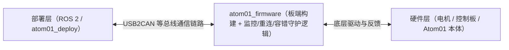

# Atom01 Firmware
> **范围说明（复核于2026-10-23）**：本页是基于 2026-04-25 归档快照整理的职责概述；上游仓库和接口可能变化，具体依赖、支持硬件与构建步骤请以各仓库当前 README、release 和代码为准。

**atom01_firmware** 是 Atom01 的底层固件与板端运行仓库，负责通信、设备驱动与基础运行时能力。

## 英文缩写速查

| 缩写 | 英文全称 | 简要说明 |
|------|----------|----------|
| ROS 2 | Robot Operating System 2 | 机器人系统集成与通信的常用中间件 |

## 为什么重要

- 固件层决定控制指令能否稳定、低延迟地落到执行器。
- 是部署层（ROS2）与硬件层（电机/控制板）之间的关键桥梁。
- 直接影响安全性与故障恢复能力。

## 核心结构/机制

- **通信链路**：例如 USB2CAN 等总线通信。
- **板端构建**：嵌入式环境编译与运行部署。
- **守护逻辑**：基础监控、重连与容错机制。

## 机制与架构图

## 常见误区或局限

- 误区：只要高层策略好，底层固件影响不大。实际中固件稳定性往往是系统可用性的硬约束。
- 局限：固件细节强依赖硬件版本，跨平台复用成本可能较高。

## 参考来源

- [sources/repos/atom01_firmware.md](../../sources/repos/atom01_firmware.md)
- [Roboparty/atom01_firmware](https://github.com/Roboparty/atom01_firmware)

## 关联页面

- [PID Control（比例-积分-微分控制）](../methods/pid-control.md) — 板端反馈执行需先明确电流、速度与位置环的分工，构建固件不等于完成闭环整定。
- [MIT 关节阻抗模式参数整定](../methods/mit-joint-impedance-mode-tuning.md) — 关节 PD 与前馈可作为底层命令读法，具体模式、单位和保护逻辑仍按 Atom01 固件协议核对。

- [Roboto Origin（开源人形机器人基线）](./roboto-origin.md)
- [Atom01 Deploy](./roboparty-deploy.md)
- [Atom01 Hardware](./atom01-hardware.md)

## 推荐继续阅读

- [Contact Dynamics](../concepts/contact-dynamics.md)
- [State Estimation](../concepts/state-estimation.md)
