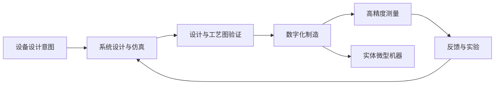

# Atomic Machines Matter Compiler

**Matter Compiler** 是 Atomic Machines 宣称的 AI 原生微型机器制造系统：它把设备设计转换为可执行的制造步骤，制造后测量实体结果，并将反馈用于后续迭代。公司公布的首个产品是 PrimeSwitch 微型机电继电器。

## 英文缩写速查

| 缩写 | 英文全称 | 简要说明 |
|------|----------|----------|
| AI | Artificial Intelligence | 系统用于设计、制造规划和测量反馈的智能能力；公开资料未披露模型细节 |
| MEMS | Micro-Electro-Mechanical Systems | 微机电系统；伯克利研讨会将该平台定位为超越传统 MEMS 工艺约束的制造路线 |
| CAD | Computer-Aided Design | 设备几何与设计表达；官方称系统会验证 CAD 设计 |
| PS-150 | PrimeSwitch 150 A | 首款公开微型机器继电器型号，150 A 为厂商标称连续电流规格 |

## 为什么重要

传统微制造往往围绕特定器件、材料和工艺组合构建。Atomic Machines 的核心主张是把制造过程做成可编程系统：改变设计时主要改变数字指令，由同一套设备执行、测量和迭代。这把生成式 AI 的“设计输出”向实体制造延伸，也提供了一个值得追踪的 AI × 硬件制造案例。

## 核心原理与公开流程

官方将 Matter Compiler 描述为一个闭环制造系统：

这条流程依据公司对系统的描述整理；公开材料未披露具体模型架构、材料库、工艺基元、测量精度或端到端自动化边界。公司称制造系统能把测量结果用于实时纠错，并可在自有设备上测试仿真提出的方案。

## 首个产品：PrimeSwitch PS-150

| 项目 | 官方公布值 / 描述 | 解读 |
|------|--------------------|------|
| 类型 | 双稳态机电继电器 | 金属触点导电，断开后提供电气隔离 |
| 连续电流 | 150 A | 厂商额定规格，仍需结合实际测试条件与系统设计理解 |
| 开启时间 | 50 μs | 官方称显著快于传统接触器 |
| 导通电阻 | 200 μΩ | 厂商标称值；公开发布材料未给出完整测试方法 |
| 隔离电压 | 1,500 V | 厂商标称规格 |
| 封装 | 9.5 mm × 3 mm，表面贴装、密封 | 公司称已向早期客户提供评估 |

官方设想的应用场景包括 AI 数据中心 800 V 直流配电保护。系统级方案仍可能需要固态旁路等配套部件；不能把继电器的单体参数直接等同于整套断路器的性能。

## 工程实践与证据边界

- **区分“代码到机器”与“prompt 到机器”：** 官方发布稿称制造由代码决定，创始人把自然语言 prompt 直达实体称为愿景。现有公开演示材料不足以证明任意 prompt 可自动完成需求澄清、可制造设计、验证和成品交付。
- **区分微型机器与任意整机：** Matter Compiler 公开定位聚焦微尺度、多材料、三维结构及运动部件。它不是面向任意尺寸硬件的一台通用桌面打印机。
- **核查厂商数据：** PrimeSwitch 参数来自 Atomic Machines 官方发布材料和产品页；当前归档资料没有独立第三方测试报告或公开基准。
- **开源状态：** 截至 2026-10-14，官方项目资料未列出 Matter Compiler 的公开代码仓库或数据集；制造平台与工艺细节未开放，尚不能据公开材料复现。
- **技术定位的外部记录：** Berkeley BSAC 于 2025 年发布的研讨会摘要也将其描述为 AI 驱动的微型机器设计与制造平台，但该摘要来自公司高管演讲，不是独立评测。

## 局限与风险

1. **公开证据有限：** 公司公开了产品规格与平台叙述，尚缺可复现的工艺流程、独立测试数据和开放实现。
2. **愿景与现状需分开：** “任意微型机器”及自然语言 prompt 直接生成实体设备是公司目标，不应当作已验证的普适能力。
3. **产品成熟度仍需验证：** 早期客户评估不等于长期可靠性、量产良率或全工况安全性已完成验证。
4. **名称可能造成误解：** “Atomic Machines”不是“原子级制造”的证据；现阶段公开产品是微尺度机电设备。

## 关联页面

- [前沿模型 × 3D / CAD / 机器人](../overview/frontier-models-3d-cad-robotics-survey.md) — 对照 AI 生成 CAD 与实体制造的证据边界。
- [人形机器人量产工程能力](../concepts/humanoid-mass-production-engineering.md) — 对照制造工艺、验证与量产成熟度问题。

## 参考来源

- [Atomic Machines / Matter Compiler 官方资料](../../sources/sites/atomic-machines-matter-compiler.md)
- [Matter Compiler 伯克利研讨会摘要](../../sources/talks/atomic-machines-matter-compiler-berkeley-seminar.md)
- [Matter Compiler 官方介绍](https://www.atomicmachines.com/matter-compiler)
- [PrimeSwitch 官方产品页](https://www.atomicmachines.com/primeswitch)

## 推荐继续阅读

- [Atomic Machines：Origin Story](https://www.atomicmachines.com/blog/atomic-machines-origin-story)
- [Atomic Machines：The Micro-machine Universe](https://www.atomicmachines.com/blog/the-micro-machine-universe)
