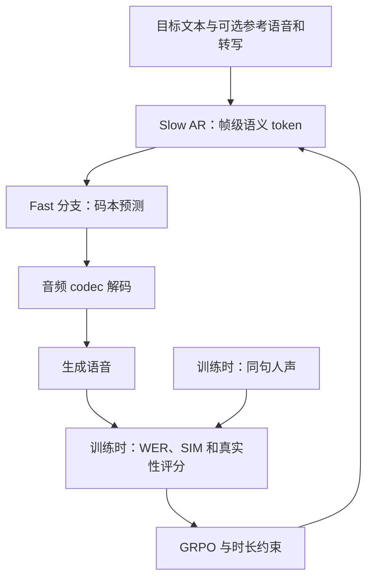
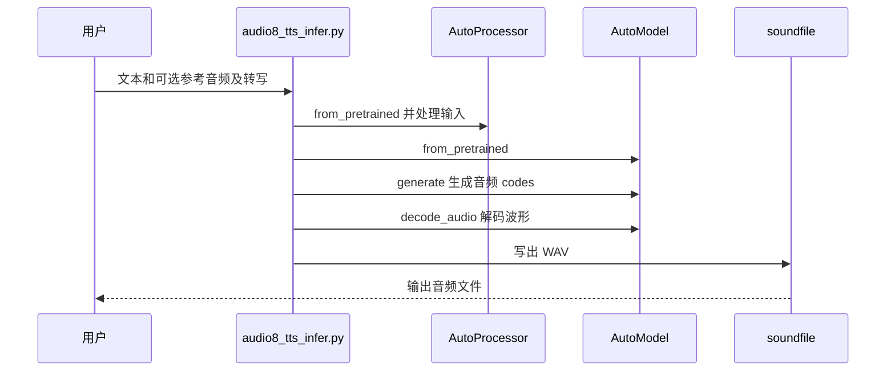

# Audio8 TTS：紧凑型多语言语音合成

## 一句话定义

Audio8-TTS-Realistic-0.6B 是支持参考音频零样本声音克隆的文本转语音模型；也可不提供参考音频生成语音。

## 英文缩写速查

| 缩写 | 英文全称 | 简要说明 |
|------|----------|----------|
| TTS | Text-to-Speech | 文本转语音 |
| SFT | Supervised Fine-Tuning | 监督微调 |
| GRPO | Group Relative Policy Optimization | 基于组内相对奖励优化 |
| WER | Word Error Rate | 词错误率 |
| SIM | Speaker Similarity | 说话人相似度 |

## 流程总览

基于 [论文 v1](https://arxiv.org/pdf/2610.14776v1) 和 [Realistic 模型卡](https://huggingface.co/Edge0/Audio8-TTS-Realistic-0.6b)，下图概括生成与训练监督，未假定两者中存在分歧的码本执行顺序。

- 模型卡列出主模型约 601M 参数，不含单独的 44.1 kHz codec；支持 23 种语言，效果随语言而异。
- 论文训练分三阶段：多语言 SFT、WER/SIM 奖励的 GRPO、加入真实性评价器的 GRPO。评价器将生成语音与相同文本的人声比较，以质量排序和停顿退化监督训练，另加抑制生成器身份线索的目标。
- 论文第 3 节称 fast 分支并行预测剩余九个码本；模型卡称 fast AR 以先前码本为条件。该差异尚未通过模型实现消解，不推断具体执行次序。

## 源码运行时序图

依据仓库快照的 `audio8_tts_infer.py`，展示单句或同模式批次推理：

入口支持批量 JSONL；参考音频与转写必须成对提供。脚本默认模型为 Preview，Realistic 需显式传入 `--model Edge0/Audio8-TTS-Realistic-0.6b`。

## 评测与局限

- 论文的九语言 CV3 平均错误率从 SFT 的 5.41% 降至最终的 4.86%，SIM 从 0.639 升至 0.661；跨模型结果来自不同评估流程，不宜直接视为严格排名。
- 真实性评价器的输出是同一条件下的相对评分，并非绝对自然度分数；论文指出对音高、能量和音频伪影的覆盖有限。
- 仓库公开推理、SFT 和部署代码，模型卡提供权重；论文数据含私有部分，完整 GRPO 训练复现条件未核实。
- 官方 README 写明 Realistic 尚无 ONNX 导出；不要将 Preview 版本的 ONNX 方案直接视为 Realistic 可用。

## 关联页面

- [X2Streaming-TTS](./paper-x2streaming-tts.md) — 面向流式文本的语音合成。
- [人形机器人语音交互](../methods/humanoid-voice-interaction.md) — 机器人语音交互链路。

## 参考来源

- [官方仓库归档](../../sources/repos/edge0-audio8-tts.md)
- [论文归档](../../sources/papers/audio8-tts-arxiv-2610-14776.md)
- [Realistic 模型卡](https://huggingface.co/Edge0/Audio8-TTS-Realistic-0.6b)

## 推荐继续阅读

- [官方推理和微调说明](https://github.com/Edge0-AI/Audio8_TTS)
