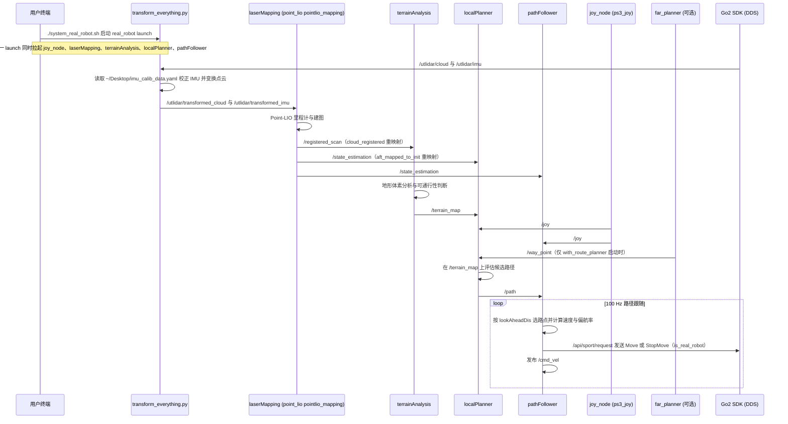

# autonomy_stack_go2

**autonomy_stack_go2**（[jizhang-cmu/autonomy_stack_go2](https://github.com/jizhang-cmu/autonomy_stack_go2)）是面向 **Unitree Go2 EDU** 的完整 **几何** 自主导航开源栈。

## 一句话定义

只用 Go2 内置 **L1 LiDAR + 雷达 IMU**，以 Point-LIO 建图定位，再接地形分析、避障、路径跟随与 FAR Planner，把目标点导航跑通——**不是** SAM / 开放词汇语义建图。

## 英文缩写速查

| 缩写 | 英文全称 | 简要说明 |
|------|----------|----------|
| GO2 | Unitree Go2 | 宇树四足；本栈要求 EDU（有 SDK） |
| LIO | LiDAR-Inertial Odometry | 激光–惯性里程计；本栈用 Point-LIO |
| LiDAR | Light Detection and Ranging | 内置 L1 为主传感器 |
| IMU | Inertial Measurement Unit | 雷达内 IMU，与激光紧耦合 |
| FAR | FAR Planner | 快速探索/路线规划模块 |
| ROS | Robot Operating System | 栈内含 ROS2 分支与仿真桥接 |

## 为什么重要

- 给 GO2 一条 **可复现的几何自主导航全栈**，而不只是单独跑 LIO。
- 展示 [point_lio_unilidar](./point-lio-unilidar.md) 如何接到地形、避障与规划。
- 与「DETR+SAM→3D」语义路线对照时，避免把 CMU 几何栈误当成语义建图（见 [CMU MSCV Semantic 3D Mapping](./cmu-mscv-semantic-3d-mapping.md) 与 [GO2 语义 Query](../queries/go2-3d-semantic-mapping-sam-pipeline.md)）。

## 核心信息

| 字段 | 内容 |
|------|------|
| 机构 | 卡内基梅隆大学（CMU） |
| 代码 | <https://github.com/jizhang-cmu/autonomy_stack_go2> |
| 开源 | **已开源** |
## 核心原理

| 模块 | 作用 |
|------|------|
| **SLAM** | Point-LIO（仓内适配 `point_lio_unilidar`） |
| **Base autonomy** | 地形可通行性分析、碰撞避免、waypoint following（源自 CMU Exploration 系） |
| **Route planner** | FAR Planner |
| **输入** | 目标点 或 手柄引导 + 系统避障 |
| **算力** | 机载或以太网外接电脑 |

## 工程实践

1. 确认 **Go2 EDU** 与 SDK；非 EDU 无官方 SDK 支持。
2. 按上游 README 克隆并编译（含仿真 / 真机分支说明）。
3. 先单独验证 L1 点云与 Point-LIO 地图锐利度，再开规划与避障。
4. 需要语义时：本栈只提供几何位姿/地图；语义层另接 DualMap / OVO 等。

## 局限与风险

- **无相机语义主路径**：不要期望开箱 DETR/SAM。
- 依赖上游 `point_lio_unilidar`、`unitree_ros2` 等版本匹配。
- 地图质量仍受时间同步、外参与振动影响（同 Point-LIO 工程坑）。

## 源码运行时序图

入口：`./system_real_robot.sh`（实际执行 `ros2 launch vehicle_simulator system_real_robot.launch`；仿真入口 `./system_simulation.sh` 未画入本图）

图依据：autonomy_stack_go2@43d5f54，读过 README.md、system_real_robot.sh、system_simulation.sh、src/base_autonomy/vehicle_simulator/launch/system_real_robot.launch、system_simulation.launch、system_real_robot_with_route_planner.launch、src/base_autonomy/local_planner/launch/local_planner.launch、src/base_autonomy/local_planner/src/pathFollower.cpp、localPlanner.cpp（订阅与发布段）、src/base_autonomy/terrain_analysis/src/terrainAnalysis.cpp（订阅与发布段）、src/slam/point_lio_unilidar/launch/mapping_utlidar.launch、config/utlidar.yaml、src/slam/point_lio_unilidar/src/laserMapping.cpp（订阅与发布段）、src/utilities/transform_sensors/transform_sensors/transform_everything.py、src/route_planner/far_planner/launch/far_planner.launch、src/route_planner/far_planner/src/far_planner.cpp（订阅与发布段）。

## 关联页面

- [point_lio_unilidar](./point-lio-unilidar.md)
- [Unitree](./unitree.md)
- [导航·SLAM 栈](../overview/navigation-slam-autonomy-stack.md)
- [GO2 三维语义建图与 SAM 流水线](../queries/go2-3d-semantic-mapping-sam-pipeline.md)
- [CMU MSCV Semantic 3D Mapping](./cmu-mscv-semantic-3d-mapping.md) — 语义投影线，勿混同
- [FAST-LIO](./fast-lio.md)
- [Situation-aware Frontier](./paper-situation-aware-frontier-quadruped-sar.md) — Go2 搜救探索目标选择，不是到点导航全栈

## 参考来源

- [sources/repos/autonomy_stack_go2.md](../../sources/repos/autonomy_stack_go2.md)
- 上游：<https://github.com/jizhang-cmu/autonomy_stack_go2>
- 源码核对（2026-11-02）：jizhang-cmu/autonomy_stack_go2@43d5f54，读过 README.md、system_real_robot.sh、system_simulation.sh、vehicle_simulator 与 local_planner 等 launch 文件、pathFollower.cpp、localPlanner.cpp、terrainAnalysis.cpp、point_lio_unilidar 的 mapping_utlidar.launch 与 laserMapping.cpp、transform_everything.py、far_planner.launch 与 far_planner.cpp（后几项为话题段 grep 级阅读）；时序图依据以上文件，未运行代码。

## 推荐继续阅读

- CMU Exploration 环境：<https://www.cmu-exploration.com>
- FAR Planner：<https://github.com/MichaelFYang/far_planner>
