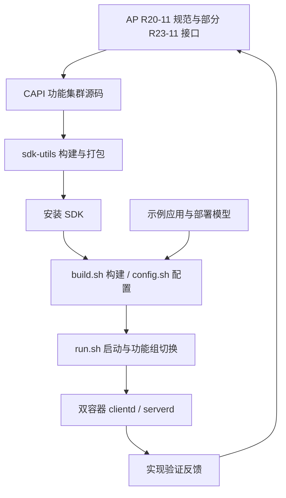
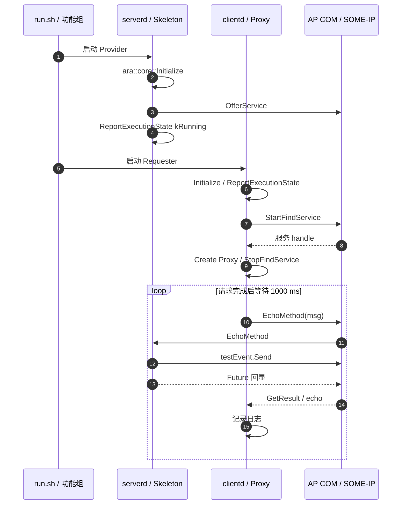

# AUTOSAR CAPI 1.0 (Common Adaptive Platform Implementation) — 自适应平台通用实现

## 一句话定义

CAPI 是 AUTOSAR Adaptive Platform 的共同软件实现：让行业在统一接口规范之外共享可编译的中间件基线、生成器及运行示例。

## 英文缩写速查

| 缩写 | 英文全称 | 简要说明 |
|---|---|---|
| AUTOSAR | Automotive Open System Architecture | 汽车软件架构标准合作组织 |
| CAPI | Common Adaptive Platform Implementation | AP 共同实现 |
| AP | Adaptive Platform | 面向高性能计算平台的汽车软件标准 |
| AA | Adaptive Application | 运行于 AP 的应用 |
| SOA | Service-Oriented Architecture | 以服务接口组织应用 |
| SOME/IP | Scalable service-Oriented MiddlewarE over IP | 示例采用的通信协议 |
| SDK | Software Development Kit | 编译、配置、部署应用的工具包 |
| SDV | Software-Defined Vehicle | 软件定义汽车 |

## 为什么重要

- 2026-08-20 的 1.0 发布意味着开发者可以从共同实现出发，而不必仅依照规范从零实现平台层；AP 规范仍然有效。
- 对机器人系统工程的参考价值在于接口、生成器、进程生命周期、服务发现和故障管理的分层设计，而不是直接把汽车平台用于关节控制。
- 官方目标是通过季度发布与实现反馈缩短规范到可执行代码的距离；尚不能据此量化实际量产周期缩短多少。

## 核心原理

| 核心信息 | 内容 |
|---|---|
| 机构 | AUTOSAR；初版基线由普华基础软件（iSOFT）贡献 |
| 发布版本 | CAPI 1.0，2026-08-20 |
| 规范锚点 | AP R20-11；部分 R23-11 接口兼容 |
| 实现范围 | 官方称覆盖 15 个核心功能集群，包含通信、执行管理、日志、诊断 |
| 交付 | 平台源码、代码生成器源码、SDK 构建入口、通信 Demo |
| 源码状态 | Community Source，公开可读，授权受限 |

目录按功能组织：`com`、`exec`、`log`、`diag` 等负责 AP 功能，`isoft/ara-gen` 提供生成器，`isoft/sdk-utils` 负责 SDK 构建，`samples/helloworld-cm` 展示通信。目录不直接等同于官方 15 集群的逐项规范列表。

### 流程总览

生成器在源码目录 `isoft/ara-gen` 中；这里的流程按官方构建指南概括，并不声称展示生成器内部调用图。

## 源码运行时序图

依据官方 [客户端 main.cpp](https://github.com/AUTOSAR/capi/blob/main/samples/helloworld-cm/client/src/main.cpp) 与 [服务端 main.cpp](https://github.com/AUTOSAR/capi/blob/main/samples/helloworld-cm/server/src/main.cpp)：两端启动次序只是示意；发现回调接受首个有效 handle，服务端发送三字符事件并回显原始请求字符串。客户端示例没有订阅该事件；1000 ms 是每次请求返回后的 sleep，不是硬实时周期。客户端日志计数从 0 开始，发送序号从 1 开始，服务端没有将序号加一。

## 工程实践

1. 在 Unix-like 环境准备 Docker、Compose 与 VS Code Dev Containers，按官方 README 打开开发容器。
2. 通过 `sdk-utils.py build` 与 `pack` 构建、打包 SDK（版本参数 2608）；安装生成的 SDK。
3. 用 SDK 的 `build.sh -i` 构建 `samples/helloworld-cm`，通过 `config.sh` 为各机器生成配置。
4. Compose 构建第二个容器；分别通过 `run.sh -R` 启动机器，再以 `run.sh -c HelloWorldGroup.Driving` 切换功能组；用日志检查回显，结束时 `run.sh -s`。
5. **建议验收指标（工程建议，非官方实测）**：记录发现耗时、请求往返延迟分布、丢包/断链恢复、状态切换与进程退出行为。

与 [ROS 2](../concepts/ros2-basics.md) 对照，可学习接口生成、服务通信和进程生命周期，但二者协议、生态、目标领域不同，不应等同。机器人高频运控仍需按截止时间预算设计。

## 局限与风险

- 公开源码不意味着 OSI 自由开源；官方许可规定信息用途，其他用途需相应许可，商业利用需授权，贡献需要符合合作伙伴资格。
- 官方声明仅面向汽车开发与测试，集成及实际认证由合作伙伴负责；不能宣称已获机器人功能安全认证。
- 本页核对了官方运行文档及 Demo 两端源码，未实际构建运行，未对全部功能集群做一致性、实时性或安全认证测试。
- 未获得行业研究报告全文；本文仅以官方发布、技术文档与源码作为事实依据。

## 关联页面

- [机器人系统工程知识链](../overview/hub-systems-engineering.md)
- [ROS 2 基础](../concepts/ros2-basics.md)
- [远程过程调用](../concepts/remote-procedure-call.md)
- [模型版本管理与 OTA](../concepts/model-versioning-ota.md)

## 参考来源

- [AUTOSAR CAPI 官方发布与项目页归档](../../sources/sites/autosar-capi.md)
- [AUTOSAR/capi 源码与运行文档归档](../../sources/repos/autosar-capi.md)

## 推荐继续阅读

- [Adaptive Platform 官方标准](https://www.autosar.org/standards/adaptive-platform/)
- [CAPI 1.0 发布说明](https://www.autosar.org/capi/capi-release)
- [构建和运行 CAPI](https://github.com/AUTOSAR/capi/blob/main/docs/building_and_running_CAPI.rst)
