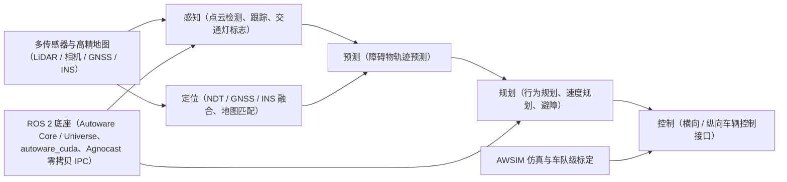
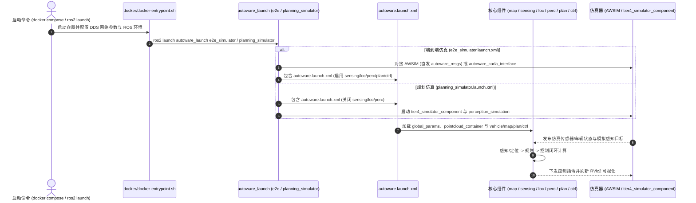

---

type: entity
tags: [repo, autonomous-driving, ros2, perception, planning, open-source, linux-foundation]
status: complete
updated: 2026-11-25
related:
  - ../queries/robot-perception-stack-selection-loop.md
  - ../overview/navigation-slam-autonomy-stack.md
  - ../entities/navigation2.md
  - ../concepts/ros2-basics.md
sources:
  - ../../sources/repos/autoware.md
summary: "Autoware 是领先的开源自动驾驶软件栈（ROS 2），覆盖感知、定位、预测、规划与控制，面向道路车辆与园区低速场景。"
---

# Autoware

**Autoware**（[autowarefoundation/autoware](https://github.com/autowarefoundation/autoware)）由 Autoware Foundation 维护，是 **开源 L4 级自动驾驶** 的代表性全栈项目，基于 ROS 2 模块化组件（Autoware Core / Universe）。

## 英文缩写速查

| 缩写 | 英文全称 | 简要说明 |
|------|----------|----------|
| ROS 2 | Robot Operating System 2 | 机器人系统集成与通信的常用中间件 |
| SLAM | Simultaneous Localization and Mapping | 同步定位与建图 |

## 为什么重要

- **道路场景完整链路**：激光/相机感知、高精地图定位、行为预测、轨迹规划、车辆控制一体化。
- **产业与学术交界**：大量试点车、仿真与工具链（AWSIM、工具文档）围绕 Autoware 展开。
- 与 [Nav2](../entities/navigation2.md) 对比：Nav2 偏 **通用移动机器人 2D 导航**；Autoware 偏 **结构化道路与多传感器融合驾驶**。

## 核心结构/机制

典型分层（Universe 组件举例，版本演进以官方为准）：

| 层 | 代表能力 |
|----|----------|
| **感知** | 点云检测、跟踪、交通灯/标志 |
| **定位** | NDT/GNSS/INS 融合、地图匹配 |
| **预测** | 障碍物轨迹预测 |
| **规划** | 行为规划、速度规划、避障 |
| **控制** | 横向/纵向车辆控制接口 |

部署常依赖 **高精地图、标定多传感器、合规安全流程**，复杂度显著高于室内 AMR。

- **2026-11-25 上游复核（`2.1.0`）**：2026-11-10 发布 Autoware `2.1.0`，将 CUDA 基础包从 Autoware Universe 迁入 Autoware Core（独立仓 `autowarefoundation/autoware_cuda` `1.0.0`）并提供 Core CUDA 层 Docker 镜像，持续推进 Agnocast 零拷贝 IPC 集成。

## 机制与架构图

## 源码运行时序图

核对源码：`autowarefoundation/autoware` 为元仓库（源码由 `repositories/autoware.repos` 经 `vcs import` 拉取），实际入口核对自 `src/README.md`、`repositories/autoware.repos`、`docker/docker-entrypoint.sh`、`docker/examples/demos/planning-simulator/docker-compose.yaml`、`docker/examples/demos/awsim/docker-compose.yaml` 及 `autowarefoundation/autoware_launch`（`0.53.0`）的 `planning_simulator.launch.xml`、`e2e_simulator.launch.xml` 与 `autoware.launch.xml`。

## 常见误区或局限

- **误区：Autoware = Nav2 升级版** — 架构目标、地图表示、法规流程不同，不可简单替换。
- **误区：克隆即可上路** — 需车队级标定、仿真验证与 ODD 定义。
- **局限**：对 **腿式/非道路机器人** 通常过重；室内 AMR 优先 Nav2 + 2D SLAM。

## 参考来源

- [sources/repos/autoware.md](../../sources/repos/autoware.md)
- [autowarefoundation/autoware](https://github.com/autowarefoundation/autoware)

## 关联页面

- [导航·SLAM·自动驾驶栈总览](../overview/navigation-slam-autonomy-stack.md)
- [Navigation2](./navigation2.md)

## 推荐继续阅读

- [Autoware Documentation](https://autowarefoundation.github.io/autoware-documentation/)
