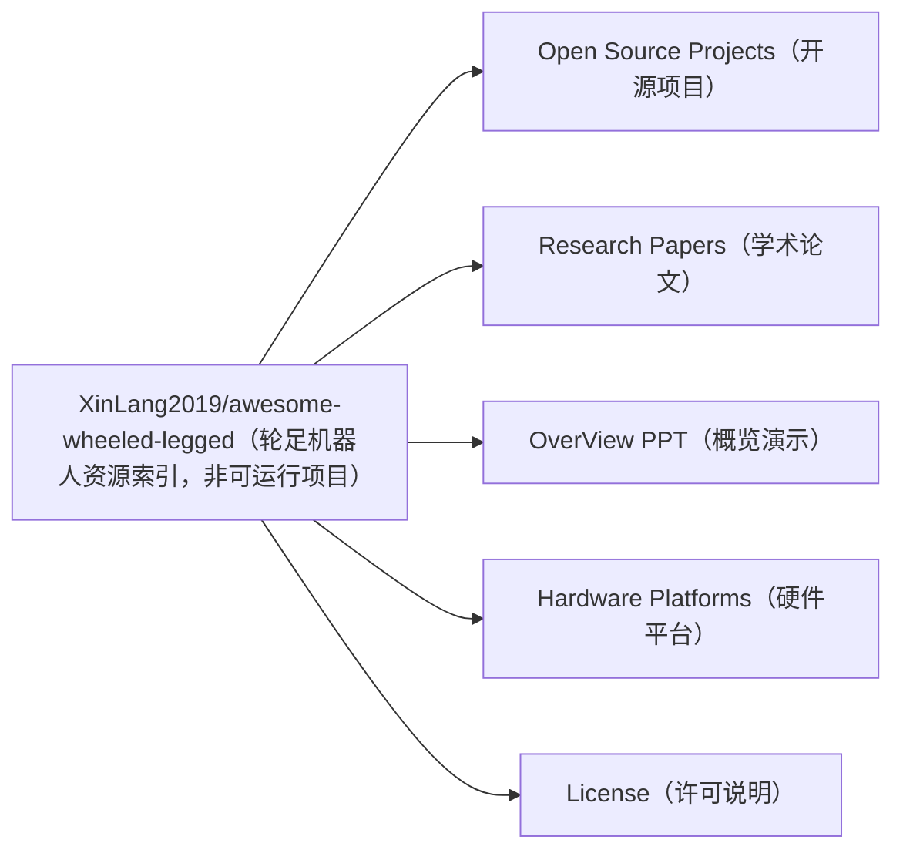

# awesome-wheeled-legged

**awesome-wheeled-legged**（[GitHub](https://github.com/XinLang2019/awesome-wheeled-legged)）来自 [古月居转载的四足机器人开源项目综述](https://mp.weixin.qq.com/s/pRGoPm41qYCNyHPWR6Dl6A)，属「轮足机器人」组。

## 一句话定义

**awesome-wheeled-legged 是轮足机器人资源清单：开源项目、论文、概览 PPT、硬件平台。**

## 英文缩写速查

| 缩写 | 英文全称 | 简要说明 |
|------|----------|----------|
| — | — | 本项目无需额外缩写 |

## 为什么重要

- 综述把它放在「轮足机器人」这条技术路线下，作为可读源码的参照项目；横向对比见 [四足机器人开源项目技术地图：从极简运动学到研究级硬件（36 个 GitHub 项目）](../overview/quadruped-open-source-projects-technology-map.md)。
- 文中星标：29（文章表述，入库日未复核）。

## 核心信息

| 项 | 内容 |
|----|------|
| **仓库** | [XinLang2019/awesome-wheeled-legged](https://github.com/XinLang2019/awesome-wheeled-legged) |
| **最近提交** | 2025-07-31 |
| **可达性** | `git ls-remote` 可达（2026-11-01） |
| **文章归类** | 轮足机器人 |

## 文章说法核对

- **文章：** 文章称其汇总了开源代码、学术论文与商业产品。
- **README / 核查：** README 目录为：Open Source Projects、Research Papers、OverView PPT、Hardware Platforms、License。
- **差异与保留：** 这是资源索引而非可运行项目。

## 机制与架构图

## 关联页面

- [混合运动](../tasks/hybrid-locomotion.md) — 按连续滚动、腿式越障与模式切换梳理清单里的平台。
- [locomotion](../tasks/locomotion.md)
- [open-source-humanoid-hardware](../entities/open-source-humanoid-hardware.md)
- [quadruped-open-source-projects-technology-map](../overview/quadruped-open-source-projects-technology-map.md)

## 参考来源

- [awesome_wheeled_legged.md](../../sources/repos/awesome_wheeled_legged.md)
- [wechat_guyueju_quadruped_opensource_deep_dive_2026-11-01.md](../../sources/blogs/wechat_guyueju_quadruped_opensource_deep_dive_2026-11-01.md)
- [原文（微信公众号）](https://mp.weixin.qq.com/s/pRGoPm41qYCNyHPWR6Dl6A)
