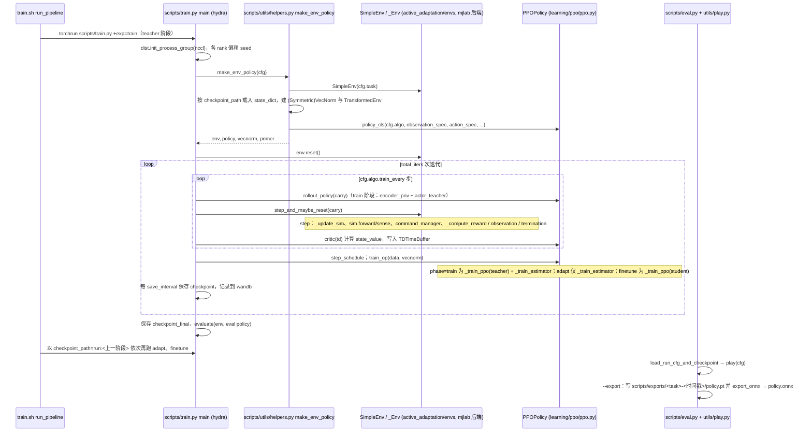

# Axellwppr / motion_tracking

**一句话定义**：[Axellwppr/motion_tracking](https://github.com/Axellwppr/motion_tracking) 是 [HEFT](./paper-heft.md) 的官方 **mjlab** 训练与导出仓库：`main` 实现 G1/L7 **PMG + WPC** 三阶段管线，`sim2real` 提供 **已发布 checkpoint** 与部署运行时。

## 英文缩写速查

| 缩写 | 英文全称 | 简要说明 |
|------|----------|----------|
| HEFT | HEavy-Payload Full-size humanoid Teleoperation | 本仓库 `main` 分支对应论文实现 |
| PMG | Privileged Motion Guidance | `vr_paired/{clean,raw}` 配对 memdataset |
| WPC | Windowed Payload Curriculum | L7 负载课程配置 `cfg/load/l7_wpc.yaml` |
| ONNX | Open Neural Network Exchange | `eval.py --export` 产出部署策略格式之一 |
| GMR | General Motion Retargeting | 配套 [Axellwppr/GMR](https://github.com/Axellwppr/GMR) 生成 50 Hz npz |

## 为什么重要

- **HEFT 可复现入口**：训练 profile（`G1_tracking.yaml` / `L7_tracking.yaml`）、`train.sh` 三阶段与 `eval.py` 导出与论文叙事一致。
- **分支职责清晰**：`sim2real` 单独承载真机部署，避免训练依赖与运行时混杂。
- **PMG 数据契约明确**：clean teacher 与 raw student 分目录存放，便于接入自有 VR 录制流。

## 核心结构

| 组件 | 路径 / 说明 |
|------|-------------|
| 训练入口 | `train.sh` → `run_pipeline "G1_tracking"` 或 `"L7_tracking"` |
| 任务配置 | `cfg/task/profile/G1_tracking.yaml`、`L7_tracking.yaml` |
| WPC | `cfg/load/l7_wpc.yaml`（公开窗标签待发布） |
| 数据集构建 | `scripts/data_process/generate_dataset.py` |
| 评测导出 | `scripts/eval.py`（`-p` 播放，`--export` 导出 ONNX/PT） |
| 部署 | `sim2real` 分支运行时与 checkpoint |

## 与其他页面的关系

- 方法背景：[paper-heft.md](./paper-heft.md)
- 跟踪基线：[paper-twist2.md](./paper-twist2.md)、[sonic-motion-tracking.md](../methods/sonic-motion-tracking.md)
- 部署集成示例：[GRIT Deploy Onboard G1](./grit-deploy-onboard-g1.md) — 更聚焦 G1 机载模式集成与策略运行，不替代 HEFT 训练 / 导出链路。
- 任务：[teleoperation.md](../tasks/teleoperation.md)

## 源码运行时序图

入口：`bash train.sh`（内部 `uv run torchrun --nproc_per_node=$NPROC scripts/train.py task=tracking task/profile=G1_tracking +exp=train`，随后依次 `+exp=adapt`、`+exp=finetune`）；导出：`uv run python scripts/eval.py --run_path <wandb 路径> -p --export`

图依据：Axellwppr/motion_tracking@731c3c4，读过 `README.md`、`pyproject.toml`、`train.sh`、`scripts/train.py`、`scripts/eval.py`、`scripts/utils/helpers.py`（make_env_policy）、`scripts/utils/play.py`（导出部分）、`cfg/exp/train.yaml`、`cfg/exp/adapt.yaml`、`active_adaptation/envs/base.py`（_step）、`active_adaptation/envs/locomotion.py`（开头）、`active_adaptation/learning/ppo/ppo.py`（get_rollout_policy / train_op / _train_ppo）。`sim2real` 部署分支、数据集生成脚本内部与 mjlab 内部未读。

## 参考来源

- [axellwppr_motion_tracking.md](../../sources/repos/axellwppr_motion_tracking.md)
- [heft_arxiv_2607_02332.md](../../sources/papers/heft_arxiv_2607_02332.md)
- 源码核对（2026-11-02）：Axellwppr/motion_tracking@731c3c4，读过 README.md、pyproject.toml、train.sh、scripts/train.py、scripts/eval.py、scripts/utils/helpers.py、scripts/utils/play.py（导出部分）、cfg/exp/train.yaml 与 adapt.yaml、active_adaptation/envs/base.py（_step）、locomotion.py（开头）、learning/ppo/ppo.py（部分）；时序图依据以上文件，未运行代码。

## 推荐继续阅读

- [机器人论文阅读笔记：HEFT](https://imchong.github.io/Robot_Learning_Paper_Notebooks/papers/07_Teleoperation/HEFT__Heavy-Payload_Full-size_Humanoid_Teleoperation_with_Privileged_Motion_Guidance/HEFT__Heavy-Payload_Full-size_Humanoid_Teleoperation_with_Privileged_Motion_Guidance.html)
- [GitHub 仓库](https://github.com/Axellwppr/motion_tracking)
- [HEFT 项目页](https://heft.axell.top/)
- [修改版 GMR 导出器](https://github.com/Axellwppr/GMR)
