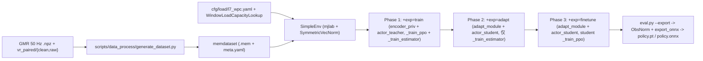
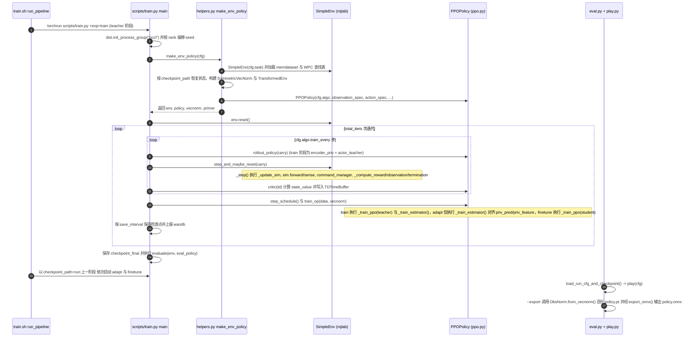

# Axellwppr / motion_tracking

## 一句话定义

[Axellwppr/motion_tracking](https://github.com/Axellwppr/motion_tracking) 是 [HEFT](./paper-heft.md)（arXiv:2607.02332）的官方 **mjlab** 运动跟踪训练与导出仓库：`main` 分支实现面向 Unitree G1 与全尺寸人形 L7 的 **PMG（Privileged Motion Guidance）** 三阶段训练管线与 **WPC（Windowed Payload Curriculum）** 负载课程，`sim2real` 分支另行承载真机部署运行时与预训练 checkpoint。

## 英文缩写速查

| 缩写 | 英文全称 | 简要说明 |
|------|----------|----------|
| HEFT | Heavy-Payload Full-size humanoid Teleoperation | 本仓库 `main` 分支对应的全尺寸重载全身遥操作论文 |
| PMG | Privileged Motion Guidance | 基于 `vr_paired/{clean,raw}` 配对数据集的特权运动引导 |
| WPC | Windowed Payload Curriculum | `cfg/load/l7_wpc.yaml` 对应的 5 s 窗口化负载课程 |
| ONNX | Open Neural Network Exchange | `eval.py --export` 固化的部署模型导出格式 |
| GMR | General Motion Retargeting | 配套 [Axellwppr/GMR](https://github.com/Axellwppr/GMR) 生成 50 Hz `.npz` 动作 |

## 为什么重要

- **端到端复现 HEFT 主栈**：仓库把论文的 `train → adapt → finetune` 三阶段课程、`G1_tracking.yaml` / `L7_tracking.yaml` 配置与 `ObsNorm` 固化导出统一收敛在 Hydra + `mjlab` 接口下。
- **PMG 配对数据契约清晰**：`generate_dataset.py` 明确分离教师使用的 `clean` 参考与学生面对的噪声 `raw` VR 流，方便接入自定义 VR 录制设备与 RoHM 清洗流程。
- **面向重载任务的课程封装**：`WindowLoadCapacityLookup` 与 `cfg/load/l7_wpc.yaml` 将 30 kg 递减式 5 s 窗口负载能力跟踪从具体奖励项解耦出来，便于扩展到不同高负载人形平台。

## 核心原理与流程总览

仓库主干模块与配置文件分布如下：

| 组件 | 路径 / 说明 |
|------|-------------|
| 流水线入口 | `train.sh` → `run_pipeline "G1_tracking"` 或 `"L7_tracking"`，串联 `+exp=train`、`+exp=adapt`、`+exp=finetune` |
| 训练主脚本 | `scripts/train.py`（Hydra 解析、`torchrun` DDP、`TDTimeBuffer` 与 `SymmetricVecNorm`） |
| 任务配置 | `cfg/task/profile/G1_tracking.yaml`（G1）、`cfg/task/profile/L7_tracking.yaml`（L7） |
| WPC 负载课程 | `cfg/load/l7_wpc.yaml` 与 `active_adaptation/utils/window_load_capacity.py`（`WindowLoadCapacityLookup`） |
| 策略与环境核心 | `active_adaptation/learning/ppo/ppo.py`（`PPOPolicy`）与 `active_adaptation/envs/base.py`（`SimpleEnv._step`） |
| 数据集构建 | `generate_dataset.sh` → `scripts/data_process/generate_dataset.py` |
| 评测与导出 | `scripts/eval.py`、`scripts/utils/play.py`、`active_adaptation/utils/export.py`（`ObsNorm` + `export_onnx`） |
| 真机部署分支 | `sim2real` 分支与 `compliance` 分支（不在本地 `main@731c3c4` 检出内） |

## 源码运行时序图

入口：`bash train.sh`（内部执行 `uv run torchrun --nproc_per_node=$NPROC scripts/train.py task=tracking task/profile=G1_tracking +exp=train`，并依次串联 `+exp=adapt` 与 `+exp=finetune`）；导出：`uv run python scripts/eval.py --run_path <wandb 路径> -p --export`。

## 工程实践

1. **构建 PMG / 跟踪数据集**
   - 通过 [Axellwppr/GMR](https://github.com/Axellwppr/GMR) 将 SMPL/动作捕捉数据重定向为 50 Hz `.npz`，如使用配对 VR 引导则准备 `vr_paired/{clean,raw}` 目录，随后运行 `bash generate_dataset.sh`（内部调用 `scripts/data_process/generate_dataset.py`）生成 `memdataset`（`.mem` + `meta.yaml`）。
2. **三阶段课程训练启动与超参调整**
   - 直接运行 `bash train.sh` 可自动串联 `+exp=train` → `+exp=adapt` → `+exp=finetune`；若需在单机多卡调整环境数与批大小，优先覆盖 `cfg/task/profile/{G1,L7}_tracking.yaml` 与 `cfg/exp/*.yaml`，并在 `adapt` 阶段确认检查点已从 `train` 阶段正确继承（`checkpoint_path=run:...`）。
   - 对 L7 重载任务启用 `cfg/load/l7_wpc.yaml` 时，需确保 `window_labels` 路径与本地生成或下载的 5 s 窗口标签一致。
3. **仿真回放与 ONNX 部署导出**
   - 训练完成后使用 `uv run python scripts/eval.py --run_path <wandb_run_or_ckpt> -p --export` 验证学生策略闭环，脚本会自动通过 `ObsNorm.from_vecnorm()` 把运行期观测均值方差烘焙进模型，避免真机部署时手动同步归一化统计。

## 常见误区与局限

- **本地 `main` 分支不包含真机部署代码**：`axellwppr_motion_tracking@731c3c4` 仅包含训练与 ONNX 导出代码；`README.md` 所述的 `sim2real` 部署运行时、已发布 checkpoint 与柔顺控制扩展分别位于 `sim2real` 和 `compliance` 分支，使用前需切换检出对应分支。
- **WPC 窗标签与配对 VR 资产需外部准备**：`cfg/load/l7_wpc.yaml` 指向外部 `data/motion/paired_vr_22/window_labels` 路径，仓库本身不随代码打包完整原始数据集或窗口负载标签。
- **`adapt` 阶段不更新学生 actor**：阅读 `ppo.py` 可见 `phase == "adapt"` 时 `train_op()` 仅调用 `_train_estimator()` 训练 `adapt_module` 去拟合教师 `encoder_priv` 特征，`actor_student` 参数仅在第三阶段 `finetune` 中通过 PPO 更新；若跳过 `finetune` 直接部署，学生策略应对未见估计误差的鲁棒性会受限。

## 关联页面

- 对应论文实体：[HEFT 论文页](./paper-heft.md)（完整实验结果、表 E.1 7 项 24 kg 真机负载任务与基线对比）
- 跟踪与遥操作基线：[TWIST2](./paper-twist2.md)、[SONIC 全身跟踪方法](../methods/sonic-motion-tracking.md)
- 机载部署对照：[GRIT Deploy Onboard G1](./grit-deploy-onboard-g1.md)（G1 机载部署架构对照）
- 上游任务定义：[遥操作（Teleoperation）](../tasks/teleoperation.md)

## 参考来源

- [axellwppr_motion_tracking_reading.md](../../sources/repos/axellwppr_motion_tracking_reading.md)（论文全文与 `@731c3c4` 源码精读归档）
- [axellwppr_motion_tracking.md](../../sources/repos/axellwppr_motion_tracking.md)
- [heft_arxiv_2607_02332.md](../../sources/papers/heft_arxiv_2607_02332.md)

## 推荐继续阅读

- [机器人论文阅读笔记：HEFT](https://imchong.github.io/Robot_Learning_Paper_Notebooks/papers/07_Teleoperation/HEFT__Heavy-Payload_Full-size_Humanoid_Teleoperation_with_Privileged_Motion_Guidance/HEFT__Heavy-Payload_Full-size_Humanoid_Teleoperation_with_Privileged_Motion_Guidance.html)
- [Axellwppr/motion_tracking GitHub 仓库](https://github.com/Axellwppr/motion_tracking)
- [HEFT 项目主页](https://heft.axell.top/)
- [修改版 GMR 重定向工具](https://github.com/Axellwppr/GMR)
