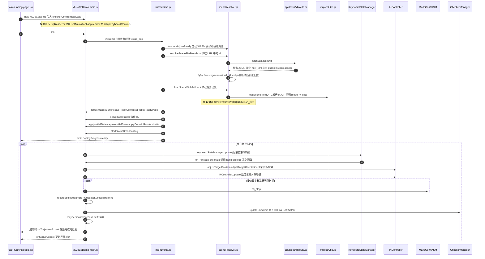

# Axis Robotics（AXIS ROBOTICS）

**Axis Robotics** 是面向 **Physical AI** 的可复用数据基础设施公司（[官网](https://axisrobotics.ai/)）。其平台用浏览器仿真遥操作降低演示采集门槛，再连接 GPU 仿真、轨迹清洗、策略训练与 Sim2Real 评估。官方[平台技术报告](https://techreport.axisrobotics.ai/)详细描述跨仿真器、跨机器的基础设施设计；[AXIS-V1 数据引擎](https://axisaiorg.github.io/AXIS-V1/)及 AxisAIOrg 开源模块是相关技术线上的其他产物。

## 一句话定义

**把「浏览器演示采集 → 统一轨迹 → GPU 仿真增广与清洗 → 下游训练评测」串成跨设备的机器人数据工作流，并以部署反馈驱动后续数据迭代。**

## 英文缩写速查

| 缩写 | 英文全称 | 简要说明 |
|------|----------|----------|
| AXIS | A Growable Community-Driven Data Engine（项目名） | 浏览器采集、任务生成与数据处理项目 |
| VLA | Vision-Language-Action | 报告中的下游策略训练方向 |
| WASM | WebAssembly | 浏览器端运行 MuJoCo 仿真的技术 |
| Sim2Real | Simulation to Reality | 仿真训练或验证向真实机器人迁移 |
| LIBERO | Language Instructed Benchmark for Everyday Robot Operation | 报告轨迹清洗验证所用的操作任务基准 |

## 为什么重要

- **数据瓶颈叙事与工程对齐：** 与[具身数据飞轮](../concepts/data-flywheel.md)同向，但强调社区规模采集、跨机器处理和自动质检。
- **部分开源可复现触点：** [AxisWebInfra](https://github.com/AxisAIOrg/AxisWebInfra)、[AxisTaskGen](https://github.com/AxisAIOrg/AxisTaskGen)、[AxisDataCleaning](https://github.com/AxisAIOrg/AxisDataCleaning)等可用于研究 Web 采集、任务定义与离线轨迹处理；完整平台不能由此推断为开源。
- **Scaling 单位变化：** [可组合能力库](./axis-composable-capability-library.md)把基本单元进一步描述为可链式 Expert，与[多专家蒸馏](../methods/multi-expert-distillation.md)的技能组合形成操作域对照。

## 核心信息

| 字段 | 内容 |
|------|------|
| **机构** | 轴心机器人（Axis Robotics） |
| **官网** | <https://axisrobotics.ai/> |
| **平台技术报告** | <https://techreport.axisrobotics.ai/> |
| **GitHub** | <https://github.com/AxisAIOrg>（部分模块开放） |
| **开源结论** | Web 遥操作、任务生成、数据清洗、训练基础设施等仓库公开；报告页未提供直达数据集或模型权重的链接。 |

## 平台架构（技术报告）

报告描述的主要数据流如下：

浏览器采集端减少了对专用采集硬件和 GPU 的依赖；较重的仿真回放和增广移到 Linux GPU 服务器。任务生成、轨迹清洗以及下游训练评测构成报告描述的生产链路。

## 技术报告中的轨迹清洗验证

报告用 LIBERO 16 个任务检查离线清洗效果，汇总加速度从 0.2128 降至 0.0985，jerk 从 2.7844 降至 1.4670；报告同时列出位置偏差 0.0398 m、移除比例 4.79%。清洗步骤包括质量筛选、迟疑片段移除、Savitzky–Golay 平滑和 cubic spline 重采样。

这些数字衡量的是轨迹质量变化，支持清洗降低高频不平滑的解释；它们本身**不等于**策略成功率、泛化或真机性能提升。应与下游训练和实体机器人评估结果分开阅读。

## 工程实践与开放状态

1. **从公开模块复现局部链路：** 组织公开 AxisWebInfra、AxisTaskGen、AxisDataCleaning、Axis-V1-Training 等仓库。[AxisWebInfra README](https://github.com/AxisAIOrg/AxisWebInfra)提供浏览器 MuJoCo 和轨迹记录的运行入口，标注 Apache-2.0；仓库索引见[AxisAIOrg 归档](../../sources/repos/axisaiorg.md)。
2. **不把模块开放等同于全栈开放：** 技术报告项目页链接组织级 GitHub，但没有提供数据集或权重直达链接。数据、训练配置、模型权重和平台服务的可复现范围应逐项核实。
3. **与 AXIS-V1 论文分工：** arXiv:2607.21588 聚焦社区数据引擎与 benchmark；本报告聚焦跨仿真器、跨机器的基础设施及数据管线；2026-09-25 博客则讨论 Expert、proxy 选数据与 Grounded RSI。它们在同一个 Axis Robotics 实体下作为不同来源维护。

## 局限与风险

- LIBERO 轨迹平滑指标属于离线清洗验证，不证明下游策略收益；需要结合论文/报告中的训练配置和任务成功率结果评估。
- 项目页虽链接 PDF，但本次抓取无法解析约 11.6 MB 文件全文；当前条目依据官方网页及其公开表格，报告细节仍应回看 PDF。
- GitHub 组织公开的是若干模块，报告页未列数据集或权重链接；不可将其表述为完整开放平台。
- 2026-09 博客的 Expert、proxy 和 RSI 主张与本报告的数据基础设施视角相邻，但不是同一项实验结果。

## 源码运行时序图

入口：`npm install`（postinstall 把 `mujoco-js` 复制到 `public/mujoco-js/`）后执行 `npm run dev`，浏览器打开 `/tasks` 点击 Start Task，进入 `/task-running?id=N`，由 `src/app/task-running/page.tsx` 挂载 `MuJoCoDemo`。下图是 AxisWebInfra 仓库的运行路径（浏览器内 MuJoCo-WASM 与键盘遥操作），不代表 Axis Robotics 的云端数据平台。

图依据：AxisAIOrg/AxisWebInfra@1c20008，实际读过 `README.md`、`package.json`（scripts 与 dependencies）、`src/app/page.tsx`、`src/app/task-running/page.tsx`、`src/app/api/tasks/[id]/route.ts`、`src/lib/local-task-api.ts`、`src/lib/mujoco-utils.ts`（loadMujoco）、`src/components/mujoco-framework-next/main.js`、`utils/initRuntime.js`、`utils/sceneResolver.js`、`utils/robot_config.js`、`utils/rendererRuntime.js`、`utils/teleopController.js`（setupKeyboardControls）、`utils/checkerRuntime.js`、`utils/KeyboardStateManager.js`（部分）、`utils/IKController.js`（方法清单）、`utils/mujocoUtils.js`（导出清单）。`loadSceneFromURL`、`IKController.update` 内部、`CheckerManager` 与 `statusBroadcaster` 的实现未逐行读，仅按调用点画出。

## 关联页面

- [可组合 robotic 能力库（2026-09-25 博客）](./axis-composable-capability-library.md)
- [Sim2Real](../concepts/sim2real.md) · [具身数据飞轮](../concepts/data-flywheel.md)
- [递归自改进（RSI）](../concepts/recursive-self-improvement.md)
- [VLA](../methods/vla.md) · [Multi-Expert Distillation](../methods/multi-expert-distillation.md)
- [2026 具身 infra 全景](../overview/embodied-infra-2026-panorama.md)

## 参考来源

- [Axis Robotics 官网归档](../../sources/sites/axisrobotics-ai.md)
- [Axis Robotics Platform 技术报告项目页核查](../../sources/sites/axisrobotics-techreport.md)
- [Axis Robotics Platform 技术报告归档](../../sources/papers/axis-robotics-platform-tech-report.md)
- [AXIS-V1 项目页归档](../../sources/sites/axisaiorg-github-io.md)
- [AxisAIOrg 仓库索引](../../sources/repos/axisaiorg.md)
- [Composable Library 博客归档](../../sources/blogs/axis_composable_library_robotic_capabilities_2026-09-25.md)
- 源码核对（2026-11-02）：AxisAIOrg/AxisWebInfra@1c20008，读过 README.md、package.json、src/app/task-running/page.tsx、src/app/api/tasks/[id]/route.ts、src/lib/mujoco-utils.ts、src/components/mujoco-framework-next/main.js、utils/initRuntime.js、utils/sceneResolver.js、utils/rendererRuntime.js、utils/teleopController.js、utils/checkerRuntime.js、utils/KeyboardStateManager.js（部分）；时序图依据以上文件，未运行代码。

## 推荐继续阅读

- 平台技术报告：<https://techreport.axisrobotics.ai/>
- AxisAIOrg 开源模块：<https://github.com/AxisAIOrg>
- AXIS 论文：<https://arxiv.org/abs/2607.21588>
- 公司博客：<https://axisrobotics.ai/blogs/blog/beyond-more-tasks-axis-is-building-a-composable-library-of-robotic-capabilities>
