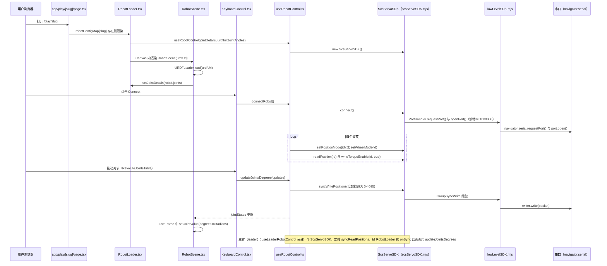

# Bambot

**Bambot**（[GitHub](https://github.com/timqian/bambot)，[官网/页面](https://bambot.org)）是 [GitHubStore《19 款能自己造的开源人形机器人》](https://mp.weixin.qq.com/s/UUwUAcKdVrlo-N60Oar3Xg) 的第 8 项，文章标价 约 $300。

## 一句话定义

**Bambot 是低成本开源 AI 机器人项目（官网 bambot.org，README 标语「Play with open-source, low-cost AI robots」），文章称含 3D 打印件、硬件清单与浏览器端控制界面。**

## 英文缩写速查

| 缩写 | 英文全称 | 简要说明 |
|------|----------|----------|
| — | — | 本项目无需额外缩写 |

## 为什么重要

- 属于文章按成本从低到高排列的「能自己造」清单；横向对比见 [能自己造的开源人形机器人 19 款：按成本与形态排序的阅读坐标](../overview/open-source-buildable-humanoids-19-technology-map.md)。
- 价格为文章标价（约 $300），入库日未核实。

## 核心信息

| 项 | 内容 |
|----|------|
| **链接** | [GitHub](https://github.com/timqian/bambot)，[官网/页面](https://bambot.org) |
| **许可（核查）** | Apache-2.0（LICENSE 文件） |
| **最近提交** | 2025-07-14 |

## 文章说法核对

- **文章：** 文章称设计结合常见舵机与模块化结构，Apache-2.0 许可，适合快速搭建可交互机器人并尝试 AI 控制。
- **README / 核查：** README 仅有标语与演示视频，LICENSE 为 Apache-2.0；其余细节（硬件清单、浏览器控制）在 README 中未展开。
- **差异与保留：** **文章归入「人形机器人」，但 README 未称其为人形**；形态与硬件细节来自文章，未核实。

## 源码运行时序图

入口：`cd website && pnpm dev`（`website/package.json` 的 `dev` 脚本为 `next dev --turbopack`），浏览器打开 `/play/<slug>`。

图依据：timqian/bambot@eba23eb，README.md、website/package.json、website/app/play/[slug]/page.tsx、website/components/playground/RobotLoader.tsx、website/components/playground/RobotScene.tsx、website/hooks/useRobotControl.ts、website/hooks/useLeaderRobotControl.ts、website/components/playground/keyboardControl/KeyboardControl.tsx、website/components/playground/keyboardControl/RevoluteJointsTable.tsx、website/components/playground/leaderControl/LeaderControl.tsx、feetech.js/index.mjs、feetech.js/scsServoSDK.mjs、feetech.js/lowLevelSDK.mjs。

## 关联页面

- [humanoid-robot](../entities/humanoid-robot.md)
- [open-source-humanoid-hardware](../entities/open-source-humanoid-hardware.md)
- [open-source-buildable-humanoids-19-technology-map](../overview/open-source-buildable-humanoids-19-technology-map.md)

## 参考来源

- [bambot.md](../../sources/repos/bambot.md)
- [wechat_githubstore_19_buildable_open_source_humanoids_2026-11-02.md](../../sources/blogs/wechat_githubstore_19_buildable_open_source_humanoids_2026-11-02.md)
- [原文（微信公众号）](https://mp.weixin.qq.com/s/UUwUAcKdVrlo-N60Oar3Xg)
- 源码核对（2026-11-02）：timqian/bambot@eba23eb，读过 README.md、website/app/play/[slug]/page.tsx、website/components/playground/RobotLoader.tsx、website/hooks/useRobotControl.ts、website/hooks/useLeaderRobotControl.ts、feetech.js/scsServoSDK.mjs（connect、writePosition 等核心段）；grep 过 website/package.json、website/components/playground/RobotScene.tsx、website/components/playground/keyboardControl/KeyboardControl.tsx、website/components/playground/keyboardControl/RevoluteJointsTable.tsx、website/components/playground/leaderControl/LeaderControl.tsx、feetech.js/index.mjs、feetech.js/lowLevelSDK.mjs；时序图依据以上文件，未运行代码。
