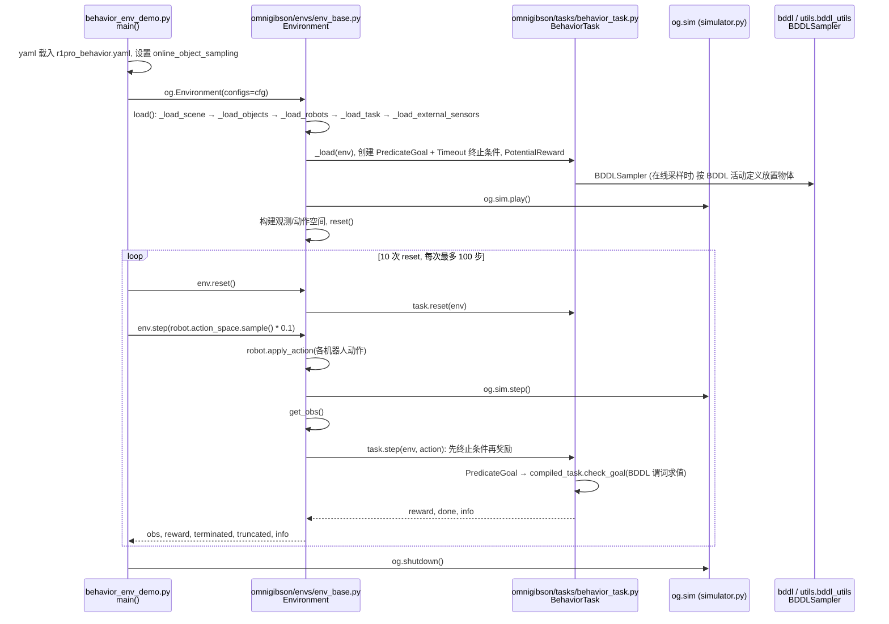

---

type: entity
tags: [entity, simulator, benchmark, embodied-ai, omniverse, everyday-activities, nvidia]
status: complete
updated: 2026-09-15
related:
  - ../queries/embodied-eval-benchmark-selection-loop.md
  - ./nvidia-omniverse.md
  - ./paper-behavior-foundation-model-humanoid.md
  - ../concepts/simulation-evaluation-infrastructure.md
  - ../overview/sim-platforms-decade-technology-map.md
  - ./paper-simfoundry-real2sim-scene-generation.md
sources:
  - ../../sources/repos/omnigibson.md
  - ../../sources/blogs/wechat_shenlan_sim_platforms_top8_decade.md
summary: "斯坦福等 2023 年推出的具身 AI 基准：基于社会调查筛选 1000 种人类日常活动，在 Omniverse 上构建高逼真多物理仿真环境，评估开放世界综合能力。"
---

# BEHAVIOR-1K

**BEHAVIOR-1K** 是斯坦福大学等机构 2023 年发布的 **千项日常活动具身 AI 基准**，在 NVIDIA Omniverse 上构建高逼真物理与视觉环境。

## 一句话定义

> BEHAVIOR-1K 用 **「人类真正希望机器人做什么」** 来定义任务：从社会调查提炼 1000 种日常活动（清理、备餐等），在统一仿真器中评测刚体、形变体、流体与热力学状态——把开放世界具身能力变成可量化的长跑目标。

## 英文缩写速查

| 缩写 | 英文全称 | 简要说明 |
|------|----------|----------|
| BDDL | BEHAVIOR Domain Definition Language | 活动逻辑与成功条件的形式化语言 |
| Sim2Real | Simulation to Real | 仿真到真机迁移 |
| VLA | Vision-Language-Action | 视觉-语言-动作策略 |
| GPU | Graphics Processing Unit | Omniverse 渲染与物理算力 |

## 为什么重要

许多 benchmark 任务来自研究者想象，与真实需求脱节。BEHAVIOR-1K 的贡献：

1. **需求对齐**：任务源于 **广泛社会调查**，覆盖家务等高频诉求。
2. **多物理统一**：刚体、可变形体、流体、温度等在同一框架下评测。
3. **极具挑战**：长视距、多步骤、多物体约束——适合作为 **行为基础模型（BFM）** 与 VLA 的 **上限考试**。
4. **生态挂接**：与 [行为基础模型](./paper-behavior-foundation-model-humanoid.md) 等研究线交叉索引。

## 核心结构/机制

- **Omniverse 场景**：高保真资产与传感器仿真。
- **BDDL 任务规范**：目标状态的形式化描述与自动成功判定。
- **活动分层**：从原子技能到完整日常流程。

## 常见误区或局限

- **误区：BEHAVIOR-1K = 单一仿真器品牌** — 它是 **基准 + 任务本体**；底层依赖 Omniverse 生态（见 [NVIDIA Omniverse](./nvidia-omniverse.md)）。
- **局限：入门成本** — 环境与资产重；快速 loco 原型见 [MuJoCo Playground](./mujoco-playground.md)。

## HMI 开源主表入口

[OmniGibson / BEHAVIOR-1K](https://github.com/StanfordVL/OmniGibson) 收录于具身智能研究室 [开源项目主表](https://github.com/RealXiaoze/humanoid-motion-intelligence/blob/main/%E8%AE%BA%E6%96%87%E4%B8%8E%E9%A1%B9%E7%9B%AE/%E5%BC%80%E6%BA%90%E9%A1%B9%E7%9B%AE%E4%B8%BB%E8%A1%A8.md)。

主表分列「BEHAVIOR / OmniGibson」（任务规范与评测）与「OmniGibson」（仿真运行层）。二者同属 StanfordVL 生态：本页承载任务基准叙事；运行层代码入口为 [StanfordVL/OmniGibson](https://github.com/StanfordVL/OmniGibson)（及 BEHAVIOR-1K 仓）。不另建重复 `omnigibson` 实体。

覆盖核对见 [HMI 开源项目主表覆盖索引](../queries/hmi-opensource-projects-coverage.md)。

## 源码运行时序图

入口：`python -m omnigibson.examples.environments.behavior_env_demo`（`OmniGibson/omnigibson/examples/environments/behavior_env_demo.py`，读取 `r1pro_behavior.yaml` 配置；安装用仓库根目录 `setup.sh`）。该示例用随机动作演示 BEHAVIOR 任务环境的 Gym 循环；官方评测另有 `OmniGibson/omnigibson/eval/eval.py`（本图未覆盖）。

图依据：StanfordVL/OmniGibson@14bc29c，读过 README.md、OmniGibson/omnigibson/examples/environments/behavior_env_demo.py、OmniGibson/omnigibson/envs/env_base.py（load/step/reset）、OmniGibson/omnigibson/tasks/behavior_task.py（终止条件、奖励、BDDLSampler 创建处）、OmniGibson/omnigibson/tasks/task_base.py（step）、OmniGibson/omnigibson/termination_conditions/predicate_goal.py。

## 关联页面

- [NVIDIA Omniverse](./nvidia-omniverse.md)
- [仿真评测基础设施](../concepts/simulation-evaluation-infrastructure.md)
- [十年仿真平台技术地图](../overview/sim-platforms-decade-technology-map.md)
- [具身大模型评测基准选型闭环](../queries/embodied-eval-benchmark-selection-loop.md) — 本页可归入其 ③ 策略任务成功率评测层：开放世界日常活动综合能力基准
- [SimFoundry](./paper-simfoundry-real2sim-scene-generation.md) — GEAR 视频孪生开源默认导出 OmniGibson 场景 JSON

## 参考来源

- [sources/blogs/wechat_shenlan_sim_platforms_top8_decade.md](../../sources/blogs/wechat_shenlan_sim_platforms_top8_decade.md)
- Li et al., *BEHAVIOR-1K: A Benchmark for Embodied AI with 1,000 Everyday Activities and Realistic Simulation* — [arXiv](https://arxiv.org/abs/2212.11794)
- 源码核对（2026-11-02）：StanfordVL/OmniGibson@14bc29c，读过 README.md、OmniGibson/omnigibson/examples/environments/behavior_env_demo.py、OmniGibson/omnigibson/envs/env_base.py、OmniGibson/omnigibson/tasks/behavior_task.py、OmniGibson/omnigibson/tasks/task_base.py、OmniGibson/omnigibson/termination_conditions/predicate_goal.py；时序图依据以上文件，未运行代码。

## 推荐继续阅读

- [BEHAVIOR 项目页](https://behavior.stanford.edu/)
- [行为基础模型（人形）](./paper-behavior-foundation-model-humanoid.md)
