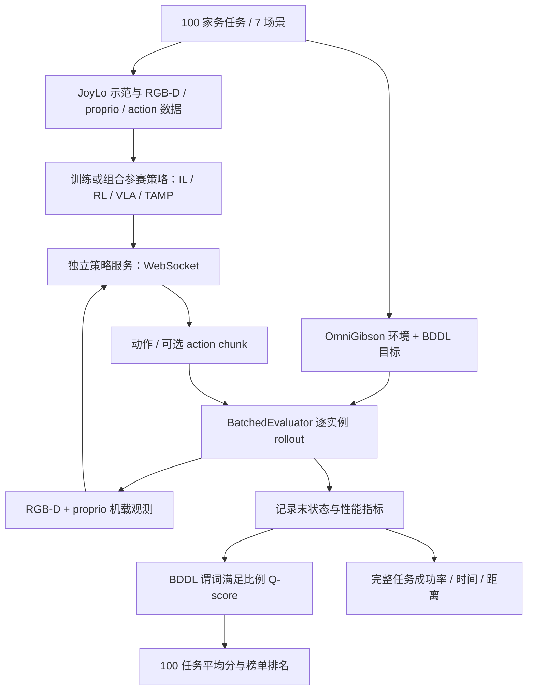
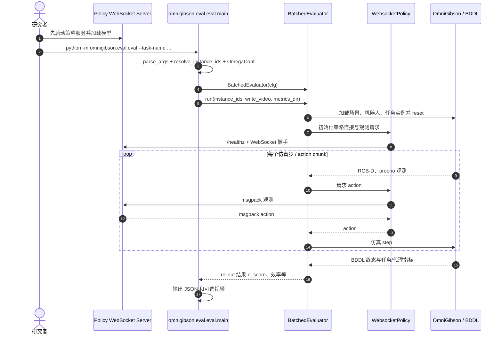

# 2026 BEHAVIOR Challenge（2026 BEHAVIOR 家庭机器人挑战赛）

## 一句话定义

**2026 BEHAVIOR Challenge** 是 Stanford Vision and Learning Lab 在 CoRL 2026 举办的第二届家庭具身智能挑战赛：让不同方法在 BEHAVIOR-1K 的 **100 项长时程家庭任务** 上，通过统一机载观测与 BDDL 目标判定公平比较。

## 英文缩写速查

| 缩写 | 英文全称 | 简要说明 |
|---|---|---|
| BDDL | BEHAVIOR Domain Definition Language | 描述家务任务目标谓词，决定 Q-score 的部分完成度 |
| RGB-D | Red Green Blue and Depth | 官方评测允许的彩色图像与深度观测 |
| VLA | Vision-Language-Action | 可用于参赛的视觉语言动作策略 |
| IL / RL | Imitation Learning / Reinforcement Learning | 允许使用的模仿学习与强化学习路线 |
| TAMP | Task and Motion Planning | 允许使用的任务与运动规划组合 |
| SLAM | Simultaneous Localization and Mapping | 可在非特权观测条件下使用的建图定位模块 |

## 为什么重要

很多操作 benchmark 强调单步抓取或固定场景，**BEHAVIOR 2026** 要在家庭尺度空间持续数分钟完成多步骤任务：跨房间搜索、导航、操作、设备开关、物体状态变化，以及 BDDL 目标满足。它考核的是完整具身系统，而不只是短片段策略的回放精度。

## 赛事与数据概况

| 维度 | 官方口径 |
|---|---|
| 会议 | CoRL 2026，2026-11-09—11-12，美国奥斯汀 |
| 赛题 | 100 项完整家务任务、7 个场景（其中 4 个为新增场景） |
| 演示 | 20,000 条 JoyLo 人类遥操作示范、约 1,950 小时 |
| 数据格式 | LeRobot v3；RGB、深度、proprio、动作与技能/子任务注释 |
| 数据总量 | 官方基线说明完整数据约 3.27 TB，可按 task chunk 下载 |
| 基线 | π0.5 + OpenPI fork；GR00T N1.7 + Isaac-GR00T fork |
| 参赛机器人 | 默认 R1Pro；也允许提供 OmniGibson 支持的自定义机器人 |
| 进程 | 2026-07-02 启动、10-16 截止、11-04 官方公告获奖日期 |

## 核心原理与评测规则

### 单赛道：评测时必须只使用机载观测

策略输入限定 **RGB + depth + proprioception**；禁止评测时读取仿真真值分割、物体状态/目标位姿、全场景点云及机器人全局位置等特权信息。**训练阶段可使用特权信息**，也可自行采集额外示范或用 IL、RL、TAMP、SLAM、LLM 组合系统；评测依然遵守同一输入限制。

### Q-score 不等于完整任务成功率

- **Q-score（主排名）**：一个 rollout 在结束时满足的 BDDL 目标谓词数 / 目标谓词总数；100 项任务的均值参与排名，因此只完成部分子目标也能得分。
- **Full-task success（完整成功）**：所有目标条件都满足的试次比例，是比 Q-score 更严格的不同指标。
- **效率次指标**：仿真时间、底盘行驶距离、双手末端位移，按每任务 200 条人类示范归一化；主分相同再作次级比较。
- **实例协议**：每任务 200 条训练演示；公开测试索引 0–9 用于报告（每实例一次），10–19 可自测；另有隐藏实例决赛评测。默认预算是平均人类示范长度的 1.5 倍。

## 流程总览

下面是官方训练、服务、执行和评分协议的**系统级流程**，不是某个参赛策略的专有网络架构。



## 工程实践：如何运行官方评测

1. 按官方指南安装 BEHAVIOR-1K、OmniGibson 及资产和依赖；官方明确建议 **v3.9.3**，不要沿用 v3.9.0。
2. 从官方 LeRobot v3 数据中按任务下载示范，先尝试 turning_on_radio 等小任务。
3. 启动与官方 websocket 协议兼容的策略服务，接收观测并返回带 action 的 msgpack 响应。
4. 执行下面的 CLI，按官方赛道使用 RGBDFullResWrapper，并把每次 rollout 的 JSON 与视频保存到输出目录。

```bash
python -m omnigibson.eval.eval \
  --task-name turning_on_radio \
  --host 127.0.0.1 --port 8000 \
  --instance-indices 0 --num-rollouts 1 \
  --env-wrapper omnigibson.eval.wrappers.RGBDFullResWrapper \
  --output-dir outputs/b1k_eval --write-video
```

**关键工程限制**：指定 Wrapper 提供头部 720×720、腕部 480×480 的官方 RGB-D 观测；默认 DefaultWrapper 是较低分辨率 RGB、无 depth，仅适合快速调试。训练、部署与评测可能需要额外大容量数据、显存和复杂仿真环境，不宜直接把赛榜分数解释成真机表现。

## 源码运行时序图

依据 StanfordVL/BEHAVIOR-1K **main** 的 eval.py、evaluator.py、eval/utils/network_utils.py 与 score_utils.py 和官方评测文档：启动后 CLI 组装策略连接与 BatchedEvaluator；环境加载实例，循环通过 websocket 获取动作，并在 rollout 结束写出 JSON/视频。



**核对边界**：评测入口及接口在 main 上有实际代码；但本次用 GitHub 文件 API 指定官方文档所述的 **v3.9.3** ref 时返回未找到。因此时序图是 **main 源码 + 官方协议**的核对结果，**不是** v3.9.3 的逐行复现证明；尚未进行端到端执行测试。

## 比赛结果与相关研究

- 官方冠军主页由 The North Star / 华为诺亚方舟团队发布，声称其 HiPhys-RSI 在**隐藏测试**得到 Q-score **0.683** 与完整成功率 **48.2%**，与榜单中冠军条目的展示口径一致。它依靠冻结 VLM coding agent 生成/修正可执行感知-规划-控制流程，再在推理时按任务选择程序或 VLA。其论文与开放状态请直接阅读 [HiPhys-RSI 冠军方案](./paper-hiphys-rsi.md)，**不能把竞赛评测仓库误认作冠军源码**。
- 另有 [One Policy for 100 Household Tasks](./paper-behavior-2026-one-policy-100-tasks.md) 提供单策略和混合策略路线；评价时要分清其公开榜分、单策略本地结果及隐藏测试冠军分，不能直接混作统一对比。

## 局限与风险

- **仿真边界**：任务成功表示在 BEHAVIOR 场景和特定协议下通过 BDDL 条件，不等于真机部署成功率或安全性。
- **Q-score 解释**：仅反映终态目标满足比例，不等于全任务完成；不能用 0.683 直接写作 68.3% 完整成功率。
- **评测环境版本**：官方建议 v3.9.3，但本次 GitHub 接口未能读取该 tag；main 的源码核查无法代替指定发布版本的复现。
- **开源边界**：挑战赛代码、数据与基线有公开入口；冠军 HiPhys-RSI 的完整可运行方案不能从官方赛事仓库取得。大型资产与许可要求另行查看官方指南。

## 关联页面

- [BEHAVIOR-1K 原始千任务基准](./behavior-1k.md)
- [HiPhys-RSI 冠军技术报告](./paper-hiphys-rsi.md)
- [One Policy for 100 Household Tasks](./paper-behavior-2026-one-policy-100-tasks.md)
- [具身评测基准选型闭环](../overview/hub-embodied-eval-benchmark.md)
- [仿真评测基础设施](../concepts/simulation-evaluation-infrastructure.md)

## 参考来源

- [Stanford 官方 2026 Challenge、Dataset、Baselines 和 Evaluation 一手资料归档](../../sources/sites/behavior-challenge.md)
- [StanfordVL/BEHAVIOR-1K 官方源码核对](../../sources/repos/behavior-1k-challenge.md)
- [赛事官网](https://behavior.stanford.edu/challenge/index.html)
- [评测规则](https://behavior.stanford.edu/challenge/evaluation.html)
- [官方榜单](https://huggingface.co/spaces/behavior-1k/2026-challenge-leaderboard)
- [HiPhys-RSI 官方项目与报告](https://behavior1k-champion.com/)

## 推荐继续阅读

- [2026 数据集与任务说明](https://behavior.stanford.edu/challenge/dataset.html)
- [基线训练与评测步骤](https://behavior.stanford.edu/challenge/baselines.html)
- [HiPhys-RSI 冠军方案完整笔记](./paper-hiphys-rsi.md)
