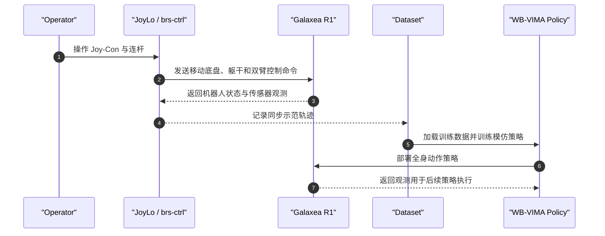

# BEHAVIOR Robot Suite (BRS)

## 一句话定义

BRS 是一个面向家庭长时程移动操作的开源系统套件：用 JoyLo 采集全身示范，再以 WB-VIMA 学习协调轮式底盘、躯干与双臂的视觉动作策略。

## 英文缩写速查

| 缩写 | 英文全称 | 简要说明 |
|------|----------|----------|
| BRS | BEHAVIOR Robot Suite | 将机器人、数据采集和策略学习整合的系统 |
| WB-VIMA | Whole-Body VisuoMotor Attention | 利用本体层级自回归生成全身动作的策略 |
| DoF | Degrees of Freedom | R1 躯干和全身控制接口所涉及的自由度 |
| ROS | Robot Operating System | brs-ctrl 与真实机器人通信和控制的软件栈 |

## 为什么重要

家庭机器人任务往往要求同一台机器人连续导航、开门、搬物、整理和操作关节物体。只看机械臂抓取成功率会漏掉底盘移动、躯干姿态与双臂协调；BRS 把数据采集接口、真实硬件与策略一并公开，便于研究者检验完整移动操作链路。

其研究对象是轮式 mobile manipulation。它与以双足/腿式动态行走为核心的 loco-manipulation 有方法交集，但控制风险和动力学边界不同。

## 方法栈

### JoyLo：全身示范采集接口

JoyLo（Joy-Con on Low-Cost Kinematic-Twin Arms）将 Joy-Con 控制器与双臂连杆组合起来，通过紧凑的人机界面协调移动底盘、躯干和双臂。Stanford 项目页报告成本低于 500 美元，并强调它面向高 DoF 移动操作示范采集。具体搭建与标定需按官方文档和目标 R1 配置核对。

### WB-VIMA：利用运动学层级生成动作

WB-VIMA 是模仿学习策略。它依据本体的运动学层级自回归预测全身动作：上游躯干或底盘相关动作先形成条件，再预测下游末端动作；多模态 self-attention 用于聚合视觉与本体感觉，降低策略只依赖 proprioception 的倾向。

### 系统数据流

## 源码运行时序图

官方代码分别位于 `brs-algo` 和 `brs-ctrl`：前者覆盖算法路径，后者提供 JoyLo / 机器人控制接口；实际训练和部署需按两仓 README 配置 ROS、机器人与数据。

## 实验与评测

Stanford 项目页报告在五项真实家庭任务上评测 WB-VIMA：把物品放上货架、清洁厕所、整理衣物、派对后收拾以及把垃圾拿到室外。任务包含长距离导航、关节物体、变形物体和狭窄空间中的操作。

项目页比较 DP3、RGB-DP、ACT 等基线，并报告 WB-VIMA 的端到端成功率分别约为 DP3 的 13 倍、RGB-DP 的 21 倍；平均子任务成功率分别为 1.6 倍和 3.4 倍。JoyLo 的用户研究在 10 名参与者中进行，项目页报告其任务成功率为 VR 控制器的 5 倍，完成时间中位数短 23%。这些数字对应各自研究设置，不应脱离任务与采样协议解读。

## 与其他工作对比

- **与桌面双臂模仿学习：** BRS 的策略输入与动作覆盖移动底盘、躯干和双臂，长任务需要将导航和操作连成闭环。
- **与 VR / Vision Pro 遥操作：** JoyLo 面向移动底座与全身高 DoF 协调；项目方报告的用户研究结果需按其 10 人、特定任务设置理解。
- **与腿式 Loco-Manipulation：** BRS 的 R1 使用轮式底盘，不能把其平衡与接触控制结果直接外推到人形机器人行走操作。

## 结论

**BRS 的价值在于把低成本全身数据入口与层级动作学习放进同一套真实移动操作流程；结果针对 R1 和五项家庭任务，不能直接等同于通用家庭机器人能力。**

1. 做长时程移动操作时，同时记录底盘、躯干、双臂与末端状态，避免只监督抓取动作。
2. 使用 JoyLo 示范数据前，先检查标定、通信同步、轨迹回放质量与安全限位。
3. WB-VIMA 的层级解码适合检验上游本体动作如何影响末端；与扁平动作基线比较时保留相同任务和评测协议。
4. 复用到不同硬件前，重做关节映射、运动学标定、ROS 控制接口和安全验证。
5. 把项目页中的相对倍数与论文的原始成功率、子任务结果一起读，确认分母和评测次数。

## 局限与风险

- 硬件实验以 Galaxea R1 为基础；轮式底盘的结果不代表腿式平台上的动态平衡与全身控制。
- JoyLo 是针对特定机构和控制接口实现的系统，换本体后需要重新设计或标定。
- 公开代码、数据和硬件文件降低复现门槛，但依赖相机、机器人、ROS 以及各仓库指定的软件环境。
- 五项真实任务和有限随机化不能覆盖开放家庭中的全部物体、布局与安全情形。

## 关联页面

- [Loco-Manipulation 与 Mobile Manipulation](../tasks/loco-manipulation.md)
- [模仿学习](../methods/imitation-learning.md)
- [具身数据采集四层分类](../concepts/embodied-data-collection-four-layers-taxonomy.md)

## 参考来源

- [BRS 论文来源](../../sources/papers/behavior_robot_suite_arxiv_2503_05652.md)
- [BRS 官方项目页归档](../../sources/sites/behavior-robot-suite.md)
- [BRS 官方实现与数据归档](../../sources/repos/behavior-robot-suite.md)

## 推荐继续阅读

- [BEHAVIOR Robot Suite 项目页](https://behavior-robot-suite.github.io/)
- [Stanford × Galaxea 项目说明](https://galaxea-dynamics.com/blogs/robotics-applications/stanford-galaxea-brs-household-robotics)
- [BRS 官方算法仓库](https://github.com/behavior-robot-suite/brs-algo)
- [BRS 官方硬件控制仓库](https://github.com/behavior-robot-suite/brs-ctrl)
