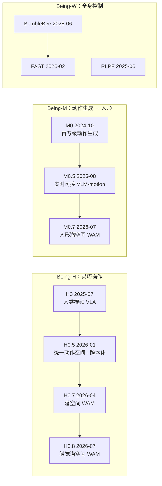

# 智在无界（BeingBeyond）

## 一句话定义

**智在无界（BeingBeyond，北京智在无界科技有限公司）** 是 2025 年在北京成立的具身基础模型公司，创始人是北京大学计算机学院副教授 **卢宗青**。公司主张从 **大规模第一视角人类视频与人体动作数据** 预训练机器人模型，再用少量真机数据后训练；主线是灵巧操作的 **Being-H** 系列（VLA → 潜空间 World–Action Model → 触觉 WAM），并有人体动作生成 / 人形模型 **Being-M**、多模态基座 **Being-VL** 与全身控制 **Being-W**（BumbleBee、FAST 等）。

## 英文缩写速查

| 缩写 | 英文全称 | 简要说明 |
|------|----------|----------|
| VLA | Vision-Language-Action | 视觉–语言–动作模型；Being-H0 / H0.5 属此类 |
| WAM | World-Action Model | 联合建模未来世界状态与动作；Being-H0.7 / M0.7 / H0.8 采用潜空间形式 |
| WBC | Whole-Body Control | 人形全身控制；BumbleBee、FAST、RLPF |
| UMI | Universal Manipulation Interface | 手持 / 穿戴式示范采集接口；RealDexUMI 为灵巧手版 |
| HF | Hugging Face | 模型与数据托管平台 |
| BPE | Byte-Pair Encoding | 字节对编码；Being-VL 用于视觉 token 合并 |
| RL | Reinforcement Learning | 强化学习；DemoGrasp、DemoFunGrasp、RLPF 等 |

## 为什么重要

- **人类数据为主的规模化样本：** 从 Being-H0（约百万条第一视角手部视频，媒体口径）到 Being-H0.8（500,000+ 小时，自报），是国内把「人类视频预训练 → 少量机器人后训练」做成连续版本线的公司之一。
- **版本谱系清楚：** H0 显式手部动作建模 → H0.5 统一动作空间、跨 30 种本体（媒体口径）→ H0.7 潜空间 WAM（先验–后验对齐，推理不滚像素）→ H0.8 把触觉并入潜世界状态。读者可以沿同一团队观察 VLA 到 WAM 的演化。
- **操作与全身控制并行：** 同一团队同时发表人形全身控制（BumbleBee、FAST、RLPF、DemoHLM）与灵巧操作，Being-M0.7 把潜空间 WAM 用到人形移动操作。
- **开源面较大：** GitHub 组织 27 个公开仓库，HF 上有 Being-H0（1B / 8B / 14B）、Being-H05-2B 与 TTP 权重；但 H0.7 之后的旗舰（M0.7、H0.8）项目页未列代码与权重。

## 公司概况

| 项 | 内容 | 来源 |
|----|------|------|
| 名称 | 北京智在无界科技有限公司；英文 BeingBeyond | 官网页脚 |
| 成立 | **2025 年 1 月**；36 氪称 2025-05 正式开始运营 | 凤凰网转硬氪 2025-06-14；36 氪 2026-01-24（**媒体口径**，官网未写） |
| 地址 | 北京市海淀区鼎好 DH3A 座 | 官网页脚 |
| 创始人 | 卢宗青：北大计算机学院长聘副教授，曾任智源研究院多模态交互研究中心负责人；多名核心成员来自智源 | 凤凰网转硬氪 2025-06-14 |
| 融资 | 2025-06 报道：数千万元，联想之星领投，智谱 Z 基金、燕缘创投、彬复资本跟投；2026-01 报道：天使轮数千万元，考拉基金领投，领航新界、灵心巧手跟投，联想之星、星连资本加注 | 同上（两篇报道轮次写法不同，不推定关系） |
| 模型线 | Being-H（灵巧操作）、Being-M（全身动作生成）、Being-VL（跨模态基座）、Being-W（全身运动控制） | 官网 |
| 产品 / 方案 | D1 桌面级灵巧手机械臂（GitHub 有 SDK）、Being-Dex 灵巧操作后训练服务（付费）、Being-Actor 人形全身遥操作、U1（Real DexUMI 数采设备） | 官网；36 氪 |

## 研究路线（Research 站 26 条）

日期为 arXiv v1 月份；无 arXiv 的按官网日期。完整清单、会议标注与代码链接见 [Research 站核查](../../sources/sites/research-beingbeyond-com.md)。

H0.8 项目页写明沿用 H0.7 的先验–后验结构、以 TopoHand 替代 H0.5 的统一动作空间；M0.7 与 H0.7 同为潜空间 WAM，二者共享多少实现本页未核对。

| 月份 | 项目 | 方向 | 本库页面 |
|------|------|------|----------|
| 2024-10 | Being-VL-0 | 多模态基座（BPE 视觉 tokenizer） | 本页「无独立详情的研究」 |
| 2024-10 | Being-M0 | 百万级人体动作生成（MotionLib） | [Being-M0](./paper-notebook-scaling-large-motion-models-with-million-level-h.md) |
| 2025-03 | Being-0 | 人形智能体：VLM + Connector + 模块化技能 | [Being-0](./paper-loco-manip-161-057-being-0.md) |
| 2025-06 | RLPF | 用物理反馈 RL 对齐动作大模型与人形控制 | [RLPF](./paper-notebook-rl-from-physical-feedback-aligning-large-motion.md) |
| 2025-06 | BumbleBee | 动作聚类 → 专家 → 蒸馏通用全身控制器 | [BumbleBee](./paper-notebook-from-experts-to-a-generalist.md) |
| 2025-06 | Being-VL-0.5 | 统一多模态理解（优先级 BPE） | [Being-VL-0.5](./cn-os-being-vl-0-5.md) |
| 2025-07 | Being-H0 | 人类视频预训练灵巧 VLA | [Being-H0](./paper-notebook-being-h0-vision-language-action-pretraining-from.md) |
| 2025-08 | Being-M0.5 | 实时可控视觉–语言–动作生成（HuMo100M） | [Being-M0.5](./paper-notebook-being-m0-5-a-real-time-controllable-vision-langu.md) |
| 2025-09 | DemoGrasp | 单条示范 + RL 的通用灵巧抓取 | [DemoGrasp](./cn-os-demograsp.md) |
| 2025-10 | DemoHLM | 单条示范合成数据的人形移动操作 | [DemoHLM](./paper-loco-manip-161-136-demohlm.md) |
| 2025-12 | DiG | flow-matching VLA 的传输差异可靠性信号 | 本页 |
| 2025-12 | DemoFunGrasp | 示范编辑 RL 的功能性灵巧抓取 | 本页 |
| 2025-12 | VIPA-VLA | 人类视频视觉–物理对齐的空间感知 VLA 预训练 | [VIPA-VLA](./cn-os-vipa-vla.md) |
| 2025-12 | UniTacHand | 人手–机器人手统一空间触觉表示 | [UniTacHand](./cn-os-unitachand.md) |
| 2026-01 | Being-H0.5 | 统一动作空间、跨本体人中心学习 | [Being-H 仓库](./cn-os-being-h.md) |
| 2026-02 | Rethink VLA | VLA 缩放的对齐、数据混合与正则对照研究 | [Rethink VLA](./cn-os-rethink-vla.md) |
| 2026-02 | FAST | 预训练 + 快速适配的人形全身控制 | [FAST](./cn-os-fast.md) |
| 2026-02 | JALA | 实验室标注 + 野外人类数据的联合对齐潜动作 | [JALA](./cn-os-jala.md) |
| 2026-03 | PTR | 后验转移重加权的保守离线策略学习 | 本页 |
| 2026-03 | OpenT2M | 百万级开源动作数据 + MonoFrill 动作模型 | 本页 |
| 2026-04 | Being-H0.7 | 第一视角视频潜空间 WAM | [Being-H0.7](../methods/being-h07.md) |
| 2026-04 | BeTTER | 用因果干预检验 VLA 是否真的推理 | 本页 |
| 2026-06 | RealDexUMI | 穿戴式灵巧 UMI 数采 | 本页 |
| 2026-07 | TTP | 人中心可迁移触觉预训练 | [TTP](./cn-os-ttp.md) |
| 2026-07 | Being-M0.7 | 人形移动操作潜空间 WAM | [Being-M0.7](./paper-being-m07-humanoid-latent-wam.md) |
| 2026-07 | Being-H0.8 | 50 万小时级触觉潜空间 WAM | 本页 |

- 2024-10 的 Being-VL-0、Being-M0 早于公司成立，由官网 Research 页收录；作者团队与后续论文重叠（末位作者均为卢宗青）。
- Being-H0.7 官网日期 2026-04-14，arXiv v1 2026-04-30。

## 无独立详情的研究

以下条目本库暂无独立详情页，摘要来自官网 TL;DR 与项目页（自报）。

- **Being-H0.8（2026-07-28，技术报告）：** 把 Being-H0.7 的先验–后验潜空间 WAM 扩展到触觉。数据为 UniHand 3.0（500,000+ 小时第一视角人类视频，自报）；TactoHand 从视频推断 MANO 手表面接触 / 接近度作为伪触觉监督；TopoHand 骨架状态–动作空间替代 H0.5 的统一动作空间，覆盖人手、灵巧手与夹爪；slow–fast 动作专家在每段动作执行前用最新本体与触觉反馈重生成。真机为 ROKAE AR5 双臂 + LinkerHand L25 / DexHand 021。项目页未列代码与权重。
- **Being-VL-0（2024-10，ICLR 2025）：** 在 VQ 视觉 token 上做 BPE 合并成结构化 token，让文本 LLM 主干在少量数据下学多模态推理。
- **DiG（2025-12，ECCV 2026）：** 用传输差异（transport discrepancy）作为 flow-matching VLA 的内部可靠性信号，改善分布偏移与长程执行。
- **DemoFunGrasp（2025-12，CVPR 2026）：** 把功能性抓取分解为抓取风格与 affordance，用示范编辑 RL 训练，sim-to-real 到多种物体与条件。
- **PTR（2026-03）：** 无奖励离线策略改进：按动作能否导向可辨识的下游结果，保守地重加权离线数据。
- **OpenT2M（2026-03，CVPR 2026）：** 百万级高质量开源动作数据集 + MonoFrill 预训练动作模型（2D-PRQ），做零样本文本到动作生成。
- **BeTTER（2026-04，ECCV 2026）：** 在受控因果干预下检验 VLA 推理，报告捷径学习、语义特征坍缩、行为惯性与因果状态跟踪失败。
- **RealDexUMI（2026-06，CoRL 2026）：** 面向灵巧手的穿戴式 UMI，强调采到「可部署」的灵巧示范；官网 U1 产品对应「Real DexUMI」（推测为同一设备线）。

## 开源与开放状态（2026-10-12）

| 渠道 / 项目 | 状态 | 依据 |
|-------------|------|------|
| GitHub [`BeingBeyond`](https://github.com/BeingBeyond) | 27 个公开仓库，含大多数论文与 D1 SDK | 组织仓库列表 |
| HF [`BeingBeyond`](https://huggingface.co/BeingBeyond) | 13 个模型：Being-H0 1B / 8B / 14B、Being-H05-2B（含 LIBERO / RoboCasa 微调）、TTP 等；14 个数据集：H0 后训练、PND Adam-U 任务、UniHand_Preview 等 | HF API |
| Being-H0.7 | 代码入口为 `BeingBeyond/Being-H` | 官网子页 |
| Being-M0.7、Being-H0.8 | 项目页未列代码、权重 | 官网子页 |
| OpenT2M、RealDexUMI | 官网子页未列代码 | 官网子页 |

**结论：** H0 / H0.5 / TTP 有可下载权重，适合直接复现；H0.7 以后的旗舰以技术报告为主，复现前逐仓核对 README，仓库存在不等于训练代码与数据完整开放。

## 工程实践

| 场景 | 建议 |
|------|------|
| 想用开源灵巧操作模型 | 从 HF 上的 Being-H0 / Being-H05-2B 开始，对照 [Being-H0](./paper-notebook-being-h0-vision-language-action-pretraining-from.md) 与 [Being-H 仓库](./cn-os-being-h.md) |
| 研究 VLA → WAM 演化 | 按 H0 → H0.5 → [H0.7](../methods/being-h07.md) → H0.8 顺序读，重点看动作空间与先验–后验对齐的变化 |
| 人形全身控制 | [BumbleBee](./paper-notebook-from-experts-to-a-generalist.md) → [FAST](./cn-os-fast.md)；移动操作看 [DemoHLM](./paper-loco-manip-161-136-demohlm.md) 与 [Being-M0.7](./paper-being-m07-humanoid-latent-wam.md) |
| 触觉 | [UniTacHand](./cn-os-unitachand.md) → [TTP](./cn-os-ttp.md) → H0.8 的 TactoHand |
| 写行业综述 | 成立写「2025-01（媒体口径）」；论文成果以官网 Research 页与 arXiv 署名为准 |

## 局限与风险

- **成立与融资只有媒体来源：** 官网未写成立日期、创始人与融资；两篇报道的轮次写法不同。
- **学术与公司边界：** 2024 年论文早于公司成立；arXiv 作者单位本页未逐篇核对，只按官网收录归入公司路线。
- **旗舰未开源：** Being-M0.7、Being-H0.8 只有技术报告与演示，数据规模与成功率为自报。
- **详情页深浅不一：** 多个本库详情（`cn-os-*`）是开源清单的模板页，机制与实验尚未深读。
- **机构标签遗留：** `cn-os-*` 仓库页的 `institutions` 仍为 `agilex-ai`，见 [核查记录](../../sources/sites/research-beingbeyond-com.md)。

## 关联页面

- [Being-H0](./paper-notebook-being-h0-vision-language-action-pretraining-from.md) · [Being-H0.7](../methods/being-h07.md) · [Being-M0.7](./paper-being-m07-humanoid-latent-wam.md) — 主线模型详情
- [BumbleBee](./paper-notebook-from-experts-to-a-generalist.md) · [FAST](./cn-os-fast.md) · [DemoHLM](./paper-loco-manip-161-136-demohlm.md) — 人形全身控制与移动操作
- [World Action Models](../concepts/world-action-models.md) · [VLA](../methods/vla.md) — 概念与方法背景
- [公司技术路线对照（2026）](../comparisons/robot-foundation-model-company-paths-2026.md)

## 参考来源

- [智在无界 Research 站核查（2026-10-12）](../../sources/sites/research-beingbeyond-com.md)
- [Being-H0.7 论文归档](../../sources/papers/being_h07.md)
- [Being-M0.7 技术报告归档](../../sources/papers/being_m07.md)
- 凤凰网科技（转硬氪，2025-06-14）<https://tech.ifeng.com/c/8kApGyTicks>
- 36 氪 / 智能涌现（2026-01-24）<https://eu.36kr.com/zh/p/3653424523682183>

## 推荐继续阅读

- [BeingBeyond Research](https://research.beingbeyond.com/) — 26 条研究的项目页
- [Being-H0.8 项目页](https://research.beingbeyond.com/being-h08) — 触觉潜空间 WAM 全文
- [BeingBeyond GitHub](https://github.com/BeingBeyond) · [Hugging Face](https://huggingface.co/BeingBeyond)
