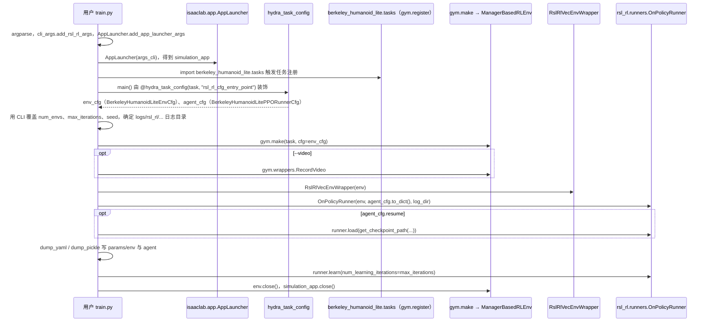
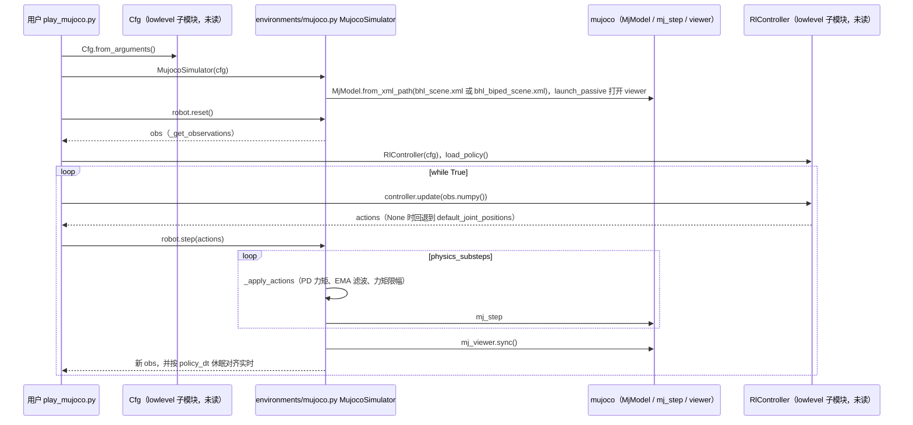

# Berkeley Humanoid Lite（BHL）

## 一句话定义

**Berkeley Humanoid Lite** 是 **UC Berkeley Hybrid Robotics** 的 **轻量人形** 开源方案：门户 **[lite.berkeley-humanoid.org](https://lite.berkeley-humanoid.org/)**，源码与仿真/学习脚本在 **[Berkeley-Humanoid-Lite](https://github.com/HybridRobotics/Berkeley-Humanoid-Lite)**（MIT）。

## 英文缩写速查

| 缩写 | 英文全称 | 简要说明 |
|------|----------|----------|
| MuJoCo | Multi-Joint dynamics with Contact | 接触丰富的刚体物理仿真引擎 |
| PPO | Proximal Policy Optimization | 人形/足式 locomotion 中最常用的 on-policy 策略梯度算法 |
| QDD | Quasi-Direct Drive | 准直驱，低减速比、高背驱动性的作动方案 |
| RL | Reinforcement Learning | 通过与环境交互最大化长期回报来学习策略的范式 |
| IK | Inverse Kinematics | 满足末端/姿态约束求解关节角的运动学逆解 |
| Sim2Real | Simulation to Real | 把仿真中学到的策略迁移落地真机的工程主线 |
| BOM | Bill of Materials | 物料清单，硬件零部件列表 |

## 为什么重要

- **低成本 QDD 叙事**：在 [开源人形硬件对比](./open-source-humanoid-hardware.md) 中常与商业整机对照，作为 **动力学透明 + RL 友好** 的参考轴。
- **最接近「人形关节需求」的开源整机**：含整机 CAD、3D 打印摆线、电机与关节参数、控制器配置、BOM、底层控制、**Isaac Lab** 训练与实机部署。
- 在 [开源 QDD 学习路线](../comparisons/open-source-qdd-actuator-projects.md) 中排在 ODRI 之后：学完力控关节后，看执行器如何进人形。

## 关节与电机要点（策展）

| 项 | 内容 |
|----|------|
| 减速 | 约 **15:1** 3D 打印摆线 + 外转子电机 |
| 电机 | 约 **14 对极**；力矩常数约 **0.1176 N·m/A** |
| 控制 | 公开电流环、位置环、速度环等参数 |
| 值得对照 | 髋/膝布置；电机参数→关节参数映射；电流/力矩限制 |

## 论文与深读状态

| 字段 | 内容 |
|------|------|
| 论文 | *Berkeley Humanoid Lite: An Open-source, Accessible, and Customizable 3D-printed Humanoid Robot*，<https://arxiv.org/abs/2504.17249> |
| Paper Notebooks 分类 | 12_Hardware_Design（[分类父节点](../overview/paper-notebook-category-12-hardware-design.md)） |
| 深读状态 | 待撰写（[PROGRESS.md](https://github.com/ImChong/Robot_Learning_Paper_Notebooks/blob/main/papers/PROGRESS.md)）；笔记完成后在本页链向笔记站并深化归纳 |

## 开源入口

| 类型 | 链接 | 状态 |
|------|------|------|
| 项目门户 | [lite.berkeley-humanoid.org](https://lite.berkeley-humanoid.org/) | 已发布 |
| GitBook 文档 | [berkeley-humanoid-lite.gitbook.io/docs](https://berkeley-humanoid-lite.gitbook.io/docs) | 已发布 |
| 主仓库 | [HybridRobotics/Berkeley-Humanoid-Lite](https://github.com/HybridRobotics/Berkeley-Humanoid-Lite) | **已开源**（MIT） |

## 复现入口：硬件与软件

原论文平台以模块化 3D 打印摆线减速器和通用采购件降低门槛；官方按美国市场价格估算硬件成本低于 5000 美元，实际成本依地区与时间变化。复现前先核对[官方发布页](https://berkeley-humanoid-lite.gitbook.io/docs/releases)的 BOM、整机与 6512 / 5010 执行器 CAD、打印文件及修订记录，再按[硬件文档](https://berkeley-humanoid-lite.gitbook.io/docs/getting-started-with-hardware)装配和校准。具体入口见[项目页归档](../../sources/sites/berkeley_humanoid_lite.md)。

软件链路包括 Isaac Lab 环境与策略训练、sim2sim、实机底层控制及 SteamVR 遥操作；[软件归档](../../sources/repos/berkeley_humanoid_lite.md)列出描述资产（URDF / MJCF / USD）、固件与各仓库。官方组织还发布 Lite V1.5 双臂和 Lite V2 相关资源，不能默认与原论文版本直接兼容。

## 局限与风险

- 官方已指出：当前 **3D 打印摆线** 在高性能运动中偏脆弱，后续版本可能改为成品关节。
- **适合学习与验证，不适合原样用于重型人形**。
- 可与 [Internal Cycloidal](./internal-cycloidal-actuator.md)（电机—减速一体）及 [Urs 等打印 QDD 论文](./paper-3d-printed-open-source-actuators-legged.md)（系统热/寿命评测）对照。

## 源码运行时序图

仓库按功能分三条入口（均在 `scripts/` 下）。`source/berkeley_humanoid_lite_lowlevel/` 是 git 子模块（`.gitmodules` 指向 Berkeley-Humanoid-Lite-Lowlevel），本次浅克隆中为空，下图涉及该子模块处只标注为黑盒，未读其内部。

### 训练：Isaac Lab + RSL-RL

入口：`python scripts/rsl_rl/train.py --task=Velocity-Berkeley-Humanoid-Lite-v0`（任务 id 来自 `tasks/locomotion/velocity/config/humanoid/__init__.py` 的 `gym.register`；`--num_envs`、`--max_iterations`、`--video` 等参数见脚本 argparse）

### 回放与导出，以及 MuJoCo sim2sim

入口：`python scripts/rsl_rl/play.py ...` 加载检查点后导出 `policy.pt` / `policy.onnx` 并写部署用 yaml；再用 `python scripts/sim2sim/play_mujoco.py`（配置经 `Cfg.from_arguments()` 读取，`configs/` 下有 `policy_humanoid.yaml` 等）在 MuJoCo 中加载配置里的策略检查点（配置中为 .onnx 路径；加载逻辑在未读的 RlController 内）。

图依据：HybridRobotics/Berkeley-Humanoid-Lite@984741a，读过 README.md、.gitmodules、scripts/rsl_rl/train.py、scripts/rsl_rl/play.py（仅导出相关行）、scripts/sim2sim/play_mujoco.py、configs/policy_humanoid.yaml（前段）、source/berkeley_humanoid_lite/berkeley_humanoid_lite/tasks/locomotion/velocity/config/humanoid/__init__.py、source/berkeley_humanoid_lite/berkeley_humanoid_lite/environments/mujoco.py（reset / step / _apply_actions）。

## 关联页面

- [开源 QDD 执行器项目对比](../comparisons/open-source-qdd-actuator-projects.md)
- [执行器驱动链选型闭环](../queries/actuator-drive-chain-selection-loop.md)
- [ODRI Solo / Bolt](./odri-solo-and-bolt.md)
- [开源人形硬件方案对比](./open-source-humanoid-hardware.md)
- [Paper Notebooks 分类父节点：12 Hardware Design](../overview/paper-notebook-category-12-hardware-design.md)
- [强化学习](../methods/reinforcement-learning.md)
- [力矩电机设计纵深](../../roadmap/depth-torque-motor-design.md)

## 推荐继续阅读

- [开源人形硬件方案对比 · Berkeley Humanoid 段](./open-source-humanoid-hardware.md#1-berkeley-humanoid-准直接驱动派)
- 主仓 README 与 GitBook 关节/控制参数章节

## 参考来源

- [berkeley_humanoid_lite.md](../../sources/repos/berkeley_humanoid_lite.md)
- [berkeley_humanoid_lite 项目页](../../sources/sites/berkeley_humanoid_lite.md)
- [开源 QDD 执行器学习策展](../../sources/personal/open_source_qdd_actuator_learning_curator.md)
- [wechat_jixie_robot_open_source_treasury_issue01_10_robots.md](../../sources/blogs/wechat_jixie_robot_open_source_treasury_issue01_10_robots.md)
- [humanoid_pnb_berkeley-humanoid-lite-an-open-source-accessible.md](../../sources/papers/humanoid_pnb_berkeley-humanoid-lite-an-open-source-accessible.md)
- 论文：<https://arxiv.org/abs/2504.17249>
- 源码核对（2026-11-02）：HybridRobotics/Berkeley-Humanoid-Lite@984741a，读过 README.md、.gitmodules、scripts/rsl_rl/{train,play}.py、scripts/sim2sim/play_mujoco.py、configs/policy_humanoid.yaml、tasks 注册 __init__.py、environments/mujoco.py；lowlevel 子模块（RlController、Cfg）未克隆未读；时序图依据以上文件，未运行代码。
