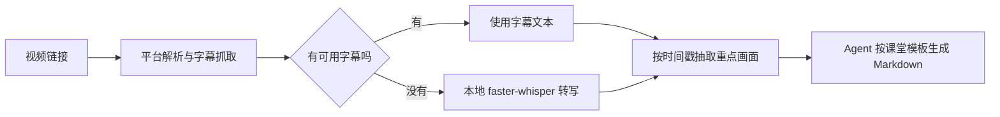

# bilibili-douyin-notes

**bilibili-douyin-notes**（[GitHub](https://github.com/lucky-Luor/bilibili-douyin-notes)，MIT）是遵循 Agent Skills 规范的视频学习工具：从 B 站、抖音、YouTube 或小红书链接提取字幕或音频，必要时在本地转写，并按模板生成可检索的课堂 Markdown 笔记。

## 一句话定义

用“字幕优先、本机 ASR 兜底、按时间戳抽取重点画面”的流程，把长视频整理为结构化笔记，方便复习和纳入个人知识库。

## 英文缩写速查

| 缩写 | 英文全称 | 简要说明 |
|------|----------|----------|
| ASR | Automatic Speech Recognition | 无可用字幕时在本机转录音频 |
| PyAV | Python Audio Video | 解码媒体并按时间戳抽帧 |
| Markdown | Markdown markup language | 输出可版本管理、可检索的笔记格式 |
| Agent Skill | Agent Skills specification | 以 `SKILL.md` 声明的代理可调用工作流 |

## 为什么重要

- 输入是公开视频链接，输出是结构化学习材料；不需要先手动下载音频、复制字幕再让代理总结。
- 字幕优先可以减少 ASR 等待与识别错误；无字幕时 `faster-whisper` 在本地运行，项目不依赖付费语音 API。
- 模板包含知识地图、概念卡、自测题和时间索引，产物可回到原视频核对，而非只有一段泛化摘要。

## 核心流程

支持 B 站、抖音、YouTube、小红书；YouTube 优先取官方或自动字幕。小红书仅支持视频笔记链接。各平台登录、访问策略和链接形态可能限制抓取。

## 工程实践

1. 将仓库安装到兼容 Agent Skills 的代理技能目录，并按需安装 `requirements.txt` 中相应平台依赖。
2. 先用 README 的 `--probe` 探测链接与分 P 信息；能取到字幕时先用字幕。
3. 无字幕时运行本地 faster-whisper。CPU int8 可运行，但速度受处理器与模型大小影响；GPU 是可选配置。
4. 需要图像辅助时启用 PyAV 截图，并在交付前核对重点帧与笔记时间索引。
5. 将产出的 Markdown 与源视频链接一并归档，保留视频作为事实核对入口。

## 局限与风险

- **开源状态：已开源**，仓库附 MIT 许可证及 `SKILL.md`。本页依据仓库 README 与技能定义归纳，不代表对每个平台抓取的长期可用性保证。
- **外部平台依赖：** 接口、反爬策略、公开视频权限和登录状态变化都可能影响字幕或媒体抓取。
- **ASR 质量：** 专有名词、口音、噪声和低音质会造成错字；课堂笔记中的公式、代码、定义与关键数字应回听核验。
- **内容与隐私：** 下载或缓存的媒体文件可能含个人信息或受版权保护内容，遵守平台条款与当地法律，并按项目说明管理缓存和 Cookie。

## 关联页面

- [Agent Skills（Addy Osmani）](./agent-skills-addyosmani.md) — 通用编码工作流技能包，可与面向视频学习的 Skill 对照。
- [Agentic Coding 软件工程基础](../concepts/agentic-coding-software-fundamentals.md)
- [Karpathy LLM Wiki](../references/llm-wiki-karpathy.md) — 生成笔记如何接入持续维护的知识库。

## 参考来源

- [项目来源归档](../../sources/repos/bilibili-douyin-notes.md)
- [项目 README](https://github.com/lucky-Luor/bilibili-douyin-notes#readme)
- [Agent Skill 定义](https://github.com/lucky-Luor/bilibili-douyin-notes/blob/main/SKILL.md)

## 推荐继续阅读

- [Agent Skills 规范](https://agentskills.io/) — 技能目录与 `SKILL.md` 的互操作约定。
- [faster-whisper](https://github.com/SYSTRAN/faster-whisper) — CTranslate2 实现的 Whisper 转录工具。
