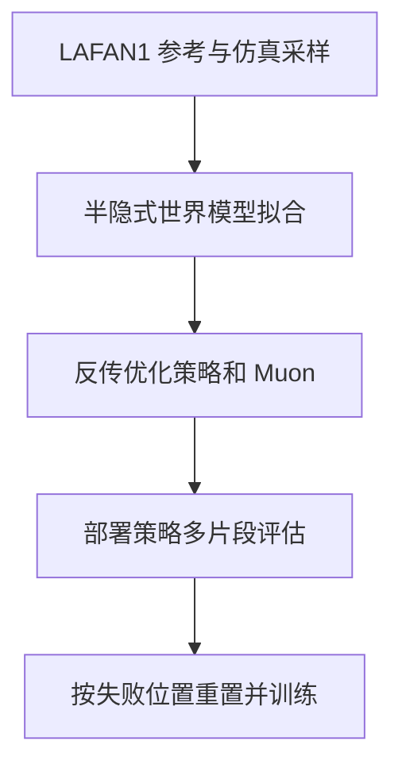
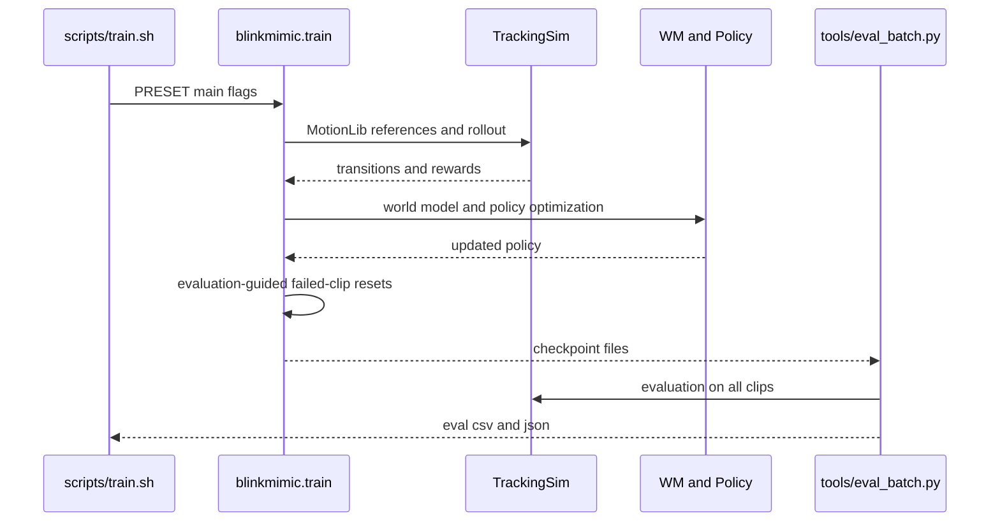

# 单卡分钟级人形运动跟踪器 BlinkMimic（BlinkMimic: Training a Humanoid Motion Tracker in Minutes on a Single GPU）

**机构：** 独立作者 Fuyi Chen（arXiv v1 未注明机构）  
**论文：** [arXiv:2611.16422](https://arxiv.org/abs/2611.16422)
**官方源码：** https://github.com/fuyichen0725/blinkmimic  

## 一句话定义

**基于 mjlab/MuJoCo Warp 训练可微世界模型，策略围绕参考姿态输出残差，通过 imagined rollouts 反向传播；Muon 优化、进度学习率、半隐式世界模型、左右镜像、部署条件错误位置重置、CUDA Graph 整轮训练降低迭代与尾部耗时。**

## 英文缩写速查

| 缩写 | 英文全称 | 简要说明 |
|---|---|---|
| CUDA | Compute Unified Device Architecture | GPU 图捕获 |
| WM | World Model | 可微世界模型 |
| EMA | Exponential Moving Average | 部署策略平滑 |
| RL | Reinforcement Learning | 想象轨迹策略更新 |

## 为什么重要

运动跟踪训练耗时不仅由前期拟合决定，最后失败 clip 的清除速度与单迭代 host 开销同样关键。

## 核心原理

基于 mjlab/MuJoCo Warp 训练可微世界模型，策略围绕参考姿态输出残差，通过 imagined rollouts 反向传播；Muon 优化、进度学习率、半隐式世界模型、左右镜像、部署条件错误位置重置、CUDA Graph 整轮训练降低迭代与尾部耗时。

### 流程总览

以下根据论文方法整理，箭头表示控制/数据流向。

## 实验与评测

RTX 4090 单卡：40 段 LAFAN1 共 2.45 小时动作，均值 2.94 min 首次达到 return 0.82；严格满足连续 3 次检查点均无失败 clip 的训练墙钟 3.38 min（3 seeds）。同测 InstantTrack v1.2 严格目标为 7.36 min。未测实体 G1 在线训练。

## 与其他工作对比

与 InstantTrack、SuperMimic 在同一仿真协议下比较训练耗时；训练墙钟和真实机器人部署速度不能混同。

## 结论

**单卡分钟级人形运动跟踪器 BlinkMimic 的实际价值在于明确研究对象与实验边界，而非脱离原文场景比较单个成功率。**

1. 3.4 min 是训练墙钟，不是实体 G1 部署耗时。
2. 必须同时关注平均 return 和失败片段数量。
3. README 提供完整训练评测入口，可用相同阈值复测。

## 工程实践

实际验证时先检查任务接口与坐标系，再按论文试验复现主指标；记录 CUDA / WM / EMA 相关状态、控制采样与异常回退路径，不能以论文中的概念图代替可执行模块证明。

**源码开放状态：** 官方仓库已公开可运行 GPU 仿真训练和评价脚本；可按 README 安装 uv、下载动作数据后调用 scripts/train.sh 与 tools/eval_batch.py。

## 源码运行时序图

此图仅表示官方 README 和脚本可核实的训练/评测调用入口，不包含未经发布的真机部署运行时。

## 局限与风险

早期源码阅读时只确认主训练循环，当前新论文归档另核对完整方法、实验与局限；未在本环境直接复现 GPU 数字。

仅 G1/LAFAN1 与单张 RTX 4090；共享 GPU 时异步 eprobe 可能出现非法显存访问。ONNX 测试工具不等于已有真机部署实现。

## 关联页面

- [InstantTrack](./instanttrack.md)：同机同评测设置下的训练速度基线。
- [SuperMimic](./paper-supermimic.md)：可微世界模型思路的前置工作。
- [model-based RL](../methods/model-based-rl.md)：用模型在规划与学习中补充环境动态。

- [humanoid locomotion](../tasks/humanoid-locomotion.md)
- [beyondmimic](../methods/beyondmimic.md)
- [sim2real](../concepts/sim2real.md)
- [11.09–11.13 29 篇总览](../overview/humanoid_quadruped_2026_11_09_13_29_papers.md)

## 参考来源

- [BlinkMimic 早期源码归档](../../sources/repos/blinkmimic.md)

- [arXiv v1 原文核对归档](../../sources/papers/blinkmimic_arxiv_2611_16422.md)
- [arXiv v1 HTML 全文](https://arxiv.org/html/2611.16422v1)
- [官方 GitHub 源码](https://github.com/fuyichen0725/blinkmimic)

## 推荐继续阅读

- [论文 PDF](https://arxiv.org/pdf/2611.16422v1)
