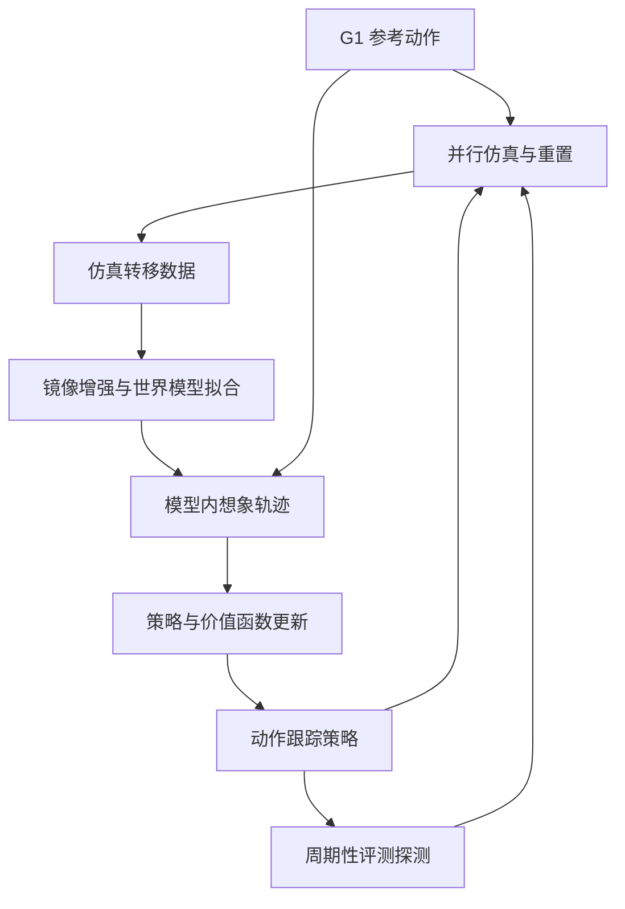
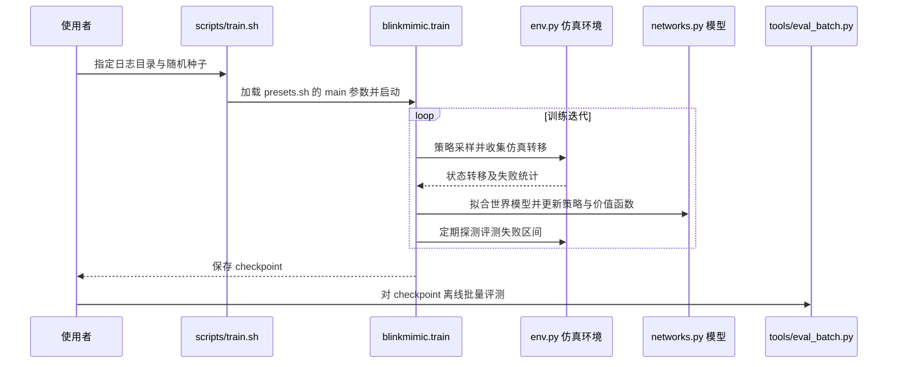

# BlinkMimic：分钟级人形全身动作跟踪
*BlinkMimic: Training a Humanoid Motion Tracker in Minutes on a Single GPU*

## 一句话定义

**BlinkMimic** 基于社区 [SuperMimic](./paper-supermimic.md) 实现和 [InstantTrack](./instanttrack.md)，通过结构化世界模型、镜像增强和评测引导重置等方法加快 G1 仿真动作跟踪训练。

## 英文缩写速查

| 缩写 | 英文全称 | 简要说明 |
|---|---|---|
| WM | World Model | 学习机器人状态转移的世界模型 |
| EMA | Exponential Moving Average | 策略参数的指数移动平均 |
| BPTT | Backpropagation Through Time | 穿过想象轨迹计算策略梯度 |
| GPU | Graphics Processing Unit | 并行仿真和训练硬件 |

## 为什么重要

动作跟踪需要在高物理更新频率、长参考运动库与严格失败判据间权衡；单次迭代耗时和尾部姿态失败均可能拖慢迭代。本文报告的是单卡仿真中的训练与离线评测速度，而非真实机器人的执行成功率。

## 核心原理

使用可微世界模型展开短时运动、以 BPTT 更新策略；通过参考动作残差、Muon 优化、部署式 probe 分配重置，以及 CUDA Graph 减少训练步开销，联合改善难动作拟合与整体吞吐。

## 流程总览

世界模型采用半隐式结构，预测速度增量并积分位置；评测探测定位失败区间，增加该区域附近的重置。策略基于模型内短轨迹进行 BPTT；保留 EMA、参考动作残差、接触奖励、Muon 和 CUDA Graph 等设计。

## 源码运行时序图

入口及主循环已按 [d264658](https://github.com/fuyichen0725/blinkmimic/tree/d264658d6c9ce61fb52f9f0f8985a369f3ccc409) 核对；其余代码细节尚未逐项审阅，未执行训练。

## 实验与评测

在单张空闲 RTX 4090 上，40 段 LAFAN1（2.45 小时），每个 checkpoint 从首帧评测 4 个副本，三种子均值：

| 方法 | 首次回报 ≥ 0.82 | 严格目标 |
|---|---:|---:|
| InstantTrack v1.2 | 5.89 分钟 | 7.36 分钟 |
| BlinkMimic | 2.94 分钟 | 3.38 分钟 |

严格目标为回报至少 0.82、40 段零失败，并连续 3 个 checkpoint 达标。计时包含编译、CUDA Graph 捕获、探测和保存，不含进程启动与数据加载；离线评测单独进行。README 中 SuperMimic 的时间按迭代数估算，不应当作同一组完整端到端实测。

## 结论

**BlinkMimic 用有针对性的失败片段重采样和整轮优化缩短仿真人形动作跟踪训练，但性能结论受 RTX 4090、G1 与 LAFAN1 固定动作库约束。**

1. 对照训练墙钟时间要计入 CUDA Graph 捕获、探测与 checkpoint，不能和仅计纯迭代的结果混用。
2. 单看回报达到 0.82 不等于所有动作稳定，应另外核对零失败的连续 checkpoint 条件。
3. 训练策略的仿真跟踪能力需另做新本体、未见动作和真机闭环验证。

## 工程实践

- 开源代码提供训练、离线评测和 ONNX 导出工具；LAFAN1 数据另行下载，数据及衍生文件许可不同于代码。
- 结果来自作者报告的仿真与指定训练动作集；不能据此推断真机成功率或未见动作泛化。
- 该版本 README 指出共享 GPU 时异步探测可能导致非法内存访问，可关闭异步选项。
- 主要阅读 README、入口、预设、训练循环及环境和网络相关段落；尚未完整审计奖励、评测、数据转换和异步实现。

## 局限与风险

单张 RTX 4090 与固定 40 段 LAFAN1 只验证本文报告的条件；模型训练速度并不证明真实执行稳定性。官方仓虽含 ONNX 导出及模拟环境检查，但不代表实际机器人驱动和动态接触系统已经过验收。

## 关联页面

- [11.09–11.13 人形／四足 29 篇论文阅读坐标](../overview/humanoid-quadruped-2026-11-09-13-29-papers.md)：本次周报中的 BlinkMimic 唯一节点复用入口。

- [本期 29 篇具身智能论文地图](../overview/embodied-frontier-29-papers-2026-11-16.md)

- [XMimic（JAX）](./paper-xmimic-jax.md)：将本训练器重构为编译程序与多 GPU 流水线；其 H100 对比排除编译，勿与本页 RTX 4090 时间混算。

- [InstantTrack](./instanttrack.md)：共同基础与同机基线。
- [SuperMimic](./paper-supermimic.md)：可微世界模型方法。
- [DeepMimic: 示例引导的技能学习](../methods/deepmimic.md) — 以参考动作跟踪任务作对照，区分传统 RL 跟踪与可微世界模型 BPTT 更新。
- [Muon（MomentUm Orthogonalized by Newton–Schulz）](../methods/muon.md) — 本训练器使用 Muon 优化；训练加速还包括重置策略与 CUDA Graph，不能只归因于优化器。

## 参考来源

- [本期论文补充核对归档](../../sources/papers/blinkmimic_arxiv_2611_16422.md)

- [BlinkMimic 论文原文与核对归档](../../sources/papers/blinkmimic-2611-16422.md)
- [本次核对的官方源码与入口](../../sources/repos/blinkmimic-2611-16422.md)
- [原有 BlinkMimic 源码归档](../../sources/repos/blinkmimic.md)

## 推荐继续阅读

- [项目 README](https://github.com/fuyichen0725/blinkmimic/blob/d264658d6c9ce61fb52f9f0f8985a369f3ccc409/README.md)
