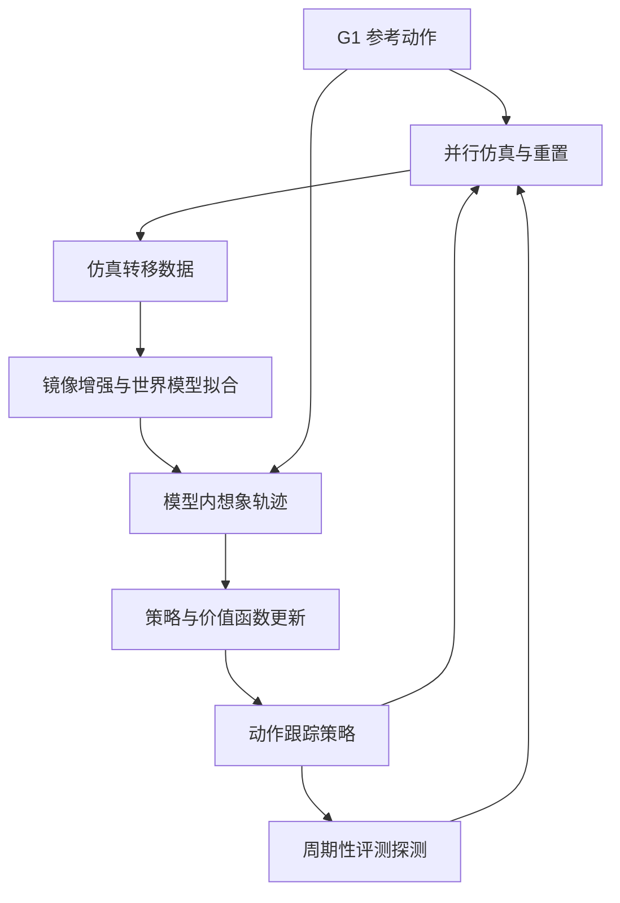
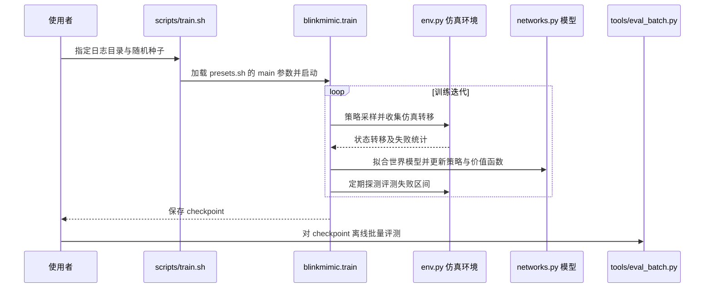

# BlinkMimic：分钟级人形全身动作跟踪

**BlinkMimic** 基于社区 [SuperMimic](./paper-supermimic.md) 实现和 [InstantTrack](./instanttrack.md)，通过结构化世界模型、镜像增强和评测引导重置等方法加快 G1 仿真动作跟踪训练。

## 英文缩写速查

| 缩写 | 英文全称 | 简要说明 |
|---|---|---|
| WM | World Model | 学习机器人状态转移的世界模型 |
| EMA | Exponential Moving Average | 策略参数的指数移动平均 |
| BPTT | Backpropagation Through Time | 穿过想象轨迹计算策略梯度 |
| GPU | Graphics Processing Unit | 并行仿真和训练硬件 |

## 流程总览

世界模型采用半隐式结构，预测速度增量并积分位置；评测探测定位失败区间，增加该区域附近的重置。策略基于模型内短轨迹进行 BPTT；保留 EMA、参考动作残差、接触奖励、Muon 和 CUDA Graph 等设计。

## 源码运行时序图

入口及主循环已按 [d264658](https://github.com/fuyichen0725/blinkmimic/tree/d264658d6c9ce61fb52f9f0f8985a369f3ccc409) 核对；其余代码细节尚未逐项审阅，未执行训练。

## 作者报告的结果与口径

在单张空闲 RTX 4090 上，40 段 LAFAN1（2.45 小时），每个 checkpoint 从首帧评测 4 个副本，三种子均值：

| 方法 | 首次回报 ≥ 0.82 | 严格目标 |
|---|---:|---:|
| InstantTrack v1.2 | 5.89 分钟 | 7.36 分钟 |
| BlinkMimic | 2.94 分钟 | 3.38 分钟 |

严格目标为回报至少 0.82、40 段零失败，并连续 3 个 checkpoint 达标。计时包含编译、CUDA Graph 捕获、探测和保存，不含进程启动与数据加载；离线评测单独进行。README 中 SuperMimic 的时间按迭代数估算，不应当作同一组完整端到端实测。

## 工程实践与局限

- 开源代码提供训练、离线评测和 ONNX 导出工具；LAFAN1 数据另行下载，数据及衍生文件许可不同于代码。
- 结果来自作者报告的仿真与指定训练动作集；不能据此推断真机成功率或未见动作泛化。
- 该版本 README 指出共享 GPU 时异步探测可能导致非法内存访问，可关闭异步选项。
- 主要阅读 README、入口、预设、训练循环及环境和网络相关段落；尚未完整审计奖励、评测、数据转换和异步实现。

## 关联页面

- [XMimic（JAX）](./paper-xmimic-jax.md)：将本训练器重构为编译程序与多 GPU 流水线；其 H100 对比排除编译，勿与本页 RTX 4090 时间混算。

- [InstantTrack](./instanttrack.md)：共同基础与同机基线。
- [SuperMimic](./paper-supermimic.md)：可微世界模型方法。

## 参考来源

- [BlinkMimic 源码归档](../../sources/repos/blinkmimic.md)

## 推荐继续阅读

- [项目 README](https://github.com/fuyichen0725/blinkmimic/blob/d264658d6c9ce61fb52f9f0f8985a369f3ccc409/README.md)
