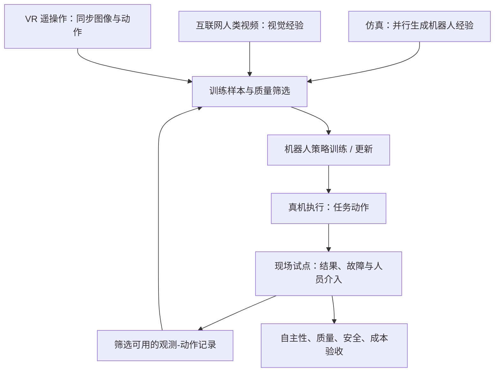

# Humanoid Robots and the Gap Between Hype and Reality / 人形机器人：热度与现实差距（Bloomberg Primer）

## 一句话定义

**Bloomberg Originals 于 2026-04-29 发布的 `Bloomberg Primer` 节目**把人形机器人的“精彩展示”拆解成四个现实门槛：**可对齐的物理数据、可自主执行的任务、工位安全与可靠性、可核算的商业价值**。节目记录不同受访者的观点与早期试点，**不是一份可复现的基准测试论文**。

## 英文缩写速查

| 缩写 | 英文全称 | 简要说明 |
|---|---|---|
| AI | Artificial Intelligence | 视频讨论的物理世界智能与神经网络策略 |
| LLM | Large Language Model | 用文字序列学习作类比，突出机器人动作数据的不同要求 |
| VR | Virtual Reality | 遥操作中以头显等设备进行人类示教的数据采集方式 |
| ROI | Return on Investment | 仓库部署时尚待核实的投资回报 |
| Sim2Real | Simulation to Reality | 仿真中的表现能否迁移至真实机器人 |

## 为什么重要

- **拆开演示和自主性。** 节目 [02:02](https://youtu.be/UQZooauU-FQ?t=122) 明说 2025 年 NEO 的一个展示使用人类遥操作；不能把录像中的动作完成当作所有环节均由策略独立决策。
- **明确数据缺口在哪里。** UC Berkeley 的 Ken Goldberg [09:25](https://youtu.be/UQZooauU-FQ?t=565) 强调缺少相机输入与真实动作命令配对的物理经验，和 LLM 可直接利用大量文字数据不同。
- **用现场错误而非估值判断落地。** GXO [20:24](https://youtu.be/UQZooauU-FQ?t=1224) 报告货物损坏、掉落、错位，以及人工纠错需求；这比产品宣传视频更接近可验收的工况定义。

## 核心原理

### 1. 四种训练数据路径与不同的代价

| 路径 | 节目所述机制 | 需要补的关键环节 |
|---|---|---|
| [仿真生成](https://youtu.be/UQZooauU-FQ?t=603) | 在大量虚拟场景里并行机器人训练 | 模拟器对真实接触、物性与失效细节的保真；需真机闭环 |
| [网络人类视频](https://youtu.be/UQZooauU-FQ?t=632) | 利用真人操作视频提供视觉和动作先验 | 2D 视频未直接给出充分的 3D 场景、本体状态和控制命令 |
| [VR 遥操作](https://youtu.be/UQZooauU-FQ?t=657) | 人控机器人，同时录入图像与机器人动作 | 采集吞吐慢；样本成本和人类介入边界必须记录 |
| [部署数据飞轮](https://youtu.be/UQZooauU-FQ?t=695) | 工作中记录观测与动作、过滤后回训更好的模型 | 质量过滤、失败标签、安全上线与可审计的模型版本管理 |

**注意：** 这是主持人与 Goldberg 介绍的四种可用路径，不表示节目披露了某家公司的完整可运行训练配方。1X 在 [12:59–13:41](https://youtu.be/UQZooauU-FQ?t=779) 另说明以世界模型预测未来动作画面、对照执行效果；属于**厂商介绍**，并未给出完整训练/评测可复现实验。

### 2. 数据—模型—部署：由节目逻辑整理的流程总览

此图只把**节目分别讨论的技术路径**合并为分析框架，不能解读成 1X、GXO 或其他厂商提供的单一集成开源系统；尤其不能默认互联网视频直接含机器人动作标签，或默认所有试点均已实现全自主。

### 3. 产业供应链和技术可行性是两条轴

视频 [13:59–17:24](https://youtu.be/UQZooauU-FQ?t=839) 用北京世界人形机器人运动会说明展示热度和硬件发展，并谈中国的政策支持、垂直整合供应链和快速制造。节目也提到泡沫警示。**制造成本、硬件出货、赛事表现和工位连续有效产出是不同指标**；节目报道的出货、扶持资金等数字未在本次逐条回溯统计源，不在本页直接当作独立基准。

### 4. GXO 仓储试点：具体可核验的失败模式

据 GXO 受访者 Patrick Kelleher 于 [19:27–21:29](https://youtu.be/UQZooauU-FQ?t=1167) 的描述：

- 冷库试点中，人员可在库外**指导机器人**完成一段电池续航内的工作，减少员工长时间处于低温环境；
- 当前仍会**损坏、掉落、错放货物**，需要同事复核和纠正；
- 移动速度、单次续航与物品操作灵巧性限制了工位吞吐；其认为近期难以将大量复杂且质量敏感的工作完全交由人形完成；
- 最终技术方案的 **ROI 尚不明确**。节目未提供统一任务成功率、人工接管比率、平均故障间隔或工时成本表。

这类试点说明存在场景价值线索，但并不自动证明完全无人化部署。

### 5. 工厂与家庭/医院：错误代价不同

节目 [21:49–23:18](https://youtu.be/UQZooauU-FQ?t=1309) 比较可隔离的固定工业流程与医院的半结构化、高后果环境，指出家庭/医院对不确定性和安全提出更严的要求。部署先后应依据任务风险与工位可控性，而不能从“厂内能搬箱子”直接推定“可安全独立照护人”。

## 工程实践

本知识库据节目中的部署痛点整理**最小验收表**，这些字段并非 Bloomberg 提供的统一 benchmark：

| 维度 | 应记录的数据 | 不应接受的替代证据 |
|---|---|---|
| 自主比例 | 策略自主任务数、远程操作/远程指导/急停次数与分母 | 仅剪辑成功 Demo 或说“AI 驱动” |
| 任务质量 | 成功率、损坏率、掉落率、错放率、人工复核次数 | 只算搬运次数不统计错误 |
| 生产效率 | 每小时合格件、任务耗时分布、充电与故障停机 | 仅看峰值运动速度 |
| 数据供给 | 观测与动作时序对齐、有效 episode、失败标签、场景覆盖 | 把 YouTube 视频小时数直接当成机器人控制真值 |
| 安全与经济性 | 人机分区、故障恢复、员工介入、设备维护与能耗、总拥有成本 | 用估值或出货量代替真实 ROI |

**应用次序（本库建议）：** 先选边界清晰、错误可恢复的工位 → 记录人为介入与完整失败分布 → 与原流程做同口径成本/质量比较 → 再决定是否扩大部署范围。

## 源码运行时序图

**不适用。** 该节目属于媒体原创产业采访，原视频没有发布可执行的软件仓库、训练入口或评测脚本；上方 Mermaid 是节目**论述的工程归纳**，不能冒充源码调用链。

## 局限与风险

1. **证据层级：** 片中 1X/GXO 的陈述与行业人士预测属于采访一手表述，**不是**经第三方独立审计的成功率/经济性报告。
2. **视频展示口径：** 有些场景含遥操或人工审核；需保留完成任务的**人机协作方式**，否则会高估自主性。
3. **数据外推：** 仿真样本、互联网视频、遥操轨迹和现场机器人数据监督强度不同，不能将规模直接相加。
4. **观看边界：** 本次通读对应视频的英文完整字幕并核对时间轴，未逐帧检查画面或重新验证外部产业统计；自动听写可能出现专有名词误差。
5. **运营边界：** GXO 冷库试点为受访者举例，未公布可推算大规模收益的完整时长、人工投入和成本数据。

## 结论

**人形机器人从“能在视频里完成动作”到“在真实工位长期、安全、经济地完成任务”，主要差在可审计的数据闭环与部署结果，而不是演示动作是否精彩。**

- 把遥操作、人工指导、完全自主三者分开统计；
- 比较训练数据时优先问是否包含同步的观测—动作序列；
- 在冷库或可隔离仓储工位核算错误、人工审核与全生命周期成本；
- 先用可控场景验证，再逐步扩展到高不确定性的人类环境；
- 不用资金规模、赛事演示和厂商前瞻预测替代实机验收。

## 关联页面

- [Physical AI 全景](../overview/physical-ai.md) — 物理世界感知、决策和执行闭环
- [遥操作](../tasks/teleoperation.md) — 控制权和示教数据的真实记录链
- [模仿学习](../methods/imitation-learning.md) — 如何利用示教数据学习动作策略
- [操作任务](../tasks/manipulation.md) — 在真实工位评估机器人抓取和物体处理
- [具身大模型评测基准选型闭环](../queries/embodied-eval-benchmark-selection-loop.md) — 明确任务测评指标、统计口径和证据边界
- [Sim2Real](../concepts/sim2real.md) — 仿真与真机之间的物理差距
- [人形机器人数据采集产业地图](../queries/humanoid-robot-data-collection-landscape.md) — 数据采集形态与成本
- [NVIDIA 机器人 ChatGPT 时刻访谈](./nvidia-robotics-chatgpt-moment-deepu-talla-2026.md) — 相关的部署门槛与分层控制观点
- [具身模型测评纵深路线](../../roadmap/depth-embodied-eval.md) — 用可追踪的验证指标替换 Demo 代理

## 参考来源

- [Bloomberg Primer 原视频字幕核对归档](../../sources/videos/bloomberg-primer-humanoid-hype-reality-2026.md)
- [Bloomberg Originals 原始视频（2026-04-29）](https://www.youtube.com/watch?v=UQZooauU-FQ)

## 推荐继续阅读

- [Bloomberg 原视频 · Robot Data Gap（07:08）](https://youtu.be/UQZooauU-FQ?t=428) — 为什么模型训练瓶颈是对应的物理动作数据
- [Bloomberg 原视频 · GXO 仓储试点（19:26）](https://youtu.be/UQZooauU-FQ?t=1166) — 从现场错误和人工介入理解商业可行性
