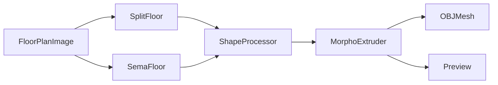
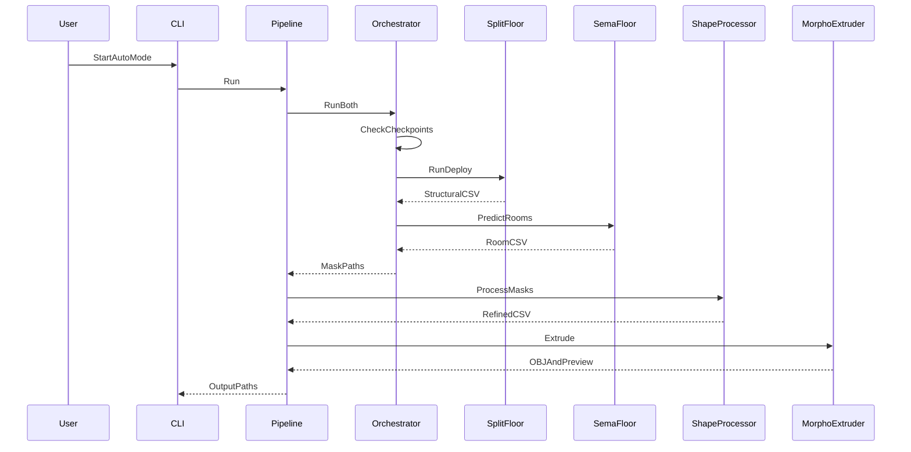

# Blueprint3D｜二维户型图到三维建筑模型（Floor Plan to 3D）

## 一句话定义

**Blueprint3D**（ashnomad/Blueprint3D）是把 2D 平面图转成粗 3D 建筑几何的三模块 Python 管线：SplitFloor 识别建筑结构，SemaFloor 分割房间，ForgeFloor 后处理并拉伸成网格。

## 英文缩写速查

| 缩写 | 英文全称 | 简要说明 |
|---|---|---|
| CNN | Convolutional Neural Network | 结构和房间语义分割的神经网络 |
| ASPP | Atrous Spatial Pyramid Pooling | SemaFloor 的多尺度上下文模块 |
| OBJ | Wavefront OBJ | ForgeFloor 生成的静态三维网格格式 |
| CSV | Comma-Separated Values | 分割掩码传给几何阶段的二维数组 |
| GUI | Graphical User Interface | ForgeFloor 的 Tkinter 图形入口 |

## 为什么重要

机器人导航或仿真场景构建经常从平面草图开始。本项目提供「图像语义 → 矢量/栅格几何整理 → 三维显示」的工程范例，可生成建筑外观初稿，但**未提供可靠尺寸、机器人碰撞/惯性和可交互门机构件**。

## 核心原理

| 子模块 | 输入 → 处理 → 输出 |
|---|---|
| SplitFloor | JPG/PNG → ResNet-50 + U-Net 类 skip decoder → 0 背景、1 门、2 墙、3 窗的结构 mask/CSV |
| SemaFloor | 同一图像 → ResNet-50 + ASPP + 解码器，房间主头与边界辅助头 → room mask/CSV |
| ShapeProcessor | 房间、结构 mask → 连通域、形态学平滑/方形化、结构优先级 → rooms/struct CSV |
| MorphoExtruder | 几何化 CSV → PyVista 楼板、墙、窗洞处理 → OBJ 和调试预览 |

## 流程总览

## 源码运行时序图

下图按 [`ForgeFloor/extruder.py`](https://github.com/ashnomad/Blueprint3D/blob/bb4a4fd81f0d29904c522dac710617ce9eb11b1e/ForgeFloor/extruder.py) 的 `main → cli_mode → ForgePlanPipeline.run`、`NeuralInferenceOrchestrator.run_both`、`ShapeProcessor.process`、`MorphoExtruder.extrude` 对齐；不表示已实测通过。

## 工程实践

- **入口：** `python ForgeFloor/extruder.py --gui` 或 `--input floor.png --auto --output_dir outputs/`；已有手工标注掩码时可传 `--sema`、`--split` 跳过神经网络。
- **重要阻塞：** 官方目录缺少 `SplitFloor/checkpoints` 与 `SemaFloor/checkpoints`，但源码自动模式必须加载权重；使用方需自行获取兼容权重或训练模型，本文未核实可用权重来源。
- **质量检查：** 检查 CSV 结构类编号、房间连通性、窗洞闭合、网格尺度/拓扑；导入 Gazebo、MuJoCo 或 Isaac 前另补碰撞、惯性和坐标。
- **源码开放：** 三模块 Python 源码已公开；未见 LICENSE，不能直接认定为 MIT/BSD 等许可。

## 局限与风险

自动重建的语义 mask 不是建筑测量真值；细墙、门窗、连通房间易受图像质量影响。仓库 README 提供示意输出但未给出统一基准或精度指标；官方 checkpoint 缺失也阻断原样重跑。OBJ 不携带完整机器人可执行的物理和交互语义。

## 关联页面

- [Pascal Editor](./pascal-editor.md) — 另一条「可编辑语义建筑节点」路线，并非同一个自动重建网络。
- [Infinigen V2](./infinigen.md) — 程序化 3D 场景生成。
- [3D Gen Studio](./3dgenstudio.md) — 网格生产编排而非建筑平面图解析。
- [Sim2Real](../concepts/sim2real.md) — 感知与物理资产进入机器人仿真的校验。
- [机器人视觉感知栈选型闭环](../queries/robot-perception-stack-selection-loop.md) — 平面图结构 / 房间分割属其 ② 2D 分割层，拉伸成 OBJ 是离线的 ③ 2D→3D 提升；输入是建筑图纸而非机器人传感器，不经过 ① 传感与标定层

## 参考来源

- [Blueprint3D 官方源码/README 归档](../../sources/repos/blueprint3d-ashnomad.md)

## 推荐继续阅读

- [官方 README 与示例图](https://github.com/ashnomad/Blueprint3D)
- [SplitFloor 结构分割推理实现](https://github.com/ashnomad/Blueprint3D/blob/bb4a4fd81f0d29904c522dac710617ce9eb11b1e/SplitFloor/deploy.py)
