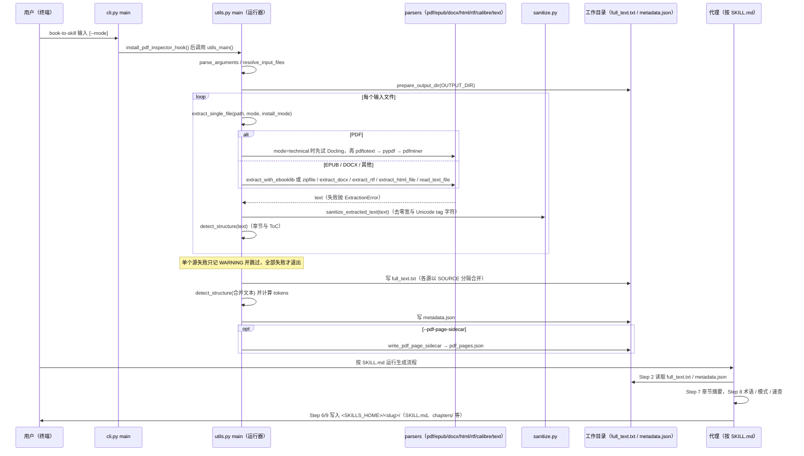

# book-to-skill（将技术资料编译为 Agent Skill）

## 一句话定义

**book-to-skill** 是一个开源资料编译器：把技术书籍、文档目录或研究资料集合整理成可由多个代理读取的 skill，并将章节内容拆分为按需加载的文件。

## 英文缩写速查

| 缩写 | 英文全称 | 简要说明 |
|------|----------|----------|
| LLM | Large Language Model | 负责生成 skill 结构与提炼内容的模型 |
| CLI | Command-Line Interface | 项目支持通过命令式入口调用资料转换工作流 |
| PDF | Portable Document Format | README 列出的输入文档格式之一 |
| EPUB | Electronic Publication | README 列出的电子书输入格式之一 |

## 为什么重要（对机器人知识工作）

- **把长期参考资料变成可调用上下文：** 机器人控制、强化学习、运动规划或仿真文档可按章节和主题拆分，减少代理反复重新定位资料的工作。
- **输出结构化技能，而非单份摘要：** 核心指引之外还生成章节文件、术语表、模式与速查表，使知识可按问题粒度加载。
- **与 LLM Wiki 分工清楚：** [LLM Wiki](../references/llm-wiki-karpathy.md) 编译跨来源、持续交叉引用的知识；book-to-skill 将一组指定资料编译成方便代理使用的独立 skill。前者偏知识库维护，后者偏资料集封装。

## 输入与输出

| 环节 | 内容 |
|------|------|
| 输入 | 技术书籍、文档目录、glob 或研究资料集合；README 列出 PDF、EPUB、DOCX、Markdown、HTML、RTF、MOBI 等格式 |
| 提炼 | 从来源组织核心框架、决策规则、反模式和章节索引 |
| 输出 | `SKILL.md`、章节文件、`glossary.md`、`patterns.md` 与 `cheatsheet.md` |
| 加载 | 默认安装到跨代理的用户级技能目录，也支持指定代理或项目本地目录 |

## 使用边界

- 上游 README 报告在其测试书籍上回答单个问题可减少 24×–51× token；这是特定基准的结果，不能直接外推到所有书籍、问题或代理。
- 编译结果是模型整理后的二手表示。涉及公式、控制参数、训练细节或安全边界时，应按生成内容中的章节引用回查原始资料。
- 该仓库提供通用文档转 skill 工具，不等同于机器人专用知识库，也不会自动替代来源追溯与人工策展。

## 开源状态

代码仓库公开可读；README 徽章标注 MIT License。当前归档依据项目 README 与仓库信息。

## 源码运行时序图

入口：`book-to-skill <文件|目录|glob> [--mode technical|text]`（`pyproject.toml` 的 `[project.scripts]` 把 `book-to-skill` 指向 `book_to_skill.cli:main`；`scripts/extract.py` 为兼容旧调用的垫片）。下图只画 **抽取器（Python，确定性）**；生成 SKILL 的步骤由代理按 `SKILL.md` 执行，不是代码。

图依据：virgiliojr94/book-to-skill@e7bb659，pyproject.toml、book_to_skill/__main__.py、book_to_skill/cli.py、book_to_skill/utils.py（parse_arguments、resolve_input_files、extract_single_file、main 及 PDF 分支）、book_to_skill/config.py（输出路径）、docs/architecture.md、SKILL.md（Step 2、6–9 标题）。其中 Step 6–9 的写入细节仅据 SKILL.md 标题与 architecture.md，未逐行读；未运行代码。

## 参考来源

- [book-to-skill 仓库归档](../../sources/repos/virgiliojr94-book-to-skill.md)
- [项目 README](https://github.com/virgiliojr94/book-to-skill/blob/master/README.md)
- 源码核对（2026-11-02）：virgiliojr94/book-to-skill@e7bb659，读过 docs/architecture.md、book_to_skill/__main__.py、book_to_skill/cli.py、book_to_skill/utils.py（main、parse_arguments、resolve_input_files、extract_single_file 的 PDF 分支等段）；grep 过 pyproject.toml、book_to_skill/config.py、SKILL.md（仅 Step 标题）；时序图依据以上文件，未运行代码。

## 关联页面

- [LLM Wiki（Karpathy 模式）](../references/llm-wiki-karpathy.md) — 持久编译和维护跨来源知识。
- [Get It. Study Companion](./get-it-study-companion.md) — 面向 PDF/Markdown 学习材料的交互式学习应用。
- [WikiSkill](./paper-wikiskill.md) — 将持久知识页嵌入 skill 进化流程的研究框架。

## 推荐继续阅读

- [book-to-skill 使用说明](https://github.com/virgiliojr94/book-to-skill/blob/master/docs/usage.md)
- [book-to-skill 性能测量](https://github.com/virgiliojr94/book-to-skill/blob/master/docs/performance.md)
