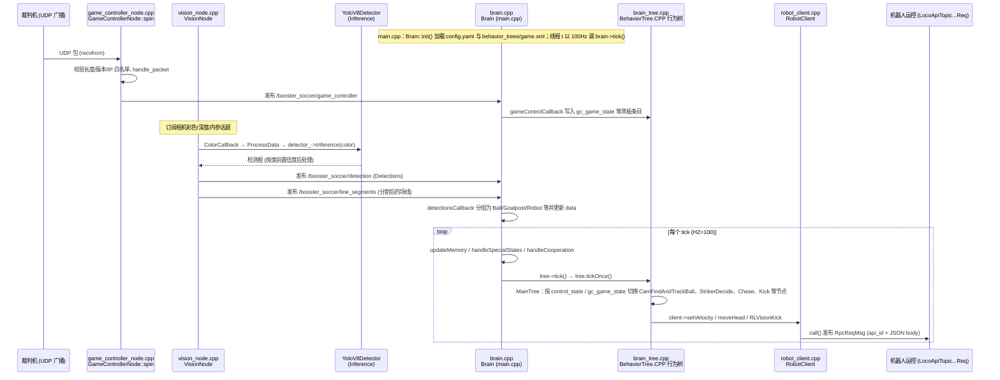

---

type: entity
tags: [humanoid, robocup, ros2, booster-robotics, perception, rl, booster]
status: draft
updated: 2026-07-26
related:
  - ../queries/robot-perception-stack-selection-loop.md
  - ./robot-lab.md
  - ../concepts/ros2-basics.md
  - ../methods/auto-labeling-pipelines.md
  - ./ultralytics.md
  - ../tasks/humanoid-soccer.md
sources:
  - ../../sources/repos/booster-robocup-demo.md
  - ../../sources/repos/ultralytics.md
summary: "Booster Robotics RoboCup Demo 是专为 Booster 系列人形机器人设计的足球比赛自主决策框架，集成了 YOLOv8 感知与基于强化学习的视觉踢球算法。"
---

# Booster Robotics RoboCup Demo

**Booster Robotics RoboCup Demo** 是由 [Booster Robotics](https://github.com/BoosterRobotics) 官方维护的开源项目，旨在为其人形机器人（尤其是 **Booster K1**）提供参加 RoboCup 足球比赛的完整自主软件方案。

## 英文缩写速查

| 缩写 | 英文全称 | 简要说明 |
|------|----------|----------|
| ROS 2 | Robot Operating System 2 | 机器人系统集成与通信的常用中间件 |
| ONNX | Open Neural Network Exchange | 跨框架神经网络模型交换格式 |
| SDK | Software Development Kit | 软件开发工具包 |
| RL | Reinforcement Learning | 通过与环境交互最大化长期回报来学习策略的范式 |

## 系统架构

该系统基于 **ROS 2 Humble** 构建，采用了典型的感知-决策-执行分层架构：

### 1. 感知层 (`vision`)
- **目标检测**: 使用 **YOLOv8**（[Ultralytics](./ultralytics.md) 谱系）模型实时识别足球、机器人对手/队友及场地边线。
- **坐标变换**: 将 2D 图像坐标通过相机外参及地面约束转换为机器人坐标系下的 3D 位姿。
- **推理优化**: 在真机端（NVIDIA Orin）使用 **TensorRT** 加速，仿真端支持 ONNX Runtime。

### 2. 决策层 (`brain`)
- **逻辑控制**: 采用分层状态机，管理机器人的比赛状态（Search, Chase, Align, Kick）。
- **通信对接**: 集成了 RoboCup 官方的 GameController 协议，监听裁判机的比赛指令（如 Start, Ready, Set, Finish）。
- **踢球控制**: 包含基础踢球逻辑和高级的 **`RLVisionKick`**（基于强化学习的视觉引导踢球），后者能够根据实时视觉反馈动态调整步态，实现更精准的击球。这些强化学习策略通常使用 [htwk-gym](../methods/htwk-gym.md) 框架训练而成。

### 3. 通信层 (`game_controller`)

- 负责将裁判机的网络广播包转换为 ROS 2 话题，实现比赛状态的自动化流转。

## 硬件与软件需求

- **硬件**: 
    - 官方支持：Booster K1 (固件 v1.5.2+), Booster T1。
    - 计算平台：支持 NVIDIA Jetpack 6.2。
- **软件**: 
    - 操作系统：Ubuntu 22.04 + ROS 2 Humble。
    - 核心依赖：Booster Robotics SDK。

## 技术特色：RLVisionKick

该框架的一个亮点是集成了强化学习（RL）踢球模块。相比传统的基于预设轨迹的踢球（Keyframe-based），RL 踢球能够：
1. **闭环调节**: 在接近足球的过程中，根据视觉偏差实时修正脚部位置。
2. **高成功率**: 在不平整草地或足球微小移动时表现出更好的鲁棒性。

## 开发与仿真

该项目支持在 **Booster Studio** 仿真器中运行，允许开发者在没有真机的情况下：
- 验证视觉算法的有效性。
- 调试状态机逻辑与协作策略。
- 模拟不同的比赛地形与光照条件。

## 源码运行时序图

入口：真机 `./scripts/start.sh`（依次 `ros2 launch vision launch.py`、`ros2 launch brain launch.py`、`ros2 launch game_controller launch.py`）；仿真用 `scripts/sim_start.sh`（brain）与 `scripts/start_vision.sh`（vision，`sim:=true`）。

图依据：BoosterRobotics/robocup_demo@fa4f31c，读过 README.md、scripts/start.sh、scripts/sim_start.sh、scripts/start_vision.sh、src/brain/src/main.cpp、brain.cpp（init/tick/各 Callback）、brain_tree.cpp、robot_client.cpp、src/brain/behavior_trees/game.xml、src/vision/src/vision_node.cpp、src/game_controller/src/game_controller_node.cpp。

## 关联页面

- [htwk-gym (足球 RL 训练框架)](../methods/htwk-gym.md) — 为该项目提供底层技能支持。
- [Humanoid Soccer (足球任务)](../tasks/humanoid-soccer.md) — 了解综合任务背景。
- [robot_lab (IsaacLab 扩展框架)](./robot-lab.md) — 了解 Booster T1 在仿真环境中的适配。
- [ROS 2 基础](../concepts/ros2-basics.md) — 该项目的通信底座。
- [自动化标注流水线](../methods/auto-labeling-pipelines.md) — 针对比赛环境定制 YOLO 模型的关键。

## 参考来源

- [BoosterRobotics/robocup_demo 源码仓库](../../sources/repos/booster-robocup-demo.md)
- Booster Robotics 官方文档
- 源码核对（2026-11-02）：BoosterRobotics/robocup_demo@fa4f31c，读过 README.md、scripts/start.sh、scripts/sim_start.sh、scripts/start_vision.sh、src/brain/src/main.cpp、brain.cpp、brain_tree.cpp、robot_client.cpp、behavior_trees/game.xml、src/vision/src/vision_node.cpp、src/game_controller/src/game_controller_node.cpp；时序图依据以上文件，未运行代码。
