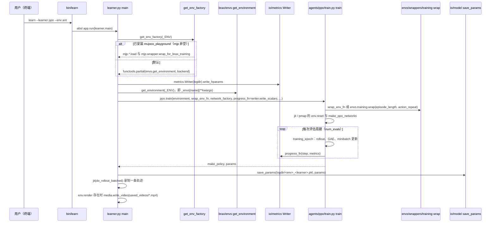

# Brax（JAX 可微物理与 RL 训练）

**Brax** 指 GitHub 仓库 [`google/brax`](https://github.com/google/brax)：在 **JAX** 上提供 **刚体仿真** 与 **强化学习训练算法** 的一体化实现。其 NeurIPS 2021 论文强调 **大规模并行** 与 **端到端可微** 的仿真–学习联合设计；近年来仓库 README 对 **组件边界** 做了更明确的拆分（见下节「维护边界」）。

## 一句话定义

**JAX 上的 RL 训练库 + 历史上自带的多种可微物理后端**；新项目中 **物理** 应优先对齐 **MJX / MuJoCo Warp**，**任务环境** 官方推荐转向 **MuJoCo Playground**，Brax 侧以 **`brax/training`** 为主维护面。

## 英文缩写速查

| 缩写 | 英文全称 | 简要说明 |
|------|----------|----------|
| JAX | JAX | 支持自动微分与 XLA 编译的数值计算库 |
| RL | Reinforcement Learning | 通过与环境交互最大化长期回报来学习策略的范式 |
| MuJoCo | Multi-Joint dynamics with Contact | 接触丰富的刚体物理仿真引擎 |
| MJX | MuJoCo JAX | MuJoCo 的 JAX/XLA 后端，支持可微与批量仿真 |
| PPO | Proximal Policy Optimization | 人形/足式 locomotion 中最常用的 on-policy 策略梯度算法 |
| SAC | Soft Actor-Critic | 连续控制常用的 off-policy 最大熵算法 |
| GPU | Graphics Processing Unit | 图形处理器，大规模并行仿真训练的算力基础 |
| CPU | Central Processing Unit | 中央处理器 |

## 为什么重要

- **可微仿真文献锚点**：论文 [arXiv:2106.13281](https://arxiv.org/abs/2106.13281) 与开源实现长期作为 **解析策略梯度**、**sim2sim** 等方向的 **基线栈**。
- **与 MuJoCo 路线收敛**：README 明确 **MJX** 为 MuJoCo 级物理的 JAX 实现入口，Brax 内置的 **MuJoCo XLA – MJX** 管线描述与 [MuJoCo MJX](./mujoco-mjx.md) 文档互链。
- **训练算法现成实现**：PPO、SAC、ARS、ES、APG 等位于 `brax/training/agents/`，适合作为 **JAX RL** 的参考实现而非从零写分布式采样循环。

## 维护边界（以 README 为准，摘录要点）

- **自 0.13.0 起**：**仅 `brax/training` 处于积极维护**；不应再把 `brax/envs` 当作新项目的默认环境来源。
- **环境**：官方建议改用 [**MuJoCo Playground**](https://github.com/google-deepmind/mujoco_playground) 等任务库，并与 `brax/training` 组合训练。
- **物理仿真**：若目标是 **MuJoCo 一致动力学**，应使用 **MJX**（[`mujoco-mjx`](https://pypi.org/project/mujoco-mjx/)）或 [**MuJoCo Warp**](./mujoco-warp.md)，README 提示未来可能将 Brax **进一步收窄为 RL 库**。

## 常见误区或局限

- **误区：「Brax 就是 GPU 版 MuJoCo」。** 物理真值与特性集合应以 **MJX 文档的 parity 说明** 为准；Brax 历史上还有 **generalized / positional / spring** 等自有近似管线，与 MuJoCo 并非同一内核。
- **误区：「继续抄 `brax/envs` 教程即可」。** 新代码路径应核对 README 的 **Playground** 迁移建议，避免依赖进入低维护状态的组件。
- **局限**：与 **PyTorch 分布式** 主栈相比，JAX 侧 **就业界模板密度** 仍略低；跨框架常需 **HTTP/gRPC 或自行封装** 做数据交换（仓库提供 PyTorch Colab 示例作参考）。

## 源码运行时序图

入口：`python bin/learn --learner ppo --env ant`（`bin/learn` 内容为 `app.run(learner.main)`；README 写作 `learn`，`pyproject.toml` 未声明 console script，需要该脚本在 PATH 中）。下图只画训练入口 `learner.main` 的 PPO 路径；`sac` / `es` / `apg` / `ars` 分支结构相同，仅调用各自的 `train`。

图依据：google/brax@c860529，README.md、bin/learn、brax/training/learner.py（flag 定义、get_env_factory、main 全文）、brax/envs/__init__.py（仅 grep get_environment / _envs）；以下仅 grep 函数定义与调用点，未逐行读：brax/training/agents/ppo/train.py、brax/training/agents/ppo/losses.py（compute_gae 存在性）、brax/envs/wrappers/training.py、brax/io/metrics.py、brax/io/model.py、pyproject.toml（仅 grep scripts 段）。未运行代码。

## 关联页面

- [MuJoCo MJX](./mujoco-mjx.md) — README 推荐的 MuJoCo 级 JAX 物理入口
- [MuJoCo Warp](./mujoco-warp.md) — README 并列的 Warp/CUDA 物理入口（AD 未通）
- [MuJoCo](./mujoco.md) — 资产格式、接触建模与 CPU 参考实现
- [dm_control](./dm-control.md) — 经典连续控制基准与 Python 工具链
- [LIFT（人形大规模预训练 + 高效微调）](./lift-humanoid.md) — 工程叙事中使用 **Brax 可微刚体** 组件的实例
- [Reinforcement Learning](../methods/reinforcement-learning.md)
- [Model-Based RL](../methods/model-based-rl.md) — 世界模型 + 可微仿真交叉引用

## 推荐继续阅读

- 论文：[Brax — A Differentiable Physics Engine…](https://arxiv.org/abs/2106.13281)
- 仓库 README 与 Colab：[google/brax](https://github.com/google/brax)
- 与 MJX 联训示例：[MuJoCo `mjx/tutorial.ipynb`（Colab）](https://colab.research.google.com/github/google-deepmind/mujoco/blob/main/mjx/tutorial.ipynb)

## 参考来源

- [brax（仓库归档）](../../sources/repos/brax.md)
- [Brax 论文摘录（arXiv:2106.13281）](../../sources/papers/brax_arxiv_2106_13281.md)
- 源码核对（2026-11-02）：google/brax@c860529，读过 README.md、bin/learn、brax/training/learner.py；另 grep 过 brax/envs/__init__.py、brax/training/agents/ppo/train.py、brax/training/agents/ppo/losses.py、brax/envs/wrappers/training.py、brax/io/metrics.py、brax/io/model.py、pyproject.toml；时序图依据以上文件，未运行代码。
