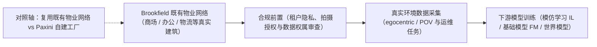

# Brookfield Physical AI Data（地产数据场景）

**Brookfield Corporation**（BN）等全球地产运营商，在 LeoInAI Substack（2026-09）叙事中代表 **「物业组合 = 数据采集场地」**：跨商场、办公、物流等资产与人形/物理 AI 团队合作采集 **真实环境 egocentric / 运维任务** 数据。

## 一句话定义

**当机器人需要学会在真实建筑里干活，谁拥有百万平米物业，谁就可能拥有数据矿权。**

## 英文缩写速查

| 缩写 | 英文全称 | 简要说明 |
|------|----------|----------|
| REIT | Real Estate Investment Trust | 地产控股常见结构 |
| POV | Point of View | 物业内 egocentric 采集 |
| IL | Imitation Learning | 数据下游 |
| FM | Foundation Model | 购买/合作方 |
| ESG | Environmental, Social, and Governance | 隐私与租户授权需合规框架 |

## 为什么重要

- **与 Paxini 对照：** [Paxini](./paxini.md) **自建** 10 万㎡ 工厂；Brookfield 型玩家 **复用既有物业** 网络。
- **垂直整合假想：** Substack 末尾讨论「采数–清洗–训世界模型」端到端服务商；地产方是最自然的 **场景房东**。

## 核心信息

| 项 | 内容 |
|----|------|
| **角色** | 场景提供方 / 数据合作方（非机器人整机厂） |
| **公开细节** | Substack **未列具体合同**；作产业趋势节点入库 |
| **风险** | 租户隐私、拍摄授权与数据权属需个案法律审查 |

## 机制与架构图

## 关联页面

- [Paxini](./paxini.md)
- [人形数据采集地图](../queries/humanoid-robot-data-collection-landscape.md)
- [Data Flywheel](../concepts/data-flywheel.md)
- [机器人学习数据管线 · Robot Learning Data Pipelines](../methods/robot-learning-data-pipelines.md)：对照从真实物业场景采集 egocentric 数据到整理为可训练策略数据集的数据管线。
- [Imitation Learning (IL, 模仿学习)](../methods/imitation-learning.md)：衔接真实建筑运维场景采集数据的下游模仿学习策略训练范式。

## 参考来源

- [LeoInAI Substack 摘录](../../sources/blogs/leoinai_humanoid_robot_datacollection_2026-09-06.md)
