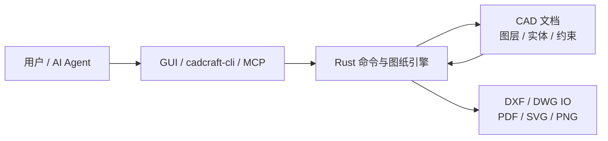
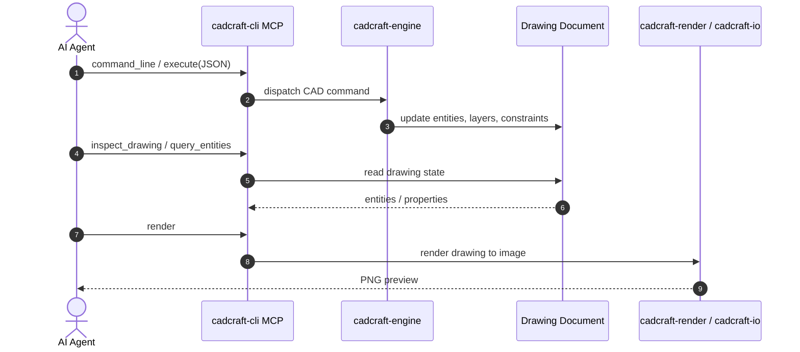

# CADCraft：可由 Agent 驱动的原生开源 CAD

**CADCraft**（[官方项目页](https://getartcraft.com/apps/cadcraft)，[GitHub](https://github.com/storytold/cadcraft)）是 Rust / egui 实现的 CAD 编辑器，提供桌面、命令行与 WebAssembly 入口，并把绘图命令、图纸检查和渲染能力暴露给 AI agent。

## 英文缩写速查

| 缩写 | 英文全称 | 简要说明 |
|------|----------|----------|
| CAD | Computer-Aided Design | 计算机辅助设计与工程绘图 |
| DXF | Drawing Exchange Format | CAD 图纸交换格式；本项目读 ASCII / binary DXF |
| DWG | Drawing | Autodesk CAD 图纸格式；本项目通过 acadrust 读写部分版本 |
| MCP | Model Context Protocol | 让代理以结构化工具调用 CAD 能力的协议 |
| WASM | WebAssembly | 浏览器中运行的 CADCraft Web 构建形式 |
| CLI | Command-Line Interface | 终端入口；提供文件转换、脚本运行与 MCP 服务 |

## 为什么值得关注

CADCraft 的重点不只是“能在浏览器画图”，而是把熟悉的 CAD 命令行和结构化控制接口放在同一应用内核上：人可以交互绘图，程序也能执行同一组命令、查询实体并渲染结果。它与 [CAD Skills](./cad-skills.md) 代表不同层次：CAD Skills 是可安装到代理里的规范和 Python CLI；CADCraft 本身则是 CAD 应用及其几何、图纸和绘制引擎。

对机器人研发而言，这类工具适合快速查看 / 修改 2D 机械图、生成简单支架或安装板草图、做格式转换与自动化绘图试验。但 README 没有宣称它能直接产出通过机构审查的机器人设计；图纸若要进入 URDF / 仿真 / 制造流程，仍须补齐 3D 几何、质量属性、坐标系、装配公差和加工校核。

## 能力边界速览

| 环节 | CADCraft 公开能力 | 工程读法 |
|------|------------------|----------|
| 绘图与修改 | 命令行、对象捕捉、图层、尺寸、填充、块、常用编辑命令 | 适合 CAD 风格 2D 制图与常见零件图编辑 |
| 参数化 | 几何 / 尺寸约束、表达式参数、自动重求解与冲突检测 | 可表达部分尺寸关系；不代表完整 AutoCAD / 商业 CAD 功能兼容 |
| 文件 IO | DXF 读 R12–2018、写 R2000；DWG 通过 acadrust 读 R13–2018、写 R2000；PDF / SVG / PNG 输出 | 必须按自己的图纸测试格式往返与实体保留情况 |
| 桌面与网页 | Rust 原生 macOS / Windows / Linux / FreeBSD build；另有 WebAssembly build | Web 包可静态托管，但桌面与 Web 的系统字体 / 文件访问能力不同 |
| Agent 自动化 | cadcraft-cli 的命令运行 / JSON 执行 / MCP；可 inspect、query、render | 可做图纸生成、转换、审阅的自动化原型；改图后应先 inspect / render 再交付 |

## 架构与代理闭环

GUI、CLI 和 MCP 共用 CADCraft 的 drawing / command engine；MCP 工具因此可以调用同一套命令并通过查询和渲染回读结果，而非只对 UI 做坐标点击。

## 源码运行时序图

README 给出了 `cadcraft-cli mcp` 的 stdio 入口及连接运行中 GUI 的控制通道方式；核心工具包括命令执行、图纸查询与渲染：

Headless MCP 方式为 `cadcraft-cli mcp`；连接 GUI 的方式是以 `--control 7979` 启动应用，再运行 `cadcraft-cli mcp --connect 127.0.0.1:7979`。实际命令名称和工具 schema 应以仓库当前 README / CLI 帮助为准。

## 运行与复现

| 目标 | README 入口 |
|------|-------------|
| 桌面 sample | `cargo run --release -p cadcraft -- --sample` |
| Web UI | `cd apps/cadcraft-web && trunk serve` |
| MCP stdio 服务 | `cadcraft-cli mcp` |
| 单次 headless 操作 | `cadcraft-cli run --sample --script 'CIRCLE 22,3 1\n' --save out.dxf --export out.png` |
| 格式转换 | `cadcraft-cli convert drawing.dxf drawing.svg` |

仓库是可运行的开源实现，双许可 MIT OR Apache-2.0。主分支工作区是 Cargo workspace；截至 2026-10-12，官方产品页下载卡显示 0.5.0，仓库 `Cargo.toml` 标记 0.6.2。工程复现或给用户推荐下载时，应检查 release 页面和主分支是否已同步。

## 局限与风险

- **功能仍在快速开发：** 项目页 / README 明确称处于 early development，不能根据相似命令名默认所有 AutoCAD 行为与文件语义一致。
- **格式保真要实测：** README 指出尚未建模的 DXF 实体保存时不会保留；精确兼容性应使用目标图纸做读写往返校验。
- **DWG 依赖独立实现：** DWG 能力通过开源 acadrust 库实现；读写格式范围需区分，README 对读入与 R2000 写出分别说明。
- **机器人设计需下游审核：** CADCraft 未提供开箱的机器人 URDF、惯量、碰撞几何或 DFM 校验链；仿真资产与制造图纸不能仅凭成功导入就视为物理正确。
- **版本显示不同步：** 项目页下载区为 0.5.0，仓库 manifest 为 0.6.2；查询具体特性时注明对应来源。

## 与其他页面的关系

- [CAD Skills](./cad-skills.md) — 可安装给代理的 build123d / URDF / 制造工作流；CADCraft 是可交互 CAD 应用 + Agent 控制面。
- [文字生成 CAD](../concepts/text-to-cad.md) — CAD 与生成式模型 / 代理脚本的概念谱系。
- [人形整机机械布局设计](../concepts/humanoid-mechanical-layout-design.md) — 机器人结构设计、CAD 模型与惯量 / 公差验证的工程上下游。

## 参考来源

- [CADCraft 官方项目页](../../sources/sites/cadcraft-artcraft.md)
- [storytold/cadcraft 官方仓库](../../sources/repos/storytold-cadcraft.md)

## 推荐继续阅读

- [CADCraft 官方项目页与下载](https://getartcraft.com/apps/cadcraft)
- [storytold/cadcraft GitHub](https://github.com/storytold/cadcraft)
- [CADCraft Releases](https://github.com/storytold/cadcraft/releases)
