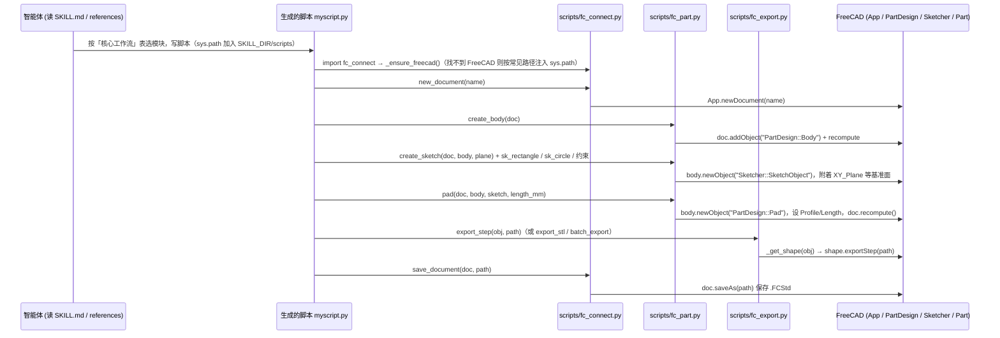

# FreeCAD Automation Skill（Cai-aa）（Cai-aa/freecad-automation-skill）

## 一句话定义

FreeCAD Automation Skill（Cai-aa）（Cai-aa/freecad-automation-skill）是FreeCAD 自动化技能，文章列出参数化建模、装配、TechDraw 工程图和 STEP/STL 导出等能力。

## 英文缩写速查

| 缩写 | 英文全称 | 简要说明 |
|------|----------|----------|
| CAD | Computer-Aided Design | 计算机辅助设计与几何建模 |
| MCP | Model Context Protocol | 代理调用 CAD/可视化工具的协议 |
| FEM | Finite Element Method | 结构有限元分析方法 |

## 为什么重要

对 CAE 自动化而言，代理能否稳定完成任务，取决于工程步骤是否清楚、工具边界是否明确、结果是否保留可审查证据。FreeCAD 自动化技能，文章列出参数化建模、装配、TechDraw 工程图和 STEP/STL 导出等能力。

## 核心原理

**项目自身范围：** FreeCAD CAD automation skill for parametric modeling and documentation.

**工作流：** 代理通过 FreeCAD 技能说明生成/调整参数化模型，并导出工程图或交换格式文件供后续检查。

**仓库映射说明：** 文章未给出该项目完整的 owner/repository URL；此处按文章中的项目名/描述与公开 GitHub 仓库匹配。引用时请以本页链接的仓库 README 为准。

## 工程实践

1. 从目标问题识别所需的 Skill、MCP、CLI 或软件接口，不把指导文件当成求解器。
2. 依照仓库 README 检查安装前提、软件/许可证、输入文件和输出证据。
3. 小规模运行并逐项核对几何、网格、边界、求解状态和物理量，再决定是否扩大任务。

文章所述的项目特征：FreeCAD 自动化技能，文章列出参数化建模、装配、TechDraw 工程图和 STEP/STL 导出等能力。

## 局限与风险

技能依赖本机 FreeCAD/Python API；STEP/STL 导出后须检查坐标系、单位、装配与几何有效性。

源码状态核验：该 GitHub 仓库于 2026-10-07 可公开访问。仓库 API 未报告 SPDX 许可证，应检查仓库内 LICENSE 与依赖许可。 

## 源码运行时序图

该仓库是 Agent Skill（`SKILL.md` + `scripts/` 辅助函数库 + `references/` 文档），没有独立的 `main` 或 CLI；运行入口是由智能体按 `SKILL.md` 生成脚本，再用 FreeCAD 执行：`freecadcmd myscript.py`（Windows 为 `FreeCADCmd.exe myscript.py`），或 FreeCAD GUI 宏。下图为 `SKILL.md`「使用流程」对应的脚本内实际调用链（零件建模到 STEP 导出）。

图依据：Cai-aa/freecad-automation-skill@ca12e96，读过 SKILL.md、scripts/fc_connect.py（全文）、scripts/fc_part.py（create_body / create_sketch / pad 及函数清单）、scripts/fc_export.py（export_step / _get_shape 及函数清单）；fc_assembly.py、fc_drawing.py 仅读函数清单，references/*.md 未读，装配与工程图流程未画。

## 关联页面

- [CAE / CFD 代理工具项目总览](../overview/cae-cfd-agent-skills-landscape.md)
- [FreeCAD Automation Skill（miaooo0000OOOO）](./miaooo0000oooo-freecad-automation-skill.md)

## 参考来源

- [公众号文章原始资料归档](../../sources/blogs/wechat_cae_cfd_agent_skills_2026-10-07.md)
- [GitHub 仓库资料归档](../../sources/repos/cai-aa-freecad-automation-skill.md)
- [Cai-aa/freecad-automation-skill 官方仓库](<https://github.com/Cai-aa/freecad-automation-skill>)
- 源码核对（2026-11-02）：Cai-aa/freecad-automation-skill@ca12e96，读过 SKILL.md、scripts/fc_connect.py、scripts/fc_part.py、scripts/fc_export.py（均为部分或全文，fc_assembly.py / fc_drawing.py 仅函数清单）；时序图依据以上文件，未运行代码。

## 推荐继续阅读

- [项目 README](<https://github.com/Cai-aa/freecad-automation-skill/blob/main/README.md>)