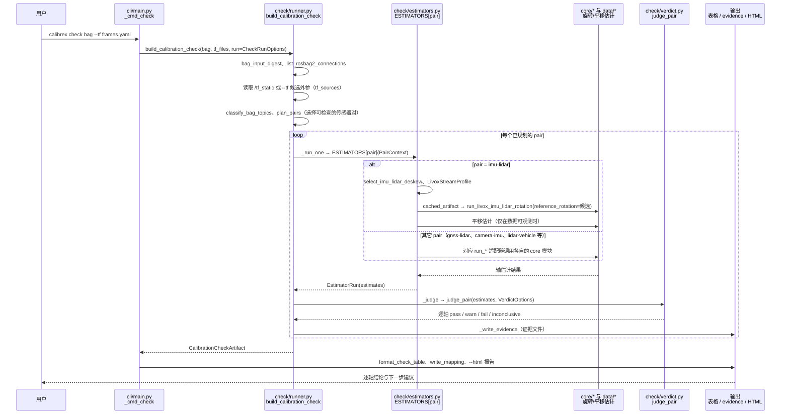

# Calibrex：多传感器标定与外参检查

## 一句话定义

Calibrex 从机器人录制的传感器数据估计或检查外参，比较已部署的变换与数据支持的估计，逐轴报告判定和可观测性。

## 英文缩写速查

| 缩写 | 英文全称 | 简要说明 |
|------|----------|----------|
| LiDAR | Light Detection and Ranging | 激光测距传感器 |
| IMU | Inertial Measurement Unit | 惯性测量单元 |
| GNSS | Global Navigation Satellite System | 全球导航卫星系统 |
| ROS | Robot Operating System | 机器人软件生态；bag 可记录传感器数据 |

## 工作流程

1. **estimate：** 从录包估计传感器间变换，输出估计值、各轴不确定度与可观测状态；未观测到的轴不会冒充测量结果。
2. **check：** 从 `/tf_static` 或 `--tf` 文件读取候选外参，按可用传感器对比较估计与部署值，输出逐轴 pass、warn、fail 或 inconclusive。
3. **drift：** 比较同一传感器组合的多次录制，检查外参是否随时间发生变化。
4. 证据包括留出数据、已知错误对照和可观测性，而不只依赖优化器收敛或训练残差。

## 工程实践与限制

- 使用 `calibrex check my_bag/ --plan` 先查看可检查的传感器对及跳过原因；车辆相关对需显式指定 `--vehicle-frame base_link`，其方法依赖地面车辆运动假设。
- **部分通过不代表完整通过。** 官方说明 camera-LiDAR 只判断旋转、不判断平移；平面行驶无法观测车辆相关对的 roll。运动激励不足时应补充合适数据，而不是把 inconclusive 当作 pass。
- 官方 KITTI 开发数据示例中，对 LiDAR 安装外参注入 +3° yaw 后，lidar-vehicle 判为 fail；这是注入错误的实验，不是所有配置的检测保证。
- 官方代码已公开、Apache-2.0，项目标为 alpha。README 将部分新能力标注为 main 分支功能，使用时应核对发布版与输入格式。浏览器页面按项目说明本地处理数据；大录包的耗时与浏览器资源限制仍需实际评估。
- 估计和验证尽量使用不同录制，并检查各轴覆盖、阈值和检测能力；不要将该工具等同于在线 SLAM 融合器。

## 源码运行时序图

入口：`calibrex check <bag> --tf frames.yaml`（`pyproject.toml` 中 `calibrex = "calibrex.cli.main:main"`；`estimate`、`drift` 同理分派）

图依据：rsasaki0109/Calibrex@7617325，读过 `README.md`、`pyproject.toml`、`src/calibrex/cli/main.py`（`_cmd_check`、`_cmd_estimate`、`_cmd_drift`）、`src/calibrex/check/runner.py`、`src/calibrex/check/estimators.py`（`ESTIMATORS`、`run_imu_lidar`）、`src/calibrex/check/verdict.py`（`judge_pair`）。

## 关联页面

- [传感器融合](../concepts/sensor-fusion.md) — 多模态融合背景。
- [状态估计](../concepts/state-estimation.md) — 标定与定位估计的关系。
- [Ultra-Fusion](./paper-ultra-fusion-multi-sensor-slam.md) — 对照在线时空标定与多传感器 SLAM。

## 参考来源

- [Calibrex 官方代码仓库](../../sources/repos/calibrex.md)
- [Calibrex 官方文档](../../sources/sites/calibrex.md)
- 源码核对（2026-11-02）：rsasaki0109/Calibrex@7617325，读过 README.md、pyproject.toml、src/calibrex/cli/main.py、src/calibrex/check/runner.py、src/calibrex/check/estimators.py、src/calibrex/check/verdict.py；时序图依据以上文件，未运行代码。

## 推荐继续阅读

- [官方 check 教程](https://rsasaki0109.github.io/Calibrex/tutorials/calibrex_check/)
- [官方浏览器录包检查](https://rsasaki0109.github.io/Calibrex/app/check.html)
