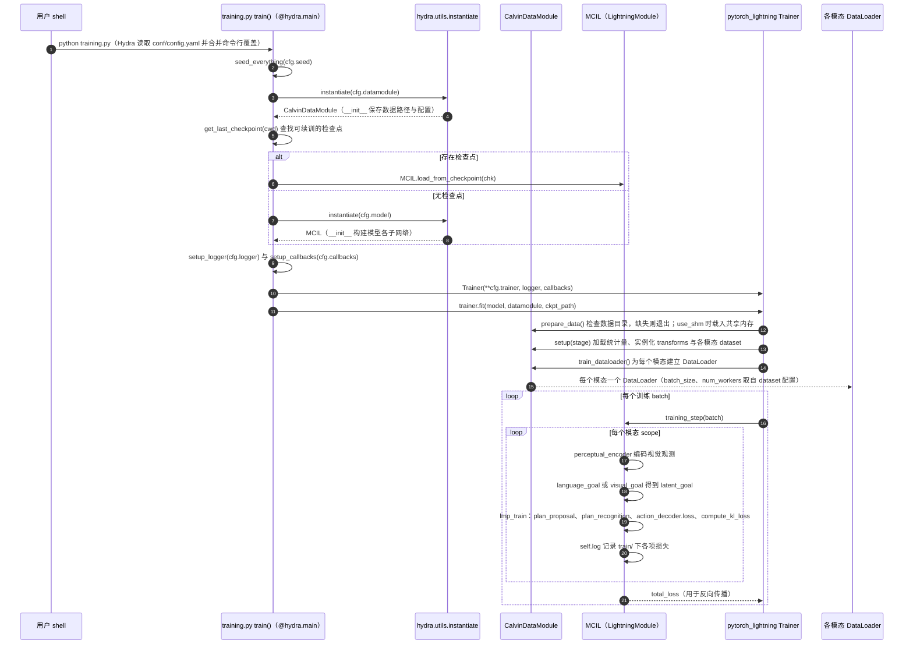

# CALVIN

[CALVIN](https://github.com/mees/calvin) 收录于具身智能研究室 [开源项目主表](https://github.com/RealXiaoze/humanoid-motion-intelligence/blob/main/%E8%AE%BA%E6%96%87%E4%B8%8E%E9%A1%B9%E7%9B%AE/%E5%BC%80%E6%BA%90%E9%A1%B9%E7%9B%AE%E4%B8%BB%E8%A1%A8.md) 的「工程与实机部署」分组，是本库为该入口建立的独立详情节点。

## 一句话定义

把语言指令、视觉观测和连续控制组织成长时序任务链，评测策略在无需每步重置时连续完成多个目标的能力；其数据与协议重点暴露错误累积和子任务切换，而非单步抓取成功率。

## 英文缩写速查

| 缩写 | 英文全称 | 简要说明 |
|------|----------|----------|
| CALVIN | CALVIN | CALVIN 相关缩写，详见正文 |
| Sim2Real | Simulation to Real | 仿真到真机部署主线 |
| RL | Reinforcement Learning | 训练与评测常用框架 |
| API | Application Programming Interface | 仿真/中间件编程接口 |

| MDP | Markov Decision Process | 状态–动作–转移–奖励形式化 |
| DR | Domain Randomization | 域随机化 |
| FM | Foundation Model | 大模型/基础模型增强迁移 |

## 为什么重要

- **主表工程定位清晰**：该条目被放在「工程与实机部署」下，说明它服务的是这条人形运动智能问题链上的具体环节，而不是泛泛的链接收藏。
- **可对照开源边界**：主表已概括其可复现范围（训练/推理/部署或仅方法页）；选型时应先读本页「开源状态」，再回官方 README / 项目页核对许可证与平台支持。
- **便于知识库交叉引用**：独立节点让路线图、对比页与 ingest 日志可以稳定链接，避免只在策展列表里「点名」却无法下钻。

## 核心原理

### 在技术路线中的位置

| 字段 | 内容 |
|------|------|
| 主表分组 | 工程与实机部署 |
| 官方入口 | https://github.com/mees/calvin |
| 开源状态（据主表） | 已开源（以官方仓库 README 为准） |

主表给出的技术定位可压缩为：

> 把语言指令、视觉观测和连续控制组织成长时序任务链，评测策略在无需每步重置时连续完成多个目标的能力；其数据与协议重点暴露错误累积和子任务切换，而非单步抓取成功率。

阅读时建议抓住三点：**(1) 输入是什么数据或观测；(2) 输出是参考轨迹、策略、数据还是中间件能力；(3) 公开材料能否支撑训练/部署复现。**

### 流程直觉（对照主表叙事）

具体模块边界以官方文档为准；本页不替代 README。

## 工程实践

1. **先核入口类型**：若是 GitHub/Gitee 仓库，从 README 的安装、训练与部署章节入手；若是项目页/论文，先确认是否已挂代码或权重。
2. **对齐本体与接口**：人形项目需核对关节顺序、控制频率、观测契约与仿真后端（Isaac / MuJoCo 等）是否与本机栈一致。
3. **按主表定位做消融**：主表强调的可分拆实验切口（例如只换重定向约束、只换部署层）应优先验证，避免一上来全链路重训。
4. **记录开源边界**：若仅有权重、Sim2Sim 或说明文档，不要假设训练管线可复现。

| 检查项 | 建议 |
|--------|------|
| 许可与星标时效 | 以官方仓库页面为准 |
| 支持机器人 / 仿真 | 读 assets 与 task 配置 |
| 真机入口 | 查找 SDK、ROS、ONNX/JIT 导出说明 |

## 局限与风险

- **主表是策展摘要**：细节、指标与许可以一手来源为准；本页只做知识库节点与导航。
- **开源状态可能变化**：标为待发布的项目后续可能放码；已开源仓库也可能拆分或迁移路径。
- **不要与同名论文页混淆**：若本库另有 `paper-*` 深读页，以论文页承载方法细节，本实体页侧重工程入口与选型。

## 源码运行时序图

入口：`cd calvin_models/calvin_agent && python training.py datamodule.root_data_dir=/path/to/dataset/ datamodule/datasets=vision_lang_shm`（基线训练；评测入口 `evaluation/evaluate_policy.py` 依赖子模块 `calvin_env`，本图未覆盖）

图依据：mees/calvin@fa03f01，实际读过的文件：`README.md`（训练命令与 Hydra 覆盖说明）、`calvin_models/calvin_agent/training.py`（全文）、`calvin_models/conf/config.yaml`（defaults 与 hydra 配置）、`calvin_models/conf/datamodule/default.yaml`（`_target_`）、`calvin_models/calvin_agent/datasets/calvin_data_module.py`（`prepare_data`、`setup`、`train_dataloader` 片段）、`calvin_models/calvin_agent/models/mcil.py`（`training_step`、`lmp_train` 片段）。未运行代码。`calvin_env` 为未拉取的子模块，评测与仿真环境路径未纳入本图；`trainer.fit` 内部对 batch 的循环由 Lightning 框架决定，图中以概括形式表示。

## 关联页面

- [sim2real](../concepts/sim2real.md)
- [isaac-lab](../entities/isaac-lab.md)
- [Humanoid Motion Intelligence](./humanoid-motion-intelligence.md)
- [开源主表覆盖索引](../queries/hmi-opensource-projects-coverage.md)
- [TEMPO](./paper-tempo.md) — 在 CALVIN ABC→D 上做语义–动作双频 RL 后训练（SR5 81.7%）
- [SLIM-0.5B](./paper-slim-05b.md) — 紧凑 latent 策略；ABC→D avg length 4.556（开源权重）
- [AtomicVLA](./paper-atomicvla.md) — 链长 avg task length +0.22 / +0.25 vs π₀ / π₀.₅（arXiv:2603.07648）

- 列表实体：[AwesomeSim2Real](../entities/awesome-sim2real.md)
- 技术地图：[AwesomeSim2Real 技术地图](../overview/lc-awesome-sim2real-technology-map.md)
- 方法/任务：[sim2real.md](../concepts/sim2real.md)、[locomotion.md](../tasks/locomotion.md)

- [humanoid-motion-intelligence](../entities/humanoid-motion-intelligence.md)
- [reinforcement-learning](../methods/reinforcement-learning.md)
- [manipulation](../tasks/manipulation.md)

## 参考来源

- [CALVIN 来源归档](../../sources/repos/calvin-benchmark.md)
- [Humanoid Motion Intelligence 仓库归档](../../sources/repos/humanoid-motion-intelligence.md)
- [开源项目主表（上游）](https://github.com/RealXiaoze/humanoid-motion-intelligence/blob/main/%E8%AE%BA%E6%96%87%E4%B8%8E%E9%A1%B9%E7%9B%AE/%E5%BC%80%E6%BA%90%E9%A1%B9%E7%9B%AE%E4%B8%BB%E8%A1%A8.md)
- [TEMPO 论文摘录](../../sources/papers/tempo_arxiv_2608_07314.md)

- [`sources/papers/lc_awesome_sim2real_2112_03227_calvin-a-benchmark-for-language-conditio.md`](../../sources/papers/lc_awesome_sim2real_2112_03227_calvin-a-benchmark-for-language-conditio.md) — 本条目策展摘录
- [`sources/papers/lc_awesome_sim2real_catalog.md`](../../sources/papers/lc_awesome_sim2real_catalog.md) — 列表总表
- [`sources/repos/awesome-sim2real.md`](../../sources/repos/awesome-sim2real.md)
- 论文：<https://arxiv.org/abs/2112.03227>
- 源码核对（2026-11-02）：mees/calvin@fa03f01，读过 README.md、calvin_models/calvin_agent/training.py、calvin_models/conf/config.yaml、calvin_models/conf/datamodule/default.yaml、calvin_models/calvin_agent/datasets/calvin_data_module.py（相关方法）、calvin_models/calvin_agent/models/mcil.py（相关方法）；时序图依据以上文件，未运行代码。

## 推荐继续阅读

- [官方入口](https://github.com/mees/calvin)
- [Humanoid Motion Intelligence 知识库实体页](./humanoid-motion-intelligence.md)
- [TEMPO](./paper-tempo.md)

- [AwesomeSim2Real 仓库](https://github.com/LongchaoDa/AwesomeSim2Real)
- [原文](https://arxiv.org/abs/2112.03227)
