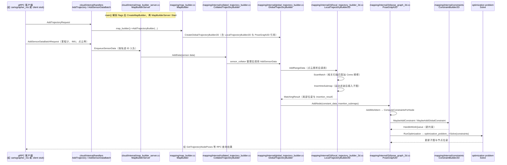

# Cartographer

**Cartographer** 是 Google 开源的 **子图 SLAM** 系统，支持 2D/3D 激光与多传感器配置。

## 英文缩写速查

| 缩写 | 英文全称 | 简要说明 |
|------|----------|----------|
| SLAM | Simultaneous Localization and Mapping | 同步定位与建图 |
| ROS 2 | Robot Operating System 2 | 机器人系统集成与通信的常用中间件 |
| URDF | Unified Robot Description Format | 统一机器人描述格式 |
| LiDAR | Light Detection and Ranging | 激光雷达，地形感知与建图主传感器 |
| LIO | LiDAR-Inertial Odometry | 激光-惯性里程计 |
| VIO | Visual-Inertial Odometry | 视觉-惯性里程计，融合相机与 IMU 估计位姿 |

## 为什么重要

- **工业成熟度**：大量仓储/服务机器人历史部署案例。
- **子图架构**：局部匹配 + 全局优化，利于大规模环境。

## 核心结构/机制

| 模块 | 说明 |
|------|------|
| **Local SLAM** | 扫描匹配、子图插入 |
| **Global SLAM** | 闭环检测、位姿图优化 |
| **cartographer_ros** | ROS/ROS2 桥接与传感器配置 |

## 常见误区或局限

- **误区：配置即开箱即用** — URDF、激光话题、帧率与时间同步需仔细标定。
- **对比**：与 slam_toolbox 相比 ROS2 迁移与社区重心不同，选型看团队栈。

## 源码运行时序图

入口：`map_builder_server_main`（`cartographer/cloud/map_builder_server_main.cc`，由 `CMakeLists.txt` 与 Bazel 目标构建；需 `--configuration_directory` 与 `--configuration_basename`，例如 `map_builder_server --configuration_directory <dir> --configuration_basename <lua>`）。本仓库不含 ROS 包装层，`cartographer_ros` 为独立仓库。

图依据：cartographer-project/cartographer@877157a，读过 `cartographer/cloud/map_builder_server_main.cc`、`cartographer/cloud/internal/map_builder_server.cc`（handler 注册）、`cartographer/cloud/internal/handlers/add_sensor_data_batch_handler.cc`、`cartographer/cloud/internal/handlers/add_trajectory_handler.cc`、`cartographer/mapping/map_builder.cc`（`AddTrajectoryBuilder`）、`cartographer/mapping/internal/collated_trajectory_builder.cc`、`cartographer/mapping/internal/global_trajectory_builder.cc`（`AddSensorData`）、`cartographer/mapping/internal/2d/local_trajectory_builder_2d.cc`（`ScanMatch`、`AddRangeData`、`InsertIntoSubmap`）、`cartographer/mapping/internal/2d/pose_graph_2d.cc`（`AddNode`、`ComputeConstraintsForNode`、`HandleWorkQueue`、`RunOptimization`）。`EnqueueSensorData` 至 collator 的内部细节、客户端 gRPC 侧与 `ConstraintBuilder2D` 内部未逐行核对；未运行代码。

## 参考来源

- [sources/repos/cartographer.md](../../sources/repos/cartographer.md)
- [cartographer-project/cartographer](https://github.com/cartographer-project/cartographer)
- 源码核对（2026-11-02）：cartographer-project/cartographer@877157a，读过 cartographer/cloud/map_builder_server_main.cc、cartographer/cloud/internal/map_builder_server.cc、cartographer/cloud/internal/handlers/add_sensor_data_batch_handler.cc、cartographer/cloud/internal/handlers/add_trajectory_handler.cc、cartographer/mapping/map_builder.cc、cartographer/mapping/internal/collated_trajectory_builder.cc、cartographer/mapping/internal/global_trajectory_builder.cc、cartographer/mapping/internal/2d/local_trajectory_builder_2d.cc、cartographer/mapping/internal/2d/pose_graph_2d.cc、README.rst；时序图依据以上文件，未运行代码。

## 关联页面

- [Navigation2](../entities/navigation2.md)
- [导航·SLAM·自动驾驶栈总览](../overview/navigation-slam-autonomy-stack.md)
- [LiDAR / LIO / VIO 选型](../comparisons/lidar-slam-lio-vio-selection.md)

## 推荐继续阅读

- https://google-cartographer-ros.readthedocs.io/
