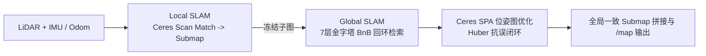
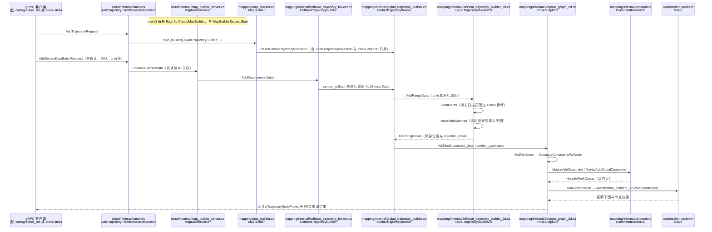

# Cartographer

## 一句话定义

**Cartographer** 是 Google 开源的实时 **2D/3D 子图 SLAM** 系统，通过 **局部概率栅格子图匹配** 与基于 **预计算多分辨率金字塔分支定界（BnB）** 的全局稀疏位姿调整（SPA）闭环，在大规模室内场景实现低漂移建图。

## 英文缩写速查

| 缩写 | 英文全称 | 简要说明 |
|------|----------|----------|
| SLAM | Simultaneous Localization and Mapping | 同步定位与建图 |
| ROS 2 | Robot Operating System 2 | 机器人系统集成与通信的常用中间件 |
| URDF | Unified Robot Description Format | 统一机器人描述格式 |
| LiDAR | Light Detection and Ranging | 激光雷达，地形感知与建图主传感器 |
| LIO | LiDAR-Inertial Odometry | 激光-惯性里程计 |
| VIO | Visual-Inertial Odometry | 视觉-惯性里程计，融合相机与 IMU 估计位姿 |

## 为什么重要

- **工业成熟度**：大量仓储/服务机器人历史部署案例。
- **子图架构**：局部匹配 + 全局优化，利于大规模环境。

## 核心原理与子图架构

| 模块 | 原文机制（Hess et al., ICRA 2016） |
|------|------|
| **Local SLAM** | 运动滤波后用 **Ceres 非线性最小二乘扫描匹配**（双三次插值概率栅格）对齐至当前活跃 **Submap**，达到固定扫描帧数后冻结子图防止内部持续漂移 |
| **BnB 全局闭环** | 构建 7 层 **预计算最大概率金字塔栅格（Precomputed Grids）**，以高层栅格严格上界做深度优先 **分支定界（Branch-and-Bound）** 搜索，消除大范围闭环检索开销 |
| **Global SPA 优化** | 后台异步执行 **稀疏位姿调整（SPA）** 并以 **Huber Loss** 抑制错误回环离群点，论文在 Deutsches Museum（2253 m）达 **5.3x 实时** 速率 |
| **cartographer_ros** | 通过 `.lua` 配置传感器坐标系、`TRAJECTORY_BUILDER_2D/3D` 与 `POSE_GRAPH` 权重接入 ROS 生态 |

## 工程实践

- **核心配置入口：** 所有传感器话题、体素滤波、子图尺寸与闭环频率由 `.lua` 文件（如 `backpack_2d.lua`）控制，调参重点为 `TRAJECTORY_BUILDER_2D.num_accumulated_range_data` 与 `POSE_GRAPH.constraint_builder.min_score`。
- **低成本雷达验证：** ICRA 2016 原文证明即使使用 **5 Hz / 单层 49 € 级 Neato Revo LDS** 配合 5 cm 栅格仍可完成厘米级室内大环闭环，但依赖精确的 `URDF` 外参与 IMU 时间同步。
- **与 Nav2 / SLAM Toolbox 配合：** 在 ROS 2 新项目里若需在线续建与 `.posegraph` 持久化优先考虑 [SLAM Toolbox](./slam-toolbox.md)；已有成熟 `.pbstream` 资产或 3D 多线激光+IMU 子图流程可继续沿用 Cartographer。

## 常见误区或局限

- **误区：配置即开箱即用** — URDF、激光话题、帧率与时间同步需仔细标定。
- **对比**：与 slam_toolbox 相比 ROS2 迁移与社区重心不同，选型看团队栈。

## 源码运行时序图

入口：`map_builder_server_main`（`cartographer/cloud/map_builder_server_main.cc`，由 `CMakeLists.txt` 与 Bazel 目标构建；需 `--configuration_directory` 与 `--configuration_basename`，例如 `map_builder_server --configuration_directory <dir> --configuration_basename <lua>`）。本仓库不含 ROS 包装层，`cartographer_ros` 为独立仓库。

图依据：cartographer-project/cartographer@877157a，读过 `cartographer/cloud/map_builder_server_main.cc`、`cartographer/cloud/internal/map_builder_server.cc`（handler 注册）、`cartographer/cloud/internal/handlers/add_sensor_data_batch_handler.cc`、`cartographer/cloud/internal/handlers/add_trajectory_handler.cc`、`cartographer/mapping/map_builder.cc`（`AddTrajectoryBuilder`）、`cartographer/mapping/internal/collated_trajectory_builder.cc`、`cartographer/mapping/internal/global_trajectory_builder.cc`（`AddSensorData`）、`cartographer/mapping/internal/2d/local_trajectory_builder_2d.cc`（`ScanMatch`、`AddRangeData`、`InsertIntoSubmap`）、`cartographer/mapping/internal/2d/pose_graph_2d.cc`（`AddNode`、`ComputeConstraintsForNode`、`HandleWorkQueue`、`RunOptimization`）。`EnqueueSensorData` 至 collator 的内部细节、客户端 gRPC 侧与 `ConstraintBuilder2D` 内部未逐行核对；未运行代码。

## 参考来源

- [sources/papers/cartographer_icra_2016.md](../../sources/papers/cartographer_icra_2016.md) — Hess et al., *Real-Time Loop Closure in 2D LIDAR SLAM*, ICRA 2016
- [sources/repos/cartographer.md](../../sources/repos/cartographer.md)
- [cartographer-project/cartographer](https://github.com/cartographer-project/cartographer)
- 源码核对（2026-11-02）：cartographer-project/cartographer@877157a，读过 cartographer/cloud/map_builder_server_main.cc、cartographer/cloud/internal/map_builder_server.cc、cartographer/cloud/internal/handlers/add_sensor_data_batch_handler.cc、cartographer/cloud/internal/handlers/add_trajectory_handler.cc、cartographer/mapping/map_builder.cc、cartographer/mapping/internal/collated_trajectory_builder.cc、cartographer/mapping/internal/global_trajectory_builder.cc、cartographer/mapping/internal/2d/local_trajectory_builder_2d.cc、cartographer/mapping/internal/2d/pose_graph_2d.cc、README.rst；时序图依据以上文件，未运行代码。

## 关联页面

- [Navigation2](../entities/navigation2.md)
- [导航·SLAM·自动驾驶栈总览](../overview/navigation-slam-autonomy-stack.md)
- [LiDAR / LIO / VIO 选型](../comparisons/lidar-slam-lio-vio-selection.md)
- [里程计与激光雷达融合定位](../methods/lidar-odometry-fusion.md) — 对照局部扫描匹配/子图与全局位姿图校正，区分里程计连续性和地图一致性。
- [A* 全局路径规划](../methods/a-star.md) — 建图结果经占据地图接口进入导航后，可供全局路径搜索使用；搜索不是 SLAM 自身功能。

## 推荐继续阅读

- https://google-cartographer-ros.readthedocs.io/
